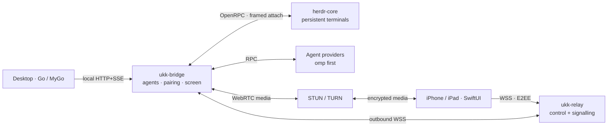

# ukk

**A native workspace for coding Agents.**

ukk turns long-running coding Agent sessions into a native desktop workspace:
real conversations, tool calls, approvals, files and diffs, persistent terminals
and panes — with an iPhone/iPad companion for the same Session and an optional
floating screen tile when a task needs the desktop itself.

> **Status: development reset, 2026-11-08.** The earlier Rust/GPUI prototype
> was removed. The active tree is a single Go module at
> [`apps/desktop`](apps/desktop) built with [MyGo](https://mygo.egoist.dev)
> native UI, plus native SwiftUI in [`apps/ios`](apps/ios). Build, CI, runtime
> and device evidence is recorded per SHA in [status](docs/status.md); nothing
> here claims a shipped release.

## What it is

- **Native, not a terminal skin.** Agent turns, tool calls and approvals come
  from provider protocols, never from scraping ANSI. A terminal pane remains
  available as a first-class view.
- **One runtime, owned by herdr-core.** Persistent terminals and processes live
  in [herdr-core](https://github.com/herdrdev/herdr-core); ukk is the client and
  never duplicates or rewrites it. Closing a pane, tab, session or window
  detaches; it never stops an Agent.
- **Provider-neutral.** omp is the first real provider. Codex and Claude Code
  use the same contract when their structured interfaces are verified; there
  are no fake adapters.
- **Remote by design.** A self-hostable relay carries authenticated, end-to-end
  encrypted control and signalling only. Screen media uses an independent
  WebRTC/STUN/TURN path. Pairing, Agent control, screen viewing and screen
  control are separate grants.
- **Three desktop OSes + iOS.** macOS, Windows and Linux share one Go UI;
  iPhone/iPad use native SwiftUI.

## Architecture



`Space → Session → AgentRun` is product state; a Pane/Tab is a view. See
[technical design](docs/tech-design.md) and [domain model](docs/subsystems/domain-model.md).

## Repository layout

```text
apps/
  desktop/             one Go module; mygo.json, go.mod, go.sum
    cmd/ukk            native Desktop
    cmd/ukk-bridge     background bridge (agents, pairing, screen)
    cmd/ukk-relay      self-hostable relay
    internal/hc        herdr-core protocol client
    internal/agents    provider-neutral Agent runtime + omp
    internal/workspace Space/Session/AgentRun + layout persistence
    internal/remote    identity, pairing, E2EE, grants
    internal/relay     relay routing and operator auth
    internal/bridge    local API + remote command dispatch
    internal/remotescreen capture, media, input
    internal/extensions plugin manifest, grants, supervision
    internal/ui        native views
  ios/                 SwiftUI app (XcodeGen)
docs/                  product, architecture, security, goals, runbooks
assets/                icon sources
```

## Build

Requires Go **1.27.3**. The MyGo CLI is pinned as a Go tool, so no global install
is needed:

```bash
cd apps/desktop
go tool mygo version
go tool mygo dev          # development window
go tool mygo build        # unsigned package for this OS
```

Platform notes: the terminal uses Ghostty's `libghostty-vt`, which MyGo packages
as a checksum-pinned native library; Linux builds need GTK 3. macOS 13+ is the
minimum. Local packaging has been exercised for macOS (`.app`), Linux
(`.deb`/tar/PKGBUILD) and Windows (`.exe`); install/run acceptance on Windows
and Linux is still open. Signing, notarization and store distribution are out of scope; macOS
ad-hoc signing is allowed.

## Documentation

| Document | Contents |
|---|---|
| [Chinese overview](docs/overview.zh-CN.md) | 产品定位、对象关系与范围 |
| [Requirements](docs/requirements.md) | Full product requirements and UX principles |
| [Technical design](docs/tech-design.md) | Components, ownership and boundaries |
| [v1 goal](docs/goals/v1-complete.md) | Completion contract and artifact scope |
| [Implementation plan](docs/goals/mygo-implementation.md) | Ordered stages and evidence gates |
| [Status](docs/status.md) | Verified, pending and blocked claims |
| [Security](docs/subsystems/security.md) | Threat model and controls |
| [Domain model](docs/subsystems/domain-model.md) | Entity lifecycles and concurrency |
| [Plugins](docs/subsystems/plugins.md) | Extension trust boundary |
| [Release](docs/release.md) · [Runbook](docs/runbooks/release.md) | Packaging and rollback |
| [References](docs/references.md) | Pinned upstream projects and licenses |

## Contributing

Work on a topic branch and open a PR with exact evidence. Do not claim CI,
runtime or device acceptance that was not observed. Read
[AGENTS.md](AGENTS.md), [CONTRIBUTING.md](CONTRIBUTING.md),
[REVIEW.md](REVIEW.md) and the [engineering standard](docs/coding-standard.md).

Licensed under MIT.
