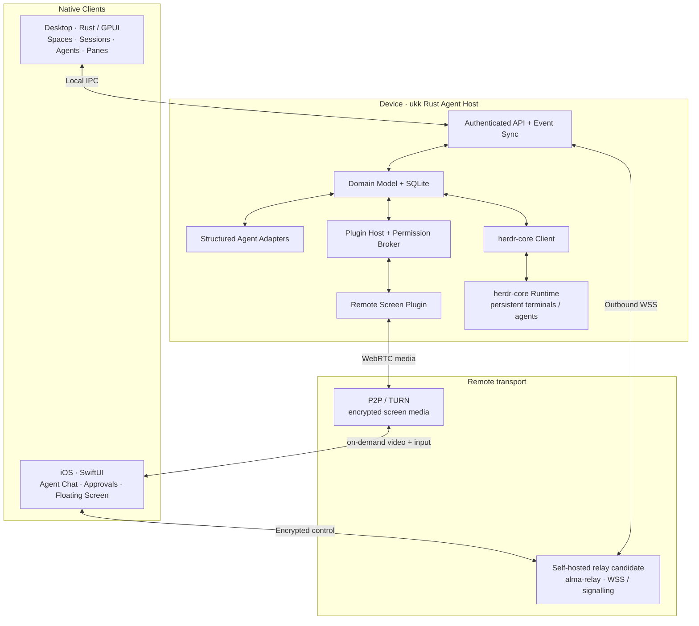

# ukk

**Native, extensible Multi-Agent Workspace.**

> **设计阶段 / Architecture-first** · GPUI Desktop + SwiftUI iOS + herdr-core + Relay + Plugins  
> 当前尚未实现可运行的客户端和 Agent Host。下面的架构图与功能均为拟定设计。

ukk 是一个从零打造的原生 Coding Agent 工作空间：同时运行多个 Codex、Claude Code 或其他兼容 Agent，保留可持久恢复的工作会话，通过 iPhone 扫码连接电脑，并在必要时以**悬浮小窗**查看或操控电脑屏幕。

**重要：** ukk 不 Fork `herdr-app`，只参考其功能并通过公共接口集成 `herdr-core`。Remote Screen 是可选插件，不是远程桌面模式。

## Architecture

**核心关系：** `Host → Spaces → Sessions → AgentRuns → herdr-core TerminalRefs`。Tabs/Panes 仅控制视图；关闭窗口不会终止 Agent。控制协议与屏幕媒体链路分离。

## Product direction

- **Multi-agent:** 动态 Agent 和子 Agent、并行会话，不预设固定角色流水线。
- **Native Desktop:** GPUI 原生 UI；Tabs、自由分栏、对话、Diff、Files、Git、Terminal、Activity。
- **Mobile Companion:** SwiftUI、扫码配对、设备管理、实时事件、审批、APNs 通知。
- **Floating Remote Screen:** 会话内浮窗，点击可展开控制，收起继续对话；查看与操控需独立授权。
- **Plugin Platform:** Manifest、命令、事件、原生视图槽位、插件权限代理、后台任务。
- **Persistent runtime:** herdr-core 持有实际执行；ukk Host 管理产品级状态与跨端同步。
- **Future clients:** Windows/Linux、Android、Web、TUI、Headless，按阶段推进但不删减完整愿景。

## Documentation

| Document | Contents |
|---|---|
| [中文版总览](docs/OVERVIEW.zh-CN.md) | 产品方向、中文架构图、对象关系 |
| [Product Requirements](docs/PRODUCT.md) | 完整功能矩阵、用户场景和体验原则 |
| [Architecture](docs/ARCHITECTURE.md) | 端到端架构、组件边界和部署 |
| [Domain Model](docs/DOMAIN_MODEL.md) | Spaces / Sessions / AgentRuns / Panes |
| [Plugin System](docs/PLUGINS.md) | 插件生命周期、能力代理、UI 槽位 |
| [Pairing](docs/PAIRING.md) | QR 扫码、设备授权与密钥 |
| [Remote Protocol](docs/PROTOCOL.md) | Commands、Events、重连与同步 |
| [Remote Screen](docs/REMOTE_SCREEN.md) | 悬浮屏幕、授权、WebRTC 传输 |
| [Security](docs/SECURITY.md) | 威胁模型、权限、风险与测试 |
| [Roadmap](docs/ROADMAP.md) | 完整产品开发阶段和验收标准 |
| [Development](docs/DEVELOPMENT.md) | 预期代码目录和工程验证步骤 |
| [Upstream References](docs/REFERENCES.md) | 官方依赖、许可和待确认事项 |
| [ADR-0001](docs/adr/0001-platform-and-runtime.md) | GPUI + SwiftUI + herdr-core 的技术决策 |
| [ADR-0002](docs/adr/0002-remote-control-is-plugin.md) | 远控作为会话插件的交互决策 |
| [AGENTS.md](AGENTS.md) | Coding Agent 参与开发时必须遵循的约束 |

## First end-to-end goal

在 Mac 启动多个 Agent → 退出 Desktop 窗口但 Agent 继续运行 → iPhone 扫码连接并恢复会话 → 查看 Diff / 发送命令 / 审批 → 临时打开悬浮 Remote Screen 完成一项桌面操作 → 收起小窗继续 Agent 对话。

详细验收拆解见 [Roadmap](docs/ROADMAP.md)。

## Project status

文档基线已建立，尚未开发代码。GPUI 版本、herdr-core API 兼容、alma-relay 配对接入、iOS 真机、WebRTC 和 macOS 权限等都需要实际验证。

**Repository license:** 尚未决定（仓库目前为 Private）；参考项目的 Apache-2.0/MIT 不等于自动给 ukk 授权。
