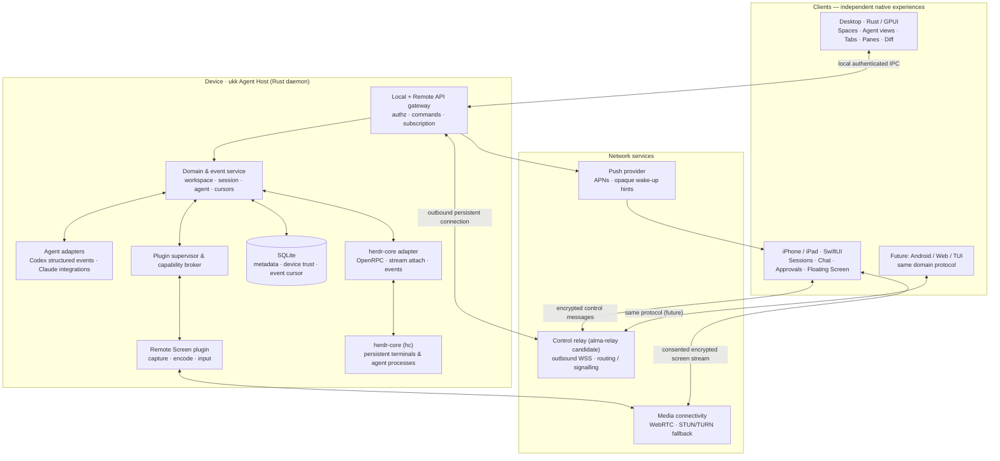

# System architecture

> Status: proposed design · 2026-11-07 · This document describes **ukk**, not an already implemented system.

## Product boundary

ukk is a native multi-agent coding workspace with a remote mobile companion. We build a **new** GPUI desktop application and do **not** fork herdr-app. herdr-core remains the authoritative terminal/process runtime. UI layouts, domain metadata, plugin lifecycle, device trust, and client synchronization belong to ukk.

## System diagram



**Trust boundaries:** client ↔ host commands are authenticated and authorized; relay is an untrusted router; plugins cannot access sensitive capabilities without grants. A pairing is not a blanket right to control the desktop.

## Source of truth

| Information | Authoritative component | Notes |
|---|---|---|
| PTY, process, terminal tree, reported program status | herdr-core | Survives closing ukk windows; status is reported via OSC 7501, not inferred from ANSI. |
| Workspaces, app-level sessions, panes, layouts, saved views | ukk Host | Domain identities map to herdr terminal addresses; do not confuse with hc's sessions. |
| Tool calls, approvals, turn structure | Agent-specific adapter | Not automatically available from herdr-core; missing capability must degrade gracefully to terminal output. |
| Paired devices, permissions, last event cursor | ukk Host | SQLite and OS key store; private keys should not be stored as plaintext in SQLite. |
| Selected tab, pane focus, floating-window position | Each client | Local ephemeral presentation state, not globally synchronized. |
| Shared work state, agent lifecycle, approval decisions | Host / agent adapter | Durable event envelope + versioned snapshots. |

## Internal modules

```text
apps/
  desktop/             GPUI composition; no process ownership
  ios/                 SwiftUI; no local herdr requirement
crates/
  domain/              IDs, relationships, commands, events
  protocol/            versioned remote schemas, streaming envelopes
  host/                background service and client synchronization
  hc-client/           OpenRPC, framed attach, sequence handling
  agent-adapters/      structured data from agent-specific interfaces
  plugin-api/          manifests, grants, extension points, compatibility
  plugin-host/         isolation, lifecycle, capability mediation
  remote/              pairing, identity, relay signalling, reconnection
  persistence/         SQLite migrations and event persistence
plugins/
  remote-screen/       first-party system capability (Mac first)
docs/                  product + ADRs + security + roadmap
```

This tree is a **target layout**, not an assertion that the crates already exist.

## Important integration rules

1. Talk to herdr-core via its documented JSON-RPC / OpenRPC API; use framed streams for interactive terminal attach. The API is preview-generation and requires compatibility tests against pinned upstream versions.
2. Never scrape terminal ANSI to invent tool/approval objects. Structured Agent adapters expose features only when verified.
3. Terminal/controller takeover must be explicit. Multiple observers are safe; conflicting writers need a lease or control arbitration.
4. Window termination does not stop Host or herdr-core. Host restart must reconstruct its cached view from hc snapshots and durable domain state.
5. The Agent control plane is not the screen media plane. Remote screen uses low-latency media transport and consumes no bandwidth while disabled.
6. Remote machines are associated with their actual host; a phone paired to one host does not implicitly gain access to every SSH-connected machine.
7. First-party plugins and untrusted third-party plugins have different trust levels. Never execute arbitrary plugin code in Host's privileged process by default.

## Deployment patterns

- **Local Mac:** Desktop GPUI ↔ Host (user service) ↔ local herdr-core. Host maintains outbound relay registration when enabled.
- **Headless Linux:** Host ↔ herdr-core; phone, desktop or future Web can connect using the same protocol. No screen sharing without a graphical session.
- **Multiple machines:** each Host owns its own device identity and trust grants; the UI can aggregate multiple Host snapshots.

## Platform integration (planned)

macOS: GPUI UI, launchd user agent for Host, ScreenCaptureKit for screen capture, user-consented Accessibility for control, VideoToolbox for hardware encoding. iOS: SwiftUI, AVFoundation/VisionKit QR, Keychain, APNs, VideoToolbox decoder. Windows/Linux: adapters and native permissions to be designed separately.

## Non-goals

Not a fork of herdr-app; not an Agent framework replacing Codex/Claude; not a mandatory remote desktop product; not a hosted central repository of users' source code. A pure terminal stream is preserved as an optional panel, not the sole product UI.

## References

- https://github.com/herdrdev/herdr-core
- https://github.com/herdrdev/herdr-core/tree/master/schema
- https://github.com/herdrdev/herdr-app
- https://github.com/zed-industries/zed/tree/main/crates/gpui
- https://github.com/yetone/alma-relay
