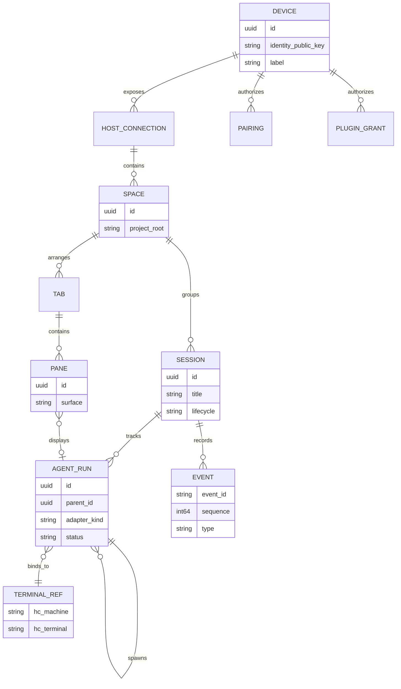

# Domain model and ownership

## Implementation baseline (Spike 04 · source, not yet runtime-verified)

The initial portable model lives in [`crates/domain/src/lib.rs`](../crates/domain/src/lib.rs), and SQLite persistence in [`crates/store/src/lib.rs`](../crates/store/src/lib.rs).

- Space, Session, AgentRun and SessionLayout have independently generated IDs.
- AgentRun binds explicitly to `core_id + terminal_address` and optionally a parent AgentRun within the same Session; its existence is not proof the runtime process is online.
- PaneNode is a validated `Leaf` or `Split` tree with maximum 16 leaves, at most 8 levels, ratio 0.15–0.85 and explicit AgentRun references.
- Immutable `split_leaf` and `close_leaf` return new layout trees only, without any process action.
- SQLite persists Space/Session/bindings/layouts with schema v1, foreign keys and revision compare-and-swap.
- Desktop currently renders session layout topology; drag handles, tabs, live structured panes and provider adapters remain unimplemented.
- For the full current implementation and commands, see [Workspace Persistence](WORKSPACE_PERSISTENCE.md).

## Entities



This diagram is an app-domain proposal. It is **not** the exact data model of herdr-core.

### Definitions

- **Device**: a physical computer or phone with its own asymmetric identity key.
- **Host connection**: a reachable ukk Host, local or remote. A device can reconnect; connection is not persistent identity.
- **Space**: a named developer workspace rooted at a project on one Host. Aggregated views may show multiple Spaces across Hosts.
- **Session**: ukk's durable, human-facing work context; it can involve many agent runs. Distinct from an hc terminal, hc daemon session, chat thread, or tab.
- **AgentRun**: one execution of an agent process, with optional parent/child relationship. Identifies its runtime through TerminalRef.
- **TerminalRef**: hc machine + terminal identity. Mapping must survive reconnect and avoid assuming names are globally unique.
- **Tab/Pane**: presentation layout. A Pane references an agent, diff, file or tool surface but does not own its process lifecycle.
- **Event**: a versioned, ordered snapshot/delta item in our sync protocol; never equate to herdr-core's internal sequence without mapping.
- **PluginGrant**: a scoped permission for a plugin capability on a particular device / subject.

## State machines

AgentRun: `created → starting → running ↔ blocked → finished|failed|cancelled`. `unknown/offline` is an *observation state*, not evidence that the underlying process stopped. Program-reported OSC status should be shown with its provenance, not forced into a state it did not report.

Session: `active ↔ paused → archived`; archiving never kills its terminals automatically. Explicit `stop execution` should be distinct from `close view`.

Screen share: `off → requesting_permission → negotiating → viewing → controlling → stopped`. Control requires a separate grant from view.

## Ownership & concurrency

Host owns durable Session and Space metadata; herdr-core owns actual terminal processes and their reported status; Agent adapters own provider-specific semantic runs and approvals. Reconciliation on Host restart associates TerminalRefs with AgentRuns, requests fresh hc snapshots and marks orphaned/unavailable records without inventing completion.

One agent can appear in multiple read-only panes and clients. Sending input, approval or screen control requires an explicitly authorized controller. Prefer short leases with expiry and visible takeover confirmation. Use idempotency keys for commands and optimistic revision checks for shared mutable metadata.

## Event envelope (proposed)

```json
{
  "protocol_version": "1.0",
  "host_id": "uuid",
  "stream_id": "workspace:uuid",
  "sequence": 104,
  "event_id": "uuid",
  "type": "agent.status.changed",
  "occurred_at": "2026-11-07T00:00:00Z",
  "subject_id": "agent-run-uuid",
  "schema_version": 1,
  "payload": {"status": "running", "source": "osc7501"}
}
```

Events are immutable; clients first fetch a versioned snapshot then subscribe with a cursor. If the cursor is expired or source indicates `missed`, replace from authoritative snapshot, do not pretend no events were lost.

## Questions tracked for implementation

- Can all preferred Agent providers supply stable semantic thread IDs and approval APIs?
- Do worktree roots belong to Space or per-Agent working directories?
- What is the retained event history budget on mobile reconnect?
- How should a session span multiple machine Hosts without ambiguous authority?

See [architecture](ARCHITECTURE.md) and [remote protocol](PROTOCOL.md).
