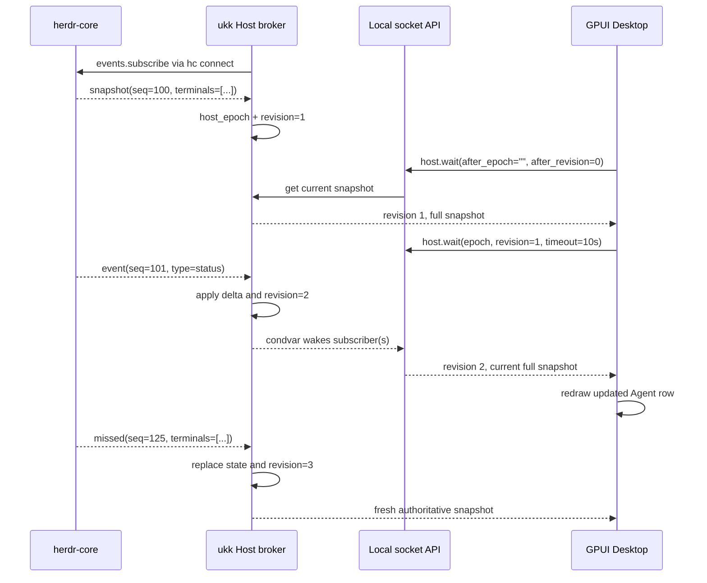

# Live Runtime Sync — Spike 03

> 2026-11-07 · Source committed to `main`; **not yet compiled or verified against a real Mac/herdr-core** in this environment. This increment covers live read-only terminal snapshots and status propagation. It does **not** make ukk a complete persistent Session/Agent event store.

## What's implemented

- The Host starts one persistent `events.subscribe` connection to herdr-core using `hc connect`.
- The Host maintains an in-memory snapshot with a process-local monotonic `revision` and unique `host_epoch`.
- Incremental events update the snapshot: `created`, `removed`, `restarted`, `lost`, `finished`, `status`, `turn`, `labels`, `title`, `size`, `foreground`, `keep`.
- `missed` replaces the whole snapshot. A sequence gap, sequence regression, malformed update, unexpected type or subscription termination forces a new subscription and snapshot.
- Heartbeats confirm continuity without publishing phantom UI updates.
- Local clients can call `host.snapshot` or `host.wait` to observe versioned state; many subscribers may read the same Host.
- The GPUI Desktop starts a background long-poll loop; terminal rows and their dynamic parent/child relations refresh automatically without blocking rendering.
- When herdr-core or the Host goes offline, Desktop uses an explicit offline label. Cached terminal records are not shown as live.
- `terminal.list` is kept as a **legacy developer diagnostic**; UI should use `host.snapshot`/`host.wait` instead.

## Data flow



## Local Host API

This is a temporary **local-only smoke-test API** over a local Unix socket or Windows Named Pipe. It is **not** the mobile/Relay application protocol.

`host.snapshot` has no parameters. `host.wait` accepts:

```json
{
  "after_epoch": "process-epoch-from-last-response",
  "after_revision": 12,
  "timeout_ms": 10000
}
```

`timeout_ms` is capped by Host to 10,000 milliseconds. Responses contain:

```json
{
  "host_epoch": "1234-unique-boot-epoch",
  "revision": 13,
  "hc_seq": 102,
  "connected": true,
  "message": null,
  "source": "events.subscribe",
  "terminals": [
    {
      "address": "t3",
      "state": "live",
      "name": "codex",
      "parent": null,
      "argv": ["codex"],
      "cwd": "/work",
      "status": {"state": "working"}
    }
  ]
}
```

The example contains abbreviated terminal fields; real records come from herdr-core. `revision` is only ordered **within one `host_epoch`**. Core `hc_seq` resets after a herdr-core restart and MUST NOT be used as the final ukk event cursor.

### Why full snapshots instead of event deltas?

For the local read-only pilot, snapshot-on-change is simple and correctly handles reconnect without exposing herdr-core's private event shape to GPUI. A full versioned protocol with durable event replay, filtering, per-Session scope and scalability budgets is still required before Web/iOS/Relay.

## Safety and correctness

- No public TCP port, cloud authentication, device pairing, Agent mutation or approval calls.
- Socket defaults to `~/.ukk/run/agent-host.sock` under a user-only directory and mode `0600`.
- Each wait is capped at 10 seconds; client read timeout is 13 seconds.
- Message size is capped on the receiving side.
- Unknown or inconsistent event deltas cause resubscription, never silent status guesses.
- `doc` events without a terminal do not change Agent view but advance the local hc sequence.
- `hidden_finished` and remote machine list are not present in subscription snapshots; the API does not fabricate them.
- Multiple local readers may watch in parallel; they cannot send Agent input.
- A busy workspace may generate frequent full snapshot transfers; event filtering/delta transport is a later optimization.

## Tests added

- Broker unit tests for status, child Agent creation/removal, heartbeat, sequence gap/regression, `missed`, core restart, and malformed event handling.
- Client unit tests for `host_epoch`, `revision`, offline flags, and schema validation.
- Integration test in `crates/host/tests/live_broker.rs`: fake `hc connect` → real ukk-host subprocess → Unix socket `host.wait` → typed client; tests a child Agent spawn and blocked status.
- Rust CI workflow runs `cargo test --workspace` and `cargo clippy --workspace --all-targets -- -D warnings`; macOS CI checks GPUI app independently.

**Tests are committed, not confirmed passing.** CI may need fixes and genuine macOS integration is still pending.

## Runbook

```bash
# Install working hc and Rust first.
cargo test --workspace
cargo clippy --workspace --all-targets -- -D warnings

# Terminal A:
cargo run -p ukk-host -- serve

# Terminal B (read-only diagnostic):
cargo run -p ukk-host -- request host.snapshot

# Terminal C:
cargo run --manifest-path apps/desktop/Cargo.toml
```

The CLI `request` currently accepts a method name but does not allow custom `host.wait` parameters, so use the desktop or `ukk-host-client::HostClient::wait_for_change` to exercise live polling.

## Not yet implemented

- Database-backed Workspace/Session/AgentRun/Pane domain identities.
- Cross-Host, durable, authorization-aware event history.
- Semantic Codex/Claude turns, approvals, chat, files/diff, PTY framed attachment.
- Production service supervisor, secure mobile pairing and Remote Screen plugin.
- Verified macOS build and E2E usage with real herdr-core.

## Acceptance tasks

- [x] Source for live event broker and long-poll API.
- [x] GPUI desktop source automatically consumes event revisions.
- [x] Unit + integration test source committed.
- [ ] CI green and Clippy clean on pinned versions.
- [ ] Real Mac live run with two agents and child.
- [ ] Confirm recovery after herdr-core daemon restart.
- [ ] Add persisted ukk Session/AgentRun mapping with SQLite.
- [ ] Verify observer fan-out performance and bounded resource usage.

Related: [Architecture](ARCHITECTURE.md), [Desktop Spike](DESKTOP_SPIKE.md), [Protocol](PROTOCOL.md), [Roadmap](ROADMAP.md).
