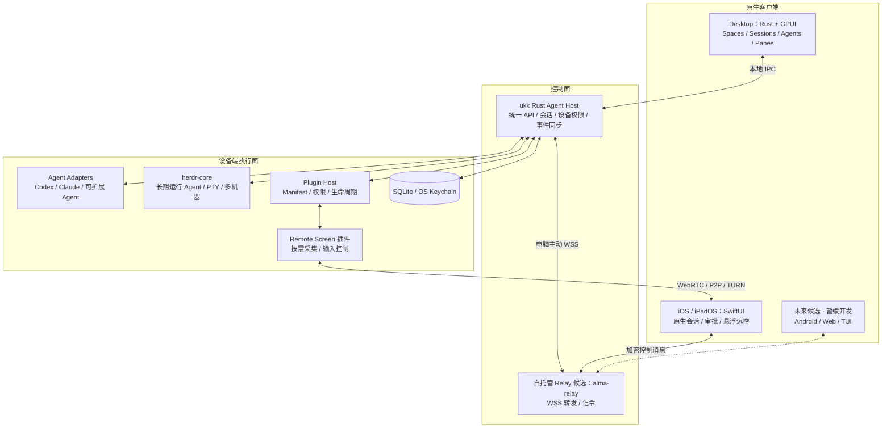
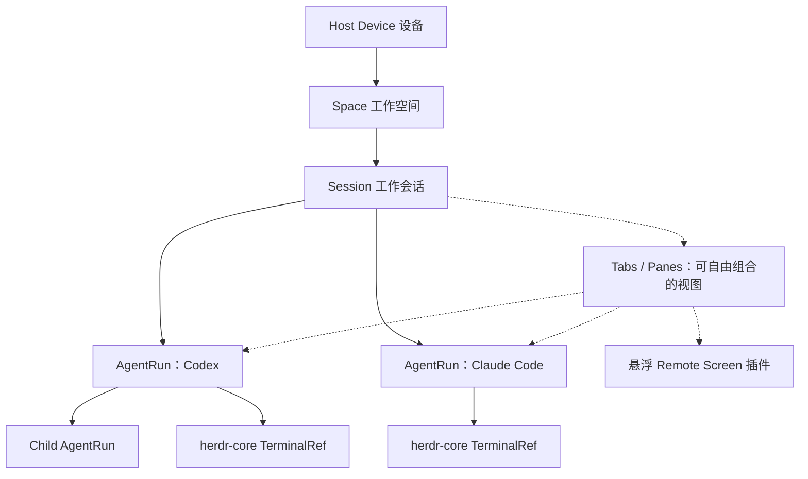

# ukk 产品与技术总览（中文版）

> 版本：设计基线 v0.1 · 2026-11-07。当前仓库以架构与产品文档为主，尚不是可运行的软件。

## 一句话定位

**ukk 是原生的、可扩展的 Multi-Agent Workspace。**

电脑用 GPUI 展示多个 Coding Agent 的长期会话与自由分栏；手机用 SwiftUI 远程继续同一会话，通过扫码配对连接电脑。Remote Screen 仅是会话中的按需悬浮插件，点开可放大并控制设备，收起后回到原本的 Agent 对话。

## 不要把产品做偏

- **不是**固定 Planner → Coder → Reviewer → Tester 流水线。Agent 数量、种类、父子关系都是动态的。
- **不是**终端/TUI 换皮。默认 UI 是原生消息、任务状态、文件 Diff、Activity，终端只是可切换的 Pane。
- **不是**另一个远程桌面 App。Remote Screen 是小窗插件，不增加一个永久的“远程桌面模式”。
- **不是** Fork herdr-app。ukk 从零构建桌面 UI，但复用 herdr-core 持久终端和 Agent Runtime。
- **不是**要求所有客户端共享 UI 代码。Desktop 用 GPUI、iOS 用 SwiftUI，通过统一数据协议共享会话。

## 当前实现优先级

**优先完成：** Desktop 原生三端（macOS / Windows / Linux，统一 GPUI 代码）＋ iOS / iPadOS（SwiftUI）；包括完整多 Agent 工作空间、持久会话、插件系统、扫码配对和按需悬浮 Remote Screen。

**暂不开发：** Android、Web、TUI。它们是未来可能接入统一协议的客户端，并非当前开发任务或近期交付承诺。Windows / Linux 不能被一起推迟。

## 总体架构图

备注：上图为设计目标，不表示仓库已经实现这些模块。Remote Screen 的真实视频流独立于 Relay 的普通 JSON 事件流。

## 产品对象关系

Session 是 ukk 产品的工作上下文；herdr-core TerminalRef 是底层运行进程地址；Pane 是显示视图。这三者不能合并成同一个生命周期。

## 扫码配对

Mac 点击“添加设备”→ 生成短时一次性 QR → iPhone 扫码 → 经过 Relay 做身份握手 → Mac 本地确认设备和验证码 → 保存信任关系 → 后续自动重连。设备绑定不意味着自动允许批准敏感操作、查看屏幕或控制鼠标。

## 插件化

插件可贡献命令、事件订阅、会话操作、原生 UI 槽位、后台任务及 Agent 适配器。必须经过 Host 的权限代理，且第一方特权插件与第三方非可信插件分级隔离。**Remote Screen 是第一个代表性插件**：悬浮小窗查看，点击展开全屏，独立授权 view/control，关闭即停止采集。

## 完整产品功能

Spaces 多机器/多项目、动态多 Agent、子 Agent、持久会话、原生消息/Plan/工具调用/审批、Tabs/自由分栏、Diff/Files/Git/Worktree、搜索与快捷操作、插件系统、设备扫码与撤销、Push、Remote Screen、自动化、诊断、备份，以及 **macOS / Windows / Linux 桌面原生三端与 iOS/iPadOS**。Android/Web/TUI 暂缓。

完整功能不会因为分阶段开发而从产品愿景中删除。

## 第一条验收链路

Mac 启动多个 Agent（包括子 Agent）→ 关掉桌面窗口但不结束 Agent → iPhone 看到实时状态并继续会话 → 审批和查看 Diff → 按需打开悬浮 Remote Screen 解决一个桌面 UI 问题 → 收起返回原会话。

## 文档索引

- [系统架构](ARCHITECTURE.md)
- [完整产品需求](PRODUCT.md)
- [领域模型](DOMAIN_MODEL.md)
- [插件系统](PLUGINS.md)
- [扫码配对](PAIRING.md)
- [传输和事件同步](PROTOCOL.md)
- [远控悬浮插件](REMOTE_SCREEN.md)
- [安全设计](SECURITY.md)
- [开发路线](roadmap.md)
- [技术选型决策](adr/0001-platform-and-runtime.md)

## 待验证而非已实现

herdr-core API 的具体版本/稳定性、Codex/Claude 的结构化事件支持、GPUI 分栏和组件兼容、alma-relay 客户端协议适配、iOS 真机扫码/流媒体、macOS 屏幕权限和输入注入都需要工程验证。未经验证不要把它们写成“已经接通”。
