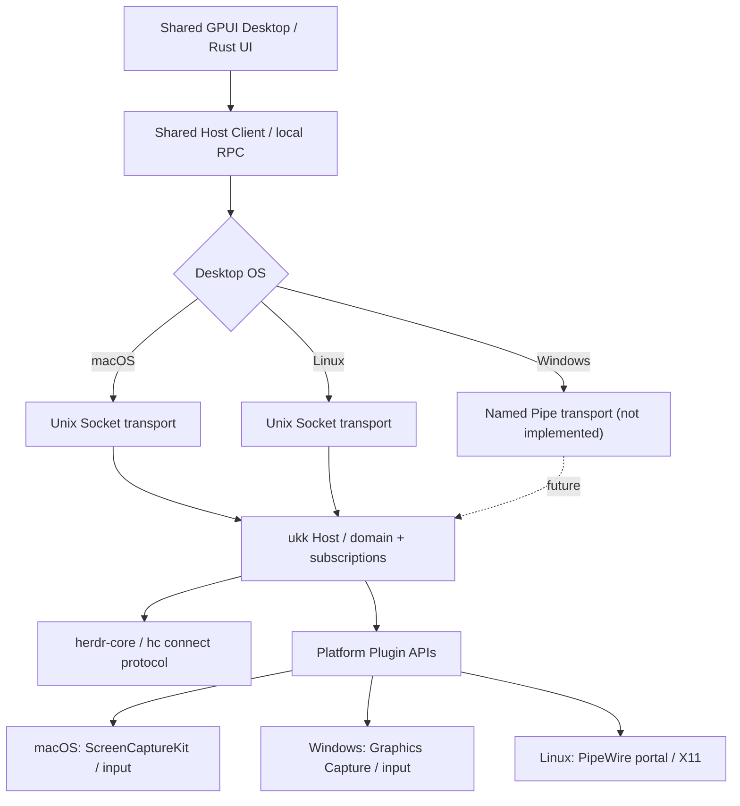

# Cross-platform support matrix / 跨平台支持约定

> 2026-11-07 · Product target is **macOS + Windows + Linux desktop at parity**, not a Mac-only application. This is a specification of intent and validation gates; it does **not** claim that every platform already builds or runs.

## Product decisions

**One Rust + GPUI Desktop codebase** targets macOS, Windows and Linux equally. Platform-specific code is isolated behind interfaces, not forked UIs. Native SwiftUI is used for iOS/iPadOS in the active delivery track. Android/Jetpack Compose and Web/TUI are deferred client candidates, with no current implementation tasks; the architecture keeps their eventual protocol access possible.

herdr-core itself supports macOS/Linux and Windows. `hc connect` exposes the same JSON-RPC text protocol across platforms; Unix uses local sockets under the hood and Windows uses named pipes. https://github.com/herdrdev/herdr-core/blob/master/schema/README.md

GPUI's `gpui_platform::application()` selects platform-specific backends:

| Desktop OS | GPUI presentation backend | Host private IPC | Host background service | Remote Screen capture | Current state in ukk |
|---|---|---|---|---|---|
| macOS | Metal; text through font-kit | Unix Domain Socket | launchd user service (planned) | ScreenCaptureKit + VideoToolbox; Accessibility input | GPUI + local socket sources committed; native build/runtime test pending |
| Windows | Win32 + DirectWrite | **Windows Named Pipe to implement** | user-scoped process / Task Scheduler or service design pending | Windows Graphics Capture + Media Foundation or D3D encoder; input API review | GPUI source shared; `hc-client` stdio works in principle; ukk Host `serve` not yet supported |
| Linux | Wayland / X11; platform graphics backend | Unix Domain Socket | systemd --user service (planned) | PipeWire/portal for Wayland, X11 capture fallback; input via permission-brokered APIs | GPUI + local socket sources committed; native build/runtime test pending |

GPU rendering, text, fullscreen, tray, update, screen capture, input injection and window decorations must be tested per OS. A macOS pass does not constitute a Windows/Linux pass.

## Implementation boundaries



- **UI owns no Agent lifetime.** A window closed on any desktop OS must not stop ukk Host or herdr-core terminals.
- **OS-neutral protocol.** Same commands, events, authorization, identity and models regardless of IPC transport.
- **Windows IPC must be local-only and same-user access controlled.** Use ACL-backed named pipes, per-user namespace, byte limits and peer validation; do not replace it with unauthenticated localhost TCP.
- **No headless screen capture assumption.** A herdr-core host can run without a graphical desktop, in which case Remote Screen is unavailable but Agents continue to work.
- **Remote Screen remains an on-demand plugin**, not a navigation mode. OS capture and control permissions will differ.
- **Platform-specific components are adapters**, not reimplementations of business logic or page layouts.

## Build / test entrypoints

```bash
# Core Rust — all three platforms; independent of GPUI's heavy graphics dependencies
cargo test --workspace
cargo clippy --workspace --all-targets -- -D warnings

# Desktop — macOS, Windows and Linux each compile from same source tree
cargo check --manifest-path apps/desktop/Cargo.toml

# Local Host + Desktop (currently usable by design only on Unix: macOS/Linux)
cargo run -p ukk-host -- serve
cargo run --manifest-path apps/desktop/Cargo.toml
```

**Windows limitation:** the `serve` / Desktop Host-client methods currently return a clear unsupported/error result. Windows builds should succeed at the source level, but runtime interoperability cannot work until Named Pipe support is implemented and verified.

## Required CI coverage

- [x] Rust core test/Clippy workflow matrix includes Ubuntu, macOS and Windows.
- [x] GPUI source build workflow matrix includes Ubuntu, macOS and Windows (with native Linux build dependencies).
- [ ] Verify CI passes on each OS and fix platform-specific compiler/toolchain issues.
- [ ] Windows named-pipe Host server + client; secure per-user access.
- [ ] End-to-end real hc snapshot/events from Windows Host and Linux Host, including reconnect and child Agent tree.
- [ ] Window close/reopen persistence, permissions, keyboard shortcuts and accessibility tested on all platforms.
- [ ] OS-specific Remote Screen privilege prompts, view/control separation and media compatibility.

## Prioritization

**All three desktops are first-class targets.** Build verification starts on all three immediately. Feature implementation can be staged to reduce uncertainty: first a complete OS-independent Host/data protocol, then local IPC parity, then UI/runtime validation on each OS. The exact shipping schedule is tied to the platform acceptance checks, not to a Mac-only MVP assumption.

Related documents: [Architecture](ARCHITECTURE.md), [Product](PRODUCT.md), [Runtime Spike](RUNTIME_SPIKE.md), [Desktop Spike](DESKTOP_SPIKE.md), [Remote Screen](REMOTE_SCREEN.md).
