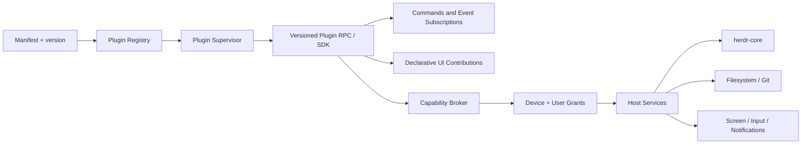

# Plugin architecture — capability-first, safe-by-default

> Design proposal. No plugin runtime is implemented yet.

## Scope

ukk plugins extend native Agent sessions without owning the runtime or application lifecycle. **Remote Screen** is the first-party example: an optional floating session overlay, not a top-level operating mode.

Plugins can contribute actions, contextual views, background tasks, resources, notification handlers and provider adapters. A plugin should not need a GPUI or SwiftUI dependency to implement its core behavior.

## Topology



## Trust levels

| Level | Runtime | Intended access |
|---|---|---|
| Built-in core components | Linked in trusted ukk release | Host administration, not treated as third-party plugins |
| First-party privileged plugin | Separate helper with explicit entitlements | Remote Screen needs capture / input after consent |
| Third-party local plugin | Isolated subprocess, restrictive environment | Only declared brokered capabilities |
| Future sandboxed WASM plugin | Wasmtime-style runtime after validation | Pure commands, transform/events, limited host calls |

Do **not** promise complete OS-level isolation merely from using a subprocess. Production sandboxing and macOS entitlements need actual verification. A plugin crash must not crash the Agent Host.

## Proposed manifest (`plugin.toml`)

```toml
manifest_version = 1
id = "dev.ukk.remote-screen"
name = "Remote Screen"
version = "0.1.0"
api = ">=0.1,<0.2"
entrypoint = "remote-screen-helper"
trust = "first-party"

[capabilities]
required = ["screen.view"]
optional = ["screen.control", "screen.audio"]

[[contributions.commands]]
id = "screen.open-preview"
title = "Open live screen preview"
scope = "session"

[[contributions.views]]
id = "screen.floating-preview"
slot = "session.overlay.floating"
client = ["ios"]
```

**Manifest does not grant privileges**. Host validates signature/origin, compatibility and grants; installation alone does not authorize screen recording or input.

## Typed extension points

- `commands`: discoverable user actions; typed parameters, idempotency and error schema.
- `events`: read-only subscriptions to filtered, typed Host events; replay cursor and backpressure.
- `views`: declarative contributions in **known slots** (session action, context panel, floating overlay, settings); platform renders with native UI.
- `agent.adapters`: optional provider integrations with capability declarations; unsupported features fall back honestly.
- `background.jobs`: governed scheduled tasks; lifecycle, concurrency, limits and audit.
- `notifications`: secure text-free push hints or local notification content.

No plugin should ship arbitrary SwiftUI or GPUI executable UI directly over the network. UI schema is a constrained, versioned description or a first-party compiled view contribution. Mobile renders its own approved native components.

## Brokered permissions

`workspace.read`, `session.observe`, `agent.send`, `agent.approve`, `filesystem.read`, `filesystem.write`, `git.write`, `screen.view`, `screen.control`, `screen.audio`, `notifications.send`, `network.connect(domain)`. All are scoped to a Host/Space/Session and trust principal, with separate approval and revocation.

Examples: a phone can view Agent states while being denied `agent.approve`; an approved phone can view a screen but be denied `screen.control`; plugin UI can request a grant but cannot silently elevate it.

## Plugin lifecycle

`discovered → installed → validated → disabled|enabled → starting → ready → stopping|failed`

Host controls activation, health, restart budget, update, revoke, uninstall, migration and crash recovery. Disabled plugins cease receiving events and release captured resources. Reinstall cannot restore revoked grants automatically.

## Compatibility and store strategy

- API version negotiated independently of plugin package version.
- Manifest schema must be validated; capabilities unknown to Host are rejected.
- Pin plugin version and publisher identity. Maintain an allowlist while API is pre-1.0.
- Plan third-party publishing, local install and marketplace as separate phases; no unreviewed code downloads in v0.
- Test across desktop, headless, iOS and offline reconnection.

## First-party plugin examples

Remote Screen (floating live screen + fullscreen control), Browser Use, Computer Use, Git integration, Search, Notifications, Discord/GitHub integrations and automations. Not all are promised for the first release; they are part of the full product inventory.

See [remote screen](REMOTE_SCREEN.md), [security](SECURITY.md), and [roadmap](ROADMAP.md).
