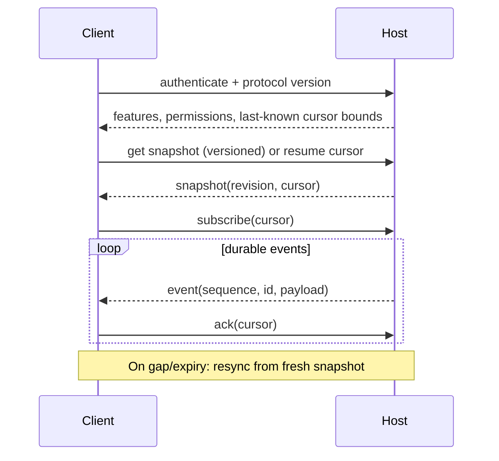

# ukk client ↔ Agent Host protocol

> Application-level draft. This is **not** herdr-core's JSON-RPC API, and is independent of alma-relay's wire protocol.

## Separation of concerns

- `herdr-core ↔ hc-client`: documented OpenRPC requests/responses, terminal framed streams and event subscription, version pinned.
- `GPUI / iOS ↔ ukk Host`: domain commands, typed events, snapshots, authorization and plugin commands.
- `Agent Host ↔ alma-relay candidate`: outbound registration, transport-level streaming/routing, no trust in relay.
- `Remote Screen ↔ phone`: distinct encrypted low-latency media session, initiated through authenticated signalling.

## Application envelope (proposal)

```json
{
  "version": 1,
  "id": "uuid",
  "kind": "command",
  "name": "agent.send",
  "host_id": "uuid",
  "session_id": "uuid",
  "agent_run_id": "uuid",
  "idempotency_key": "uuid",
  "expected_revision": 17,
  "payload": {"text": "Run the tests"}
}
```

Responses: `accepted` (durable dispatch), `completed` (semantic completion if available), `error` (typed), with correlation ID. Acceptance is not task completion.

## Commands and subscriptions

```text
device.list
device.pair.start / device.pair.confirm / device.revoke
space.list / space.open
session.list / session.create / session.archive
agent.list / agent.launch / agent.send / agent.interrupt
agent.approval.respond   (requires scope, supported adapter)
terminal.attach         (explicit writer lease and framed stream)
events.snapshot / events.subscribe(cursor)
plugin.list / plugin.enable / plugin.command
screen.start_preview / screen.request_control / screen.stop
```

Endpoint names are provisional; server validates schema, authorization, rate limits and project/workspace scope for every action.

## Reconnect / event sync



Use at-least-once event delivery with deduplication by `event_id`; do not promise exactly-once delivery across WAN. Event order is guaranteed only **per stream**; cross-host total ordering is not guaranteed. Never infer `Done` merely because heartbeat disappears.

## Streaming and backpressure

Control messages use length-limited envelopes, priority for approvals and interactive commands, bounded queues, ping/heartbeat, cancellation and explicit backpressure. Large terminal bytes and file transfer should use specialized multiplexed channels and quotas. Screen/video is never placed into event history.

## Capability negotiation

Clients query `features`: terminal attach, structured turns, agent approval, diff, worktree integration, plugin slot, screen preview, screen control. Unsupported capabilities should be visibly unavailable and should not be fabricated from ANSI terminal streams.

## Security

Sign/authenticate every client session; encrypt payloads over an untrusted relay; verify device grants on every sensitive command. Idempotent `agent.send` prevents accidental duplicate execution on reconnect. Control commands such as pointer movement and approvals are never queued for blind automatic replay.

## Testing

Contract tests for GPUI/SwiftUI ↔ Host schema, reconnect from arbitrary event cursor, protocol version incompatibility, transport fragmentation, duplicate event, delayed ack, lost command reply, revoked device, credential rotation and concurrent control attempts.

Related: [domain model](DOMAIN_MODEL.md), [pairing](PAIRING.md), [security](SECURITY.md).
