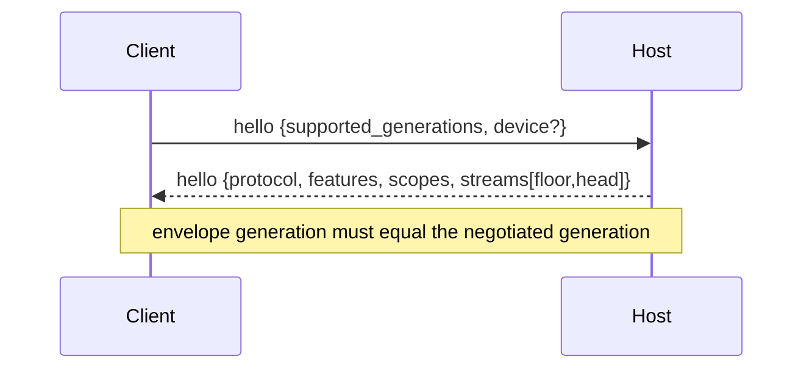

# ukk client ↔ Agent Host protocol

> Status: implemented contract for generation 1 (`crates/protocol`) · 2026-11-08.
> Host socket/relay wiring and pairing cryptography are separate follow-ups
> (S1 Host integration, S2 pairing). This document describes what the protocol
> crate actually enforces, not an aspiration.

The protocol is independent of herdr-core's OpenRPC API and of alma-relay's
transport frame. herdr-core positions (`hc_seq`) and Host process epochs
(`host_epoch`) are **never** durable protocol fields.

## Planes and separation of concerns

| Layer | Contract | Owner |
| --- | --- | --- |
| `herdr-core ↔ hc-client` | OpenRPC, framed terminal attach, OSC 7501 status | pinned upstream |
| Desktop ↔ Host, local | user-scoped OS IPC (Unix socket / Named Pipe), OS-authenticated peer uid | H1 transport |
| Phone/remote client ↔ Host | this document: device identity, scopes, durable sync | `crates/protocol` |
| Host ↔ relay | outbound encrypted transport; relay is an untrusted router | S2 |
| Remote Screen | media path outside event history | M1 |

The two client planes share envelope types but **not** trust. A remote device
claim is rejected on the local socket, a local peer is rejected on a remote
binding, and an idempotency key first used on one plane is rejected on the
other. There is no implicit forwarding from local IPC to WAN.

## Transport framing

One UTF-8 JSON message per frame. Frames are bounded (see
[Limits](#limits-and-backpressure)). Unknown top-level fields are rejected.
The reserved names `hc_seq` and `host_epoch` are rejected explicitly with a
typed error, because accepting them would let a client believe an ephemeral
position is a durable cursor.

## Handshake



The transport establishes the plane before the hello:

* Local IPC: the transport verifies the OS peer uid and supplies it to
  `TransportBinding::local_ipc(uid)`. The hello must **not** contain a device.
* Remote: the hello must contain a `device` claim. The Host verifies it against
  the trust registry (device id, public-key fingerprint, key generation).

`accept_hello` returns the typed errors `SessionError::Binding`,
`SessionError::Negotiation` or `SessionError::Denial`; nothing is executed on a
failed handshake.

```json
{
  "type": "hello",
  "request_id": "6f1c…",
  "supported_generations": [1],
  "device": {
    "device_id": "9d2a…",
    "key_fingerprint": "sha256:…",
    "generation": 3
  }
}
```

```json
{
  "type": "hello",
  "protocol": 1,
  "request_id": "6f1c…",
  "features": ["agent.approval", "events.durable_sync", "screen.preview"],
  "scopes": ["agent.send", "session.observe"],
  "streams": [{"stream": "workspace", "floor": 40, "head": 912}]
}
```

Generation negotiation picks the highest generation offered by the client that
the Host serves (`ProtocolRange`, currently `1..=1`). Empty offers, generation
`0` and disjoint ranges fail closed. A negotiated connection rejects any
envelope carrying a different generation.

Features are capability hints only. An unsupported feature is visibly
unavailable; it is never emulated by scraping terminal output.

## Commands

```json
{
  "type": "command",
  "protocol": 1,
  "request_id": "cdd1…",
  "idempotency_key": "0e4b…",
  "issued_at_ms": 1762550000000,
  "command": {
    "command": "agent_send",
    "session_id": "…",
    "agent_run_id": "…",
    "text": "Run the tests",
    "expected_revision": 7
  }
}
```

Envelopes do not carry a device id or plane. Those are fixed by the
authenticated handshake and cannot be re-declared per message.

### Command set

| Command | Payload | Required scope (remote) | Class |
| --- | --- | --- | --- |
| `session_create` | `space_id`, `title`, `expected_revision?` | `session.manage` | idempotent mutation |
| `agent_send` | `session_id`, `agent_run_id`, `text`, `expected_revision?` | `agent.send` | idempotent mutation |
| `approval_respond` | `session_id`, `approval_id`, `decision`, `revision` (must be > 0) | `approval.respond` | human decision |
| `pointer_input` | `session_id`, `lease_id?`, `events[1..=32]` | `screen.control` + live lease | ephemeral input |
| `device_revoke` | `device_id` | `device.manage` | idempotent mutation |

Local OS owners do not need device grants, but every command still passes
semantic validation and replay classification. Approvals and pointer input can
never be queued for automatic reconnect replay.

### Result classification

`Accepted` means durably dispatched, not finished. `Completed` means semantic
completion where the adapter reports it. `Rejected` carries a typed denial.
Acceptance is never displayed as task completion.

```json
{"type":"result","request_id":"cdd1…","replayed":false,
 "result":{"status":"accepted","dispatch_id":"…"}}
```

## Durable event sync

Events are ordered only per stream. There is no cross-stream or cross-Host
total order, and a dropped heartbeat never means "done".

```json
{
  "type": "event",
  "protocol": 1,
  "event_id": "b71e…",
  "stream": "workspace",
  "cursor": 913,
  "emitted_at_ms": 1762550000123,
  "event": {
    "event": "agent_run_status_changed",
    "session_id": "…",
    "agent_run_id": "…",
    "status": "waiting_for_approval",
    "revision": 8
  }
}
```

### Cursor invariants

* `DurableCursor` is assigned only by the Host event log. It is a per-stream
  monotonic `u64` and survives Host and herdr-core restarts.
* `hc_seq`, `host_epoch` and any process-local revision are not cursors. Durable
  messages and checkpoints reject those field names.
* A client persists `CursorCheckpoint {stream, cursor}` after applying events.
  Checkpoints refuse to move backwards.
* Restoring a log requires the durable head and retention floor; the next event
  continues at `head + 1`, never at 1. Non-contiguous or inconsistent durable
  records are rejected.
* A cursor beyond the head is a typed protocol error, never a silent reset.

### Resume and gap recovery

```json
{"type":"subscribe","protocol":1,"stream":"workspace","cursor":912,"max_batch":256}
```

The Host answers with ordered `event` frames. Resume outcomes:

| Cursor vs log | Outcome |
| --- | --- |
| `> head` | `CursorBeyondHead` error |
| `< floor` (history pruned) | snapshot required at current head |
| `== floor` or between floor and head | replay events `> cursor`, up to `max_batch` |

A snapshot is bound to a cursor. The client applies the snapshot body, persists
`at_cursor`, then resumes from it. `EventInbox::apply_snapshot` (or
`EventInbox::resume_from`) positions the deduplication window at the snapshot
cursor and clears the recent-id window; without it the first post-snapshot
event would look like an out-of-order gap. A snapshot behind the applied cursor
is refused. A snapshot body is an opaque JSON object owned by the Host domain
layer.

```json
{"type":"snapshot","protocol":1,"stream":"workspace","at_cursor":912,
 "revision":41,"body":{"sessions":[]}}
```

Delivery is at-least-once. Clients deduplicate by deciding whether a cursor is
already applied and by remembering a bounded window of recent `event_id`
values. The same event id at a different cursor is an `InconsistentReplay`
error, not a duplicate.

ACKs are advisory: `{"type":"ack","protocol":1,"stream":"workspace","cursor":913}`.
Losing an ACK causes redelivery and client-side deduplication, never a second
semantic effect.

## Idempotency

Every command carries an `idempotency_key`. The Host records:

`(key) → (command fingerprint, plane, authenticated principal, result?)`

* Same key, same command, same principal and plane → the original
  classification is returned with `replayed: true`; the command is not executed
  again. An in-flight attempt returns `Duplicate {result: null}`.
* Same key with a different command → `fingerprint_mismatch`.
* Same key from another principal (device/local owner) → `cross_principal`; a
  key can never leak another peer's result.
* Same key on the other plane → `cross_plane`.
* The store is bounded and refuses new keys at capacity. It never evicts a
  record silently, because eviction re-enables duplicate execution.
* **In-flight records never expire.** A command whose result is not yet
  classified remains a duplicate (`result: null`) no matter how old it is.
  Dropping it would let a retry execute a second time. An abandoned in-flight
  record is resolved by Host reconciliation, not by silent expiry.
* **Completed records expire into tombstones.** The retention window starts at
  completion. After it, the result is dropped but the key remains: a retry is
  refused with the typed `expired` error, never treated as a first attempt.
  Tombstones still consume capacity, so capacity exhaustion remains a visible
  typed refusal rather than a correctness regression.
* The reconnect queue applies the same window. It rejects commands older than
  the idempotency retention (or far in the future) and discards entries that
  aged out before drain. A queued command is therefore never replayed after the
  Host would refuse its key.

The fingerprint is the canonical serialized command, excluding request id,
timestamp and the key itself.

## Authorization

Scopes are explicit, additive and server-side:

| Scope | Grants |
| --- | --- |
| `session.observe` | subscribe to durable events and read Sessions |
| `session.manage` | create/archive Sessions |
| `agent.send` | dispatch text to an Agent |
| `approval.respond` | answer a structured approval |
| `screen.view` | see that a screen is available |
| `screen.control` | inject input behind a controller lease |
| `plugin.invoke` | invoke an installed plugin command |
| `device.manage` | pair, rotate or revoke devices |

Authorization is re-evaluated against the live trust registry on **every**
command, every subscription request **and every outbound event batch**.
Transports must call `ProtocolService::authorize_delivery(session, now)` before
sending each batch; a denial closes the open subscription. Cached permissions
from the handshake are never authoritative, so revocation, key rotation and
grant expiry take effect on the next command or delivery batch. Authorization
runs before idempotency lookup, so an unauthorized retry cannot discover a
previous result.

### Reconnect replay queue

Only idempotent mutations may be queued. `approval_respond` and `pointer_input`
are refused at enqueue time, so reconnection cannot approve an action or inject
input the user never repeated. Queue entries are stamped with `issued_at_ms`;
enqueue and drain reject entries outside the idempotency retention window. A
stale entry is discarded rather than replayed, because the Host would refuse its
expired key and executing it would reintroduce a duplicate side effect.

### Device identity and rotation

A device is `(device_id, public-key fingerprint, generation)` plus grants bound
to that generation and an absolute expiry. Typed denials distinguish:

* `unknown_device`, `device_revoked`, `forged_identity` (wrong fingerprint or a
  future generation), `stale_identity` (older key generation or a session
  minted before rotation), `missing_scope`, `grant_expired`, `plane_mismatch`.

Key rotation increments the generation and drops all grants; the device must be
re-granted. Revocation clears grants, invalidates sessions and withdraws
controller leases.

### Remote input

`pointer_input` requires `screen.control` **and** an active controller lease
matching the device and Session. Leases are issued only by an explicit local
action, expire in absolute time (max 10 minutes) even if the phone vanishes,
and are withdrawn on device revocation. Missing, expired and mismatched leases
all produce distinct typed denials.

## Limits and backpressure

Default bounds (`Limits`); all are configurable and validated at startup:

| Bound | Default | Enforced |
| --- | --- | --- |
| encoded envelope | 64 KiB | before parse and before send |
| command/event payload | 32 KiB | encode and decode |
| snapshot | 4 MiB | snapshot frame |
| reconnect queue depth | 256 | enqueue |
| retained events | 4096 | append (prunes oldest, advances floor) |
| idempotency records | 4096 | admit (refuses, never evicts) |
| idempotency retention | 10 min | completed records → tombstones, queue freshness; in-flight never expires |
| replay batch | 256 | subscribe |

Endpoint names not listed here are not part of generation 1. Terminal bytes and
screen media use separate channels and never enter event history.

## Security notes

* The relay is an untrusted router. Device grants are verified at the Host, not
  by the relay.
* Local IPC is a separate trust domain with OS peer authentication; it is never
  exposed on a network listener.
* Structured approvals are never inferred from ANSI output, and a reconnect
  never replays an approval or pointer input.
* Pairing cryptography, E2EE and replay protection at the transport layer are S2
  work; this crate defines and tests the authorization and synchronization
  contract those transports must call.

See [security](SECURITY.md), [pairing](PAIRING.md),
[live events](LIVE_EVENTS.md), [domain model](DOMAIN_MODEL.md).

## Contract tests

`crates/protocol/tests`:

* `wire.rs` — round-trip of every client/server message, tagged wire shape,
  reserved ephemeral field rejection, unknown field rejection (including inside
  tagged command/event/pointer payloads), version negotiation mismatch,
  generation mismatch, oversized command/event/snapshot, mandatory approval
  revision.
* `sync.rs` — two independent reconnecting clients, dropped ACK with dedup and
  backward-checkpoint refusal, out-of-order delivery, event-id reuse, retention
  gap → snapshot → inbox positioning → next event, cursor monotonicity across
  two restarts, rejection of non-contiguous/squeezed/generation-mismatched
  durable logs, cursor beyond head.
* `security.rs` — mid-session revocation, revocation/expiry/rotation stopping an
  **open delivery stream**, stale/forged/unknown identity, key rotation
  invalidating sessions, duplicate/idempotent commands, principal- and
  plane-scoped keys, approval/pointer replay refusal, pointer scope and lease
  checks, local/WAN plane separation, expired grants, lease withdrawal.
* `retention.rs` — in-flight records never expire; completed records become
  tombstones that refuse retries; capacity is refused rather than evicting;
  stale/future queued commands are rejected/discarded; the service refuses a
  post-retention retry instead of re-executing.
