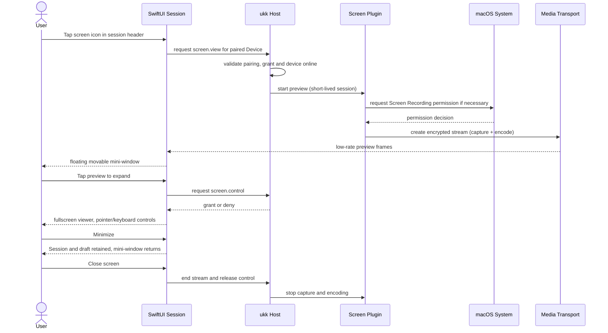
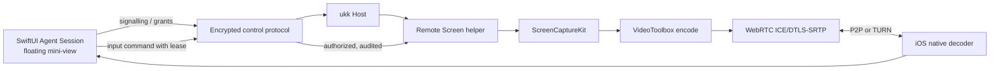

# Remote Screen plugin — small floating capability, not a separate mode

## Intent

The iOS companion remains in a normal multi-agent session. A small, optional floating live-screen preview can be opened, dragged, minimized and tapped to expand. Expand enters a dedicated **temporary** full-screen viewer for direct computer interaction. Closing returns to the exact previous session position and draft.

**Never add a persistent "Remote Desktop" main tab or replace the core Agent interface.**

## Interaction sequence

## Proposed UI

- **Collapsed:** 16:9 floating tile in Session detail, video view, live/offline status, a one-tap expand and close action, draggable within safe area. Never obstruct send button permanently.
- **Expanded:** use available screen space; pan/zoom, trackpad-style pointer, tap-to-click, keyboard, scroll, screen selection; visible end control.
- **Switching session:** preview may remain pinned to a Device with clearly displayed context; default should minimize/stop rather than silently changing the target.
- **Reduced data:** throttle preview frames/resolution; stream audio only if separately authorized; stop media when tile is dismissed or after inactivity.
- **Disconnected:** keep session chat responsive, show 'Device offline', retry deliberately instead of replaying stale pointer events.

## macOS host implementation targets

- Screen capture: ScreenCaptureKit, user-selected screen or window with OS permission.
- Hardware encoding: VideoToolbox H.264 baseline support (evaluate HEVC after interoperability testing).
- Input: OS-supported event injection with Accessibility permission; require control grant independent of view grant.
- Transport: authenticated WebRTC DTLS-SRTP or another audited E2EE media mechanism; prefer direct P2P where possible, TURN fallback.
- Lifecycle: on-demand helper, never permanently record the screen; show a desktop capture indicator and immediate stop control.

**ScreenCaptureKit is not remote control**: permission for viewing does not authorize mouse/keyboard control. Add macOS permissions UX, refusal handling, TCC revocation detection and headless restrictions.

## iOS renderer targets

SwiftUI holds the shell and controls; AVFoundation/VideoToolbox or vetted WebRTC-native library decodes stream. Use a stable SwiftUI `UIViewRepresentable` where custom view is needed. Respect safe areas, orientation changes, touch gestures, keyboard, accessibility and Backgrounding limitations.

## Streaming architecture

The alma-relay candidate is for Host connection and signalling. It is **not** the media TURN server. The optional TURN service is a separate deployment, even if referenced by alma-relay config. Verify that its existing TURN credential delivery is suitable for ukk or implement ours.

## Safety requirements

- First pairing grants only requested Agent access, **not** screen control by default.
- Screen `view` and `control` are different grants with separate switches.
- Device local user sees when capture/control are active and can instantly revoke.
- Clipboard, file transfer, mic and audio each require independent grants.
- No recording by default. Screenshot saving/download is a separate permission.
- Session-specific consent, expiring control leases and per-session audit trail.
- Input commands should never be blindly replayed after reconnect.
- Screen access is not proof that the terminal agent runs in that screen session.

## Failure / compatibility matrix

| Scenario | Expected behavior |
|---|---|
| macOS screen permission denied | Explain local permission steps; Agent API unaffected |
| Accessibility denied | View-only; disable all control input |
| Phone locked/backgrounded | Pause video and input; rely on normal Agent/push flow |
| Host sleeping/offline | Show offline; never spoof cached video as live |
| TURN unavailable behind strict NAT | Show actionable network error and stay in Session |
| Other client controls same screen | Read-only or explicit takeover; visible lease owner |
| Headless Linux Host | Remote Screen unsupported without display session |

## Not a requirement for v0

High frame rate gaming, GPU passthrough, streaming multiple displays at once, hidden unattended surveillance, always-on capture. Full product can add audio and secure clipboard after security validation.

See [plugin architecture](PLUGINS.md) and [pairing](PAIRING.md).
