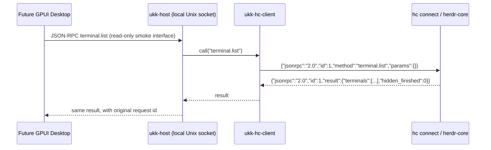

# Runtime integration spike 01 — hc plain JSON-RPC

> 2026-11-07 · Source committed; **not yet compiled or run against a real hc daemon in this environment**. The first automated check is configured in GitHub Actions. Local Mac acceptance remains pending.

## Purpose

Validate the minimum path that will eventually feed GPUI:



The test client is CLI `ukk-host request`; the GPUI window is **not yet implemented**. The Host bridge currently exposes only `host.ping` and `terminal.list`.

## Prerequisites on a Mac

- Rust stable toolchain with `cargo` installed.
- A working `hc` executable in PATH from [herdr-core](https://github.com/herdrdev/herdr-core).
- macOS with permission to run a local user-scoped process.
- Python 3 for the mock-transport integration test (GitHub Actions Linux has it).

## Quickstart

```bash
git clone https://github.com/suj1e/ukk.git
cd ukk
cargo test --workspace

# Confirm a local hc daemon and read a snapshot:
hc ls
cargo run -p ukk-host -- doctor
cargo run -p ukk-host -- list

# In terminal A: start private local socket host:
cargo run -p ukk-host -- serve

# In terminal B: test the local API:
cargo run -p ukk-host -- request host.ping
cargo run -p ukk-host -- request terminal.list

# Optional: inspect raw hc protocol schema:
cargo run -p ukk-host -- schema

# Optional long-lived stream: snapshot, event/heartbeat/missed:
cargo run -p ukk-host -- watch
```

To see multiple terminals in the snapshot, start two persistent processes **using hc**, e.g. `hc run --bg --name ukk-test-a sleep 120` and `hc run --bg --name ukk-test-b sleep 120` (choose unique names and ensure `sleep` is available); then run `ukk-host list`.

If an OS-specific `hc` binary is not in PATH, set `UKK_HC_BIN=/absolute/path/to/hc`. To override the default socket path `~/.ukk/run/agent-host.sock`, set `UKK_SOCKET` to a local, user-protected directory.

To stop the server, stop its process. If an interrupted server leaves a stale `agent-host.sock`, ensure no server is running and remove only that stale socket manually before restarting. The prototype does not auto-delete an existing socket, intentionally avoiding removal of another live host's endpoint.

## Current implementation

```text
Cargo.toml
crates/hc-client/
  src/lib.rs                 subprocess JSON-RPC client + event watcher
  tests/mock_protocol.rs     black-box transport tests using a fake hc binary
crates/host/
  src/main.rs                read-only local Host server + CLI commands
.github/workflows/
  rust-spike.yml             cargo test and Clippy
```

- `hc-client::call`: launches `hc connect`, sends one JSON line, validates matching request ID, forwards result or structured RPC error.
- `hc-client::watch`: plain-mode `events.subscribe`, emits initial snapshot and subsequent `event`/`heartbeat`/`missed` notifications.
- `ukk-host::serve`: binds a user-only Unix-domain socket (no HTTP listener); responds to `host.ping` and `terminal.list`, rejects unsupported/mutating RPC methods.
- Unit tests validate JSON-RPC IDs/errors. An integration test uses a Python fake `hc connect` process and checks a two-terminal snapshot plus `missed`.
- No plugin, remote connection, mobile pairing, storage or UI code is claimed complete.

## Acceptance checklist

- [x] Source interface matched the published herdr-core `schema/README.md` (plain JSON-RPC, snapshot and notification protocol).
- [x] Minimal local Rust integration prototype and mock protocol tests committed.
- [x] Automated `cargo test`/Clippy workflow configured.
- [ ] CI successful on pinned Rust and dependencies (verify in Actions).
- [ ] Run `cargo test` on the development Mac.
- [ ] Real Mac `hc connect` terminal.list receives two live terminals.
- [ ] Host stays up after Desktop client disconnects.
- [ ] Live event notifications survive a new client subscription and recover after core restart.
- [ ] GPUI Desktop displays Host snapshots and reconnect status.

## Next engineering steps

1. Confirm CI and real Mac hc behavior; fix any version-specific schema mismatches.
2. Add Host-side event broker and authoritative snapshot recovery on `missed`. A core `seq` number resets on core process restart, so it is not a durable ukk event cursor.
3. Add GPUI app entrypoint with sidebar, Agent list and Session tabs consuming the read-only Host socket.
4. Add explicit runtime launch/attach, framed terminal stream, controller arbitration and domain mappings after schemas are verified.
5. Only after local auth and event correctness: background service lifecycle, plugin broker and mobile remote/pairing.

## Protocol references

- [herdr-core API docs](https://github.com/herdrdev/herdr-core/blob/master/schema/README.md)
- [OpenRPC schema](https://github.com/herdrdev/herdr-core/blob/master/schema/hc.openrpc.json)

**Important:** This bootstrap Host API is a local-only smoke-test surface. It is *not* the final versioned mobile protocol described in [PROTOCOL.md](PROTOCOL.md). Do not expose it directly to a public network.
