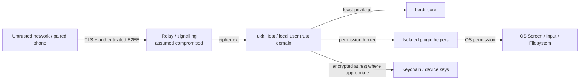

# Security architecture & threat model

> Planning document; these mechanisms must be implemented, reviewed and tested before remote control is generally enabled. Do not describe the present repository as secure or production-ready.

## Assets to protect

Source code, filesystem and secrets; agent tool execution authority; process/terminal control; approval decisions; screen pixels and user input; device identities; session history; pairing invitations; keys; push tokens; relay metadata.

## Trust boundaries

The relay is not an authority over desktop actions. Phone pairing grants per-device identity, not root privileges. A compromised or revoked mobile device must not retain full control.

## Local Host IPC and service lifecycle

The local Desktop ↔ Host endpoint is a separate trust boundary from the future
remote protocol. It is local-only, same-user and read-only for Agent runtime
state; workspace metadata mutations require a rotated per-Host capability.
There is **no TCP listener and no TCP fallback**.

### Controls implemented in `crates/host` and `crates/host-client`

| Control | Implementation |
|---|---|
| User-scoped lifecycle | macOS launchd user agent, Linux systemd `--user`, Windows logon Scheduled Task (`Interactive`, `RunLevel Limited`). No root daemon. Explicit `install`/`uninstall`/`restart`/`status`/`cleanup`; `serve` never auto-installs. |
| Agent lifetime independence | Service stop/restart/uninstall only owns the Host endpoint. The systemd unit uses `KillMode=process`; the Windows task ends only the Host. No Host path sends `terminal.stop`/`kill`. |
| Unix directory | Validate real directory and Host ownership **before** chmod, then chmod the default dir to 0700 and re-verify; all paths must have group/other bits clear. Symlinks rejected. |
| Unix socket | Created 0600; type, uid and mode re-verified after bind. |
| Unix peer identity | `SO_PEERCRED` (Linux/Android) or `getpeereid` (macOS/BSD); peer uid must equal Host euid. Unsupported platforms fail closed. |
| Stale socket recovery | Exclusive lifecycle `flock`; only `ECONNREFUSED` is treated as stale. Before unlink the path must still be a socket owned by the Host uid with mode 0600. Ambiguous connect errors, live sockets, symlinks, foreign files and non-private stale sockets are never removed. `cleanup` validates the directory ownership/mode before creating the lock. |
| Windows pipe ACL | Explicit protected SDDL DACL: current user + SYSTEM only. No default-ACL fallback. |
| Windows remote rejection | `PIPE_REJECT_REMOTE_CLIENTS`; pipe name is namespacing, not authentication. |
| Windows single owner | `FILE_FLAG_FIRST_PIPE_INSTANCE` is created **before** `LocalAuth::install()` and broker start. A refused second Host cannot rotate or temporarily remove the live Host's mutation capability token. |
| Windows peer identity | Server verifies the client process token SID; client verifies the server process token SID. Both compare against the current user. Client opens with IDENTIFICATION-only QoS. |
| Deadlines/cancellation | Unix read/write timeouts; Windows overlapped I/O with bounded waits and `CancelIoEx`. A silent or non-reading peer cannot pin a worker. |
| Resource bounds | 32 concurrent clients, 256 requests per connection, 64 KiB request, 4 MiB reply, 60s idle read, 10s write. Excess clients get a bounded error and are closed. |
| Capability separation | Local mutation token authorizes workspace metadata only. Agent mutation, terminal input and screen control remain unauthorized on this interface. |

### Security consequences and residual risks

- **Same-user is the trust boundary.** A malicious process running as the same
  OS user has the same token identity and can read the capability file. This
  interface is not a sandbox between same-user applications. Windows
  executable-signature/app identity and stronger isolation are future work.
- The Windows DACL includes SYSTEM for conventional pipe administration. The
  SID verification rejects SYSTEM *clients*, but the Host must never itself run
  as LocalSystem. A SYSTEM/elevated Host would be a new audited boundary.
- The Windows mutation token file relies on the user profile ACL; Unix uses
  0600 inside the 0700 run directory. Neither is protected against same-user
  code.
- **Different-user denial is NOT VERIFIED in CI.** The DACL/mode and peer-uid
  paths are implemented and tested within one user; cross-account tests require
  a second OS account and a documented runbook
  ([HOST_LIFECYCLE.md](HOST_LIFECYCLE.md#different-user-denial-not-verified--runbook)).
- Windows runtime tests (including overlapped deadline cancellation and
  second-Host refusal) are committed but must be confirmed by Windows CI and a
  real machine before Windows evidence is claimed.
- `install`/`uninstall`/`restart` were not executed against real service
  managers in this change. Template contents and rendering are unit-tested.
- Credentials, tokens and Agent content must never be logged. Diagnostics may
  show endpoint paths, modes and uids, which are not secrets.

## Threat scenarios and mitigations

| Threat | Required mitigation |
|---|---|
| QR observed by another person | One-time short expiry, host confirmation with code, signed transcript and replay protection |
| Malicious relay / MITM | Authenticated end-to-end key agreement, device public key pinning, transcript binding, AEAD, TLS |
| Stolen phone | Per-device revocation, Keychain storage, optional biometric gate for approvals/control, short-lived sessions |
| Malicious third-party plugin | Signed distribution, separate helper, brokered scoped permissions, process limits, audit, crash isolation |
| Agent prompt injection asks for broad host powers | Approval, scope-bound tools, no implicit plugin/system capability escalation |
| Unauthorized screen viewing | Distinct screen.view consent, visible local indicator, explicit stop, no always-on capture |
| Input injection | Distinct screen.control scope, time-limited controller lease, audit, re-auth on escalation |
| Replay of `agent.send` or approvals | Idempotency keys, expiry, nonce, revision check, never replay input on reconnect |
| Relay resource exhaustion | Size/rate limits, quotas, circuit breakers, event backpressure |
| Notification metadata leakage | APNs opaque hints, no code/file/secrets in push payloads |
| Local privilege escalation | User-scoped background service, OS sandbox/entitlements as appropriate, no root service by default |
| Dependency supply-chain | Pinned hashes/versions, audit licenses and vulnerabilities, reproducible CI, release signing |
| Remote Host compromised | Explicit host trust warning; phone cannot guarantee source-code or agent-output integrity |

## Permission matrix (illustrative)

| Role / Capability | Observe sessions | Send to Agent | Approve dangerous action | View screen | Control input |
|---|---|---|---|---|---|
| Local Desktop owner | Yes | Yes | Explicit local policy | OS permission | OS permission |
| Paired phone, observer | Yes | No | No | No | No |
| Paired phone, operator | Yes | Optional scope | Separate approval grant | Optional explicit scope | Separate temporary lease |
| Plugin (default) | No | No | No | No | No |

## Credential management

Use macOS Keychain / iOS Keychain. Host identity and pairing material must never be committed to git or logged. Rotate session keys independently of device trust. Persist only public identities/metadata in SQLite; protect sensitive local data with OS file permissions and storage design review.

## Remote Screen policy

- Viewing and control authorization separate.
- Active sharing indication and kill switch locally.
- Never enable input when no local permission or no per-device grant.
- Input lease expires even if the phone silently disconnects.
- Clipboard, file exchange, audio and recordings have independent grants.
- No frame storage unless explicit user action and retention policy.

## Required release gates

1. Third-party review of pairing/cryptographic construction; prefer established audited protocols/libraries.
2. Fuzz and property testing around input parsers, framing, and cursor replay.
3. Manual permission tests on macOS and iOS including screen denial/revocation.
4. Test malicious relay, lost phone, revoked device, expired QR, device identity substitution.
5. Review licenses and transitive native dependencies for GPUI/herdr-core/media integration.
6. Independent security testing before generally available remote access.

## Reporting

Until a dedicated security address and policy are set, do **not** post vulnerabilities with secrets or exploit details into public issues. Repository owner should add a private disclosure channel before any public release.

See [pairing](PAIRING.md), [remote screen](REMOTE_SCREEN.md), and [plugin architecture](PLUGINS.md).
