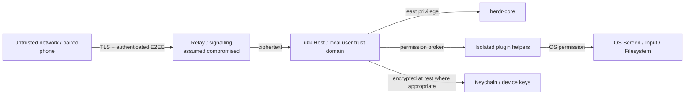

# Security architecture & threat model

> Planning document; these mechanisms must be implemented, reviewed and tested before remote control is generally enabled. Do not describe the present repository as secure or production-ready.

## Assets to protect

Source code, filesystem and secrets; agent tool execution authority; process/terminal control; approval decisions; screen pixels and user input; device identities; session history; pairing invitations; keys; push tokens; relay metadata.

## Trust boundaries

The relay is not an authority over desktop actions. Phone pairing grants per-device identity, not root privileges. A compromised or revoked mobile device must not retain full control.

## Threat scenarios and mitigations

| Threat | Required mitigation |
|---|---|
| QR observed by another person | One-time short expiry, host confirmation with code, signed transcript and replay protection |
| Malicious relay / MITM | Authenticated end-to-end key agreement, device public key pinning, transcript binding, AEAD, TLS |
| Stolen phone | Per-device revocation, Keychain storage, optional biometric gate for approvals/control, short-lived sessions |
| Malicious third-party plugin | Signed distribution, separate helper, brokered scoped permissions, process limits, audit, crash isolation |
| Agent prompt injection asks for broad host powers | Approval, scope-bound tools, no implicit plugin/system capability escalation |
| Unauthorized screen viewing | Distinct screen.view consent, visible local indicator, explicit stop, no always-on capture |
| Input injection | Distinct screen.control scope, time-limited controller lease, audit, re-auth on escalation |
| Replay of `agent.send` or approvals | Idempotency keys, expiry, nonce, revision check, never replay input on reconnect |
| Relay resource exhaustion | Size/rate limits, quotas, circuit breakers, event backpressure |
| Notification metadata leakage | APNs opaque hints, no code/file/secrets in push payloads |
| Local privilege escalation | User-scoped background service, OS sandbox/entitlements as appropriate, no root service by default |
| Dependency supply-chain | Pinned hashes/versions, audit licenses and vulnerabilities, reproducible CI, release signing |
| Remote Host compromised | Explicit host trust warning; phone cannot guarantee source-code or agent-output integrity |

## Permission matrix (illustrative)

| Role / Capability | Observe sessions | Send to Agent | Approve dangerous action | View screen | Control input |
|---|---|---|---|---|---|
| Local Desktop owner | Yes | Yes | Explicit local policy | OS permission | OS permission |
| Paired phone, observer | Yes | No | No | No | No |
| Paired phone, operator | Yes | Optional scope | Separate approval grant | Optional explicit scope | Separate temporary lease |
| Plugin (default) | No | No | No | No | No |

## Credential management

Use macOS Keychain / iOS Keychain. Host identity and pairing material must never be committed to git or logged. Rotate session keys independently of device trust. Persist only public identities/metadata in SQLite; protect sensitive local data with OS file permissions and storage design review.

## Remote Screen policy

- Viewing and control authorization separate.
- Active sharing indication and kill switch locally.
- Never enable input when no local permission or no per-device grant.
- Input lease expires even if the phone silently disconnects.
- Clipboard, file exchange, audio and recordings have independent grants.
- No frame storage unless explicit user action and retention policy.

## Required release gates

1. Third-party review of pairing/cryptographic construction; prefer established audited protocols/libraries.
2. Fuzz and property testing around input parsers, framing, and cursor replay.
3. Manual permission tests on macOS and iOS including screen denial/revocation.
4. Test malicious relay, lost phone, revoked device, expired QR, device identity substitution.
5. Review licenses and transitive native dependencies for GPUI/herdr-core/media integration.
6. Independent security testing before generally available remote access.

## Reporting

Until a dedicated security address and policy are set, do **not** post vulnerabilities with secrets or exploit details into public issues. Repository owner should add a private disclosure channel before any public release.

See [pairing](PAIRING.md), [remote screen](REMOTE_SCREEN.md), and [plugin architecture](PLUGINS.md).
