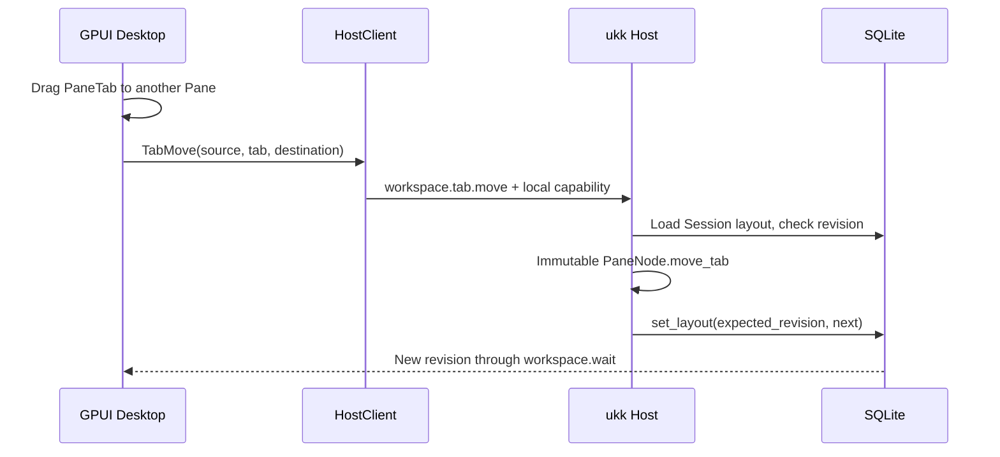

# Native Tab transfer between Panes

> Iteration toward [Issue #10](https://github.com/suj1e/ukk/issues/10). This change does not implement drag reorder within a group, cross-Session transfers or production GUI acceptance.

## Contract

- A Tab is a **view** and never owns a herdr-core Agent or PTY process.
- Dragging an existing Tab onto a **different Pane** (Leaf or Tabs group) transfers the same `PaneTab { id, title, content }`. Neither its ID nor its AgentRun reference changes.
- A source Tabs group with two entries collapses to its remaining legacy Leaf; the destination Leaf becomes a Tabs group. Existing destination Tabs append the transferred entry.
- No operation leaves a source Pane empty. A one-tab source group cannot be emptied; moving to the same group is rejected.
- Layout validation after the move checks unique IDs, maximum 16 surfaces, tree depth and AgentRun references, including hidden Tab contents.
- A transfer is **one** `workspace.tab.move` Host command with a single SQLite `expected_revision` CAS write, so concurrent edits fail as Conflict instead of silently overwriting each other.
- Drag payload contains the current Session ID, source Tabs ID and Tab ID. Desktop rejects stale cross-Session drops; Host still enforces local capability and session-scoped layout validation.
- Source/destination metadata changes sync to other native windows through the existing Workspace revision observer. Active Tab focus remains local to each window.

## Architecture

## Code ownership

| Module | Responsibility |
|---|---|
| `crates/domain/src/tab_transfer.rs` | Pure atomic move, source collapse and regression tests |
| `crates/domain/src/tabs.rs` | Existing add / close / reorder |
| `crates/host/src/workspace_rpc.rs` | Authorized mutation and CAS conflict |
| `apps/desktop/src/workspace/tabs.rs` | Tab drag payload, group-level drop target |
| `apps/desktop/src/workspace/panes.rs` | Leaf drop target |
| `apps/desktop/src/workspace/actions.rs` | One local Host command after drop |

## Acceptance

- [x] Source implementation of drag to Leaf or another Tabs group.
- [x] Domain tests for ID preservation, collapsed source, destination append and invalid targets.
- [x] Host test for revision conflict and retained AgentRun binding.
- [ ] Root Rustfmt, tests and strict Clippy on macOS, Windows, Linux.
- [ ] Native GPUI format, compile, tests and Clippy on macOS, Windows, Linux.
- [ ] Real-window smoke: nested splits, distinct drop targets, drag outside bounds, simultaneous edit conflict.
- [ ] Accessibility, keyboard-driven move, tab-strip drop insertion position and drag affordance visual QA.

This is not a claim that real mouse interaction has been tested on a running desktop.
