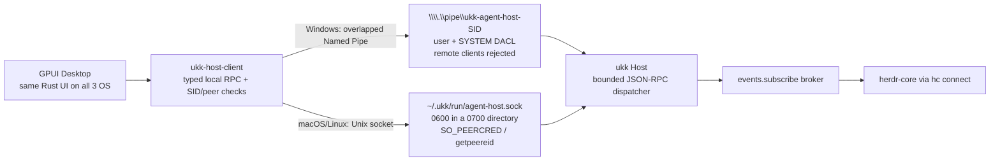

# Windows local Host IPC — Named Pipe and cross-platform Host lifecycle

> Updated 2026-11-08. Windows is a first-class GPUI Desktop target. Source is
> committed and all three OS jobs of Rust core/Host CI run `42391205944`
> passed at code commit `a40e3a3`. **Real-device validation and cross-user
> denial have not been observed.** Do not present this as production-ready
> authorization.

## Architecture



The Host service is a **user-scoped lifecycle** (launchd agent, systemd
`--user`, Windows logon task), independent of Desktop windows. It is not the
Agent runtime: stopping/restarting/uninstalling it never signals herdr-core.
See [Host lifecycle](HOST_LIFECYCLE.md).

The screen/keyboard control plugin and Relay mobile transport are **not** using
this local IPC endpoint. No TCP fallback exists.

## Files

- `crates/host-client/src/windows_pipe.rs`: Win32 token SID lookup, protected
  pipe creation, overlapped `PipeStream` with per-operation read/write deadlines
  and `CancelIoEx`, server/client SID verification, client connection.
- `crates/host-client/src/lib.rs`: Windows and Unix `HostClient` bindings with
  bounded request/reply framing and transport deadlines.
- `crates/host/src/transport.rs`: shared bounded JSON-RPC connection handler,
  concurrency/request quotas, Unix and Windows serve/request routes.
- `crates/host/src/local_fs.rs`: Unix directory/socket permission verification,
  lifecycle `flock`, stale-socket probe/removal.
- `crates/host/src/peer.rs`: Linux/Android `SO_PEERCRED` and macOS/BSD
  `getpeereid` same-user checks.
- `crates/host/src/lifecycle.rs` + `crates/host/service/*`: explicit
  install/uninstall/restart/status/cleanup and service templates.
- `crates/host/tests/windows_named_pipe.rs`: Windows-only subprocess + RPC,
  two-client and second-Host tests; deadline/SID unit tests live in
  `windows_pipe.rs`.
- `crates/host/tests/ipc_hardening.rs`: Unix framing, size, auth, quota,
  connection-cap, path-permission and stale/live-socket tests.
- `.github/workflows/rust-spike.yml`: Windows, macOS and Ubuntu matrix.

## Security invariants

1. Pipe name is derived from the process token user SID:
   `\\.\pipe\ukk-agent-host-S-1-...`; **not** an environment override. The name
   is namespacing, not authentication.
2. The server supplies an explicit protected SDDL DACL: only the current user's
   SID and SYSTEM have full access. It refuses null/missing security
   descriptors. **No Win32 default pipe ACL fallback.**
3. `PIPE_REJECT_REMOTE_CLIENTS` prohibits remote machines.
4. `FILE_FLAG_FIRST_PIPE_INSTANCE` is required for the first server instance;
   a second Host cannot take over a live endpoint.
5. Client opens with `SECURITY_SQOS_PRESENT | SECURITY_IDENTIFICATION`, never
   full impersonation.
6. **Server verifies the client process token SID** and **client verifies the
   server process token SID**; both compare against the current user. Foreign
   peers are refused in both directions, even if the DACL were permissive.
7. Every read/write is an overlapped `ReadFile`/`WriteFile` with a bounded
   timeout. On timeout the operation is cancelled with `CancelIoEx` and reaped
   with `GetOverlappedResult`; no sync pipe call can block indefinitely. Accept
   uses overlapped `ConnectNamedPipe` for the same reason.
8. Quotas and frames are explicit: 32 concurrent clients, 256 requests per
   connection, 64 KiB request line, 4 MiB reply, 60s idle read deadline, 10s
   write deadline. Excess connections receive a bounded JSON-RPC error
   (`-32029`) and are closed before any request is read.
9. The Host must run as the **interactive user**, not LocalSystem or an elevated
   global service. A higher-privilege service would require a new,
   independently audited boundary.
10. Every handle and allocated descriptor is closed/freed through RAII,
    including error paths.

### Unix equivalents

- Default socket directory `~/.ukk/run` is forced to 0700; any `UKK_SOCKET`
  directory must be a real directory owned by the Host uid with no group/other
  permission bits. Symlinks and foreign files are refused.
- Socket is 0600; type, uid and mode are verified after bind.
- Peer uid must equal the Host effective uid (`SO_PEERCRED` on Linux/Android,
  `getpeereid` on macOS/BSD); unsupported platforms fail closed.
- Stale-socket recovery runs under an exclusive `flock`: a successful connect
  probe means a live Host and the socket is never unlinked; a failed probe plus
  a still-a-socket re-check permits safe removal. `ukk-host cleanup` performs
  the same check explicitly.
- Read/write timeouts and quotas match the Windows limits.

### Threats not yet addressed for production

- **Different-user denial has not been executed in CI.** Windows DACL + SID
  code and Unix mode + peer-uid code are source-committed and unit/integration
  tested within one user; cross-account denial remains NOT VERIFIED. Runbook:
  [HOST_LIFECYCLE.md#different-user-denial-not-verified--runbook](HOST_LIFECYCLE.md#different-user-denial-not-verified--runbook).
- A malicious process running as the **same user** shares the token identity;
  there is no Windows executable-signature identity or cross-integrity-level
  policy yet. Same-user code is inside the current trust domain.
- The Windows mutation token file relies on the profile ACL (no explicit DACL
  hardening yet); Unix uses 0600 inside the 0700 run directory.
- The DACL includes SYSTEM. The SID check rejects SYSTEM *clients* of a
  user-owned Host, but the Host itself must never run as SYSTEM.
- `install`/`uninstall`/`restart` have not been run against real service
  managers in this change; only template/source tests exist.
- Windows CI ran the Windows-only tests successfully at `a40e3a3`, but this is
  not real-device evidence and does not prove cross-user denial.
- Agent mutation and screen control must not be enabled on this interface until
  the above risk review and explicit per-device/app permissions exist.

## Lifecycle commands

```text
ukk-host install      # explicit; never auto-installed by `serve`
ukk-host uninstall    # removes the user service; herdr-core Agents keep running
ukk-host restart      # restarts the Host endpoint only
ukk-host status       # service + endpoint + permissions + stale diagnosis
ukk-host cleanup      # Unix stale-socket recovery, only after no live Host
```

Artifact locations and restart semantics are documented in
[HOST_LIFECYCLE.md](HOST_LIFECYCLE.md). `serve` never writes a plist/unit/task.

## Build and run on Windows

Install a Rust MSVC toolchain and a working `hc.exe` from herdr-core. From a
fresh ukk checkout in PowerShell:

```powershell
cargo test --workspace
cargo clippy --workspace --all-targets -- -D warnings

# Explicit current-user service (optional):
cargo run -p ukk-host -- install
cargo run -p ukk-host -- status

# Or run in the foreground in terminal 1:
cargo run -p ukk-host -- serve

# In terminal 2:
cargo run -p ukk-host -- request host.ping
cargo run -p ukk-host -- request host.snapshot

# In terminal 3 (GPUI native shell; requires Windows graphics build deps):
cargo run --manifest-path apps/desktop/Cargo.toml
```

The Host background broker reconnects to `hc connect`; the Desktop subscribes
through `host.wait`. No custom `UKK_SOCKET` is used on Windows. For macOS/Linux,
`UKK_SOCKET` remains an explicit developer override and its directory is still
required to be user-private.

If you run the tests without hc, `host.ping` should still succeed, and the
broker snapshot will show `connected: false`. That is expected for a missing
runtime, not evidence of live Agent integration.

## Verification gates

- [x] Windows SID/DACL Named Pipe server and read-only client source committed.
- [x] Server/client SID verification and overlapped deadline/cancellation
      source committed.
- [x] Unix 0700/0600 verification, peer-uid checks, stale-socket lifecycle
      recovery and quotas committed.
- [x] Explicit install/uninstall/restart/status/cleanup commands and templates
      committed; templates covered by unit tests on every OS.
- [x] macOS local evidence: framing/auth/quota/connection limits, permission
      rejection, SIGTERM → stale socket → restart, live-socket refusal, client
      deadline and reply cap (`cargo test -p ukk-host -p ukk-host-client`).
- [x] Windows CI builds and runs `cargo test --workspace` and Clippy
      (including `windows_named_pipe.rs` and the overlapped deadline unit
      tests): run `42391205944` at `a40e3a3`.
- [x] Linux CI runs the Unix hardening tests: run `42391205944` at `a40e3a3`.
- [ ] Real `install`/`uninstall`/`restart` on macOS, Linux and Windows.
- [ ] Different-user access denied on all three platforms.
- [ ] GPUI UI builds and launches on Windows (not just source present).
- [ ] Real herdr-core on Windows: two live terminals, correct status and child
      hierarchy, Host restart leaving Agents alive.

See [Host lifecycle](HOST_LIFECYCLE.md), [platform support](PLATFORM_SUPPORT.md),
[live event stream](LIVE_EVENTS.md), and [security](SECURITY.md).
