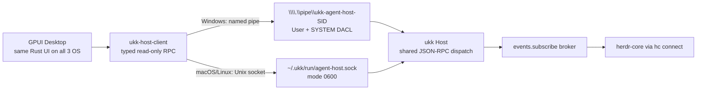

# Windows local Host IPC — Named Pipe implementation

> Windows is a first-class GPUI Desktop target alongside macOS and Linux. Source was committed on 2026-11-07; **not compiled or validated on a Windows machine yet**. Do not present this as production-ready authorization.

## Architecture



The screen/keyboard control plugin and Relay mobile transport are **not** using this local IPC endpoint yet. Windows Pipe is for local desktop UI ↔ Host only.

## Files

- `crates/host-client/src/windows_pipe.rs`: Win32 token SID lookup, protected pipe creation, accept, and client connection.
- `crates/host-client/src/lib.rs`: Windows `HostClient` binding, same versioned `host.snapshot` and `host.wait` APIs.
- `crates/host/src/main.rs`: Windows `serve` and `request` routes, OS-independent bounded JSON-RPC request dispatcher.
- `crates/host/tests/windows_named_pipe.rs`: Windows-only subprocess + RPC tests with herdr-core deliberately absent.
- `.github/workflows/rust-spike.yml`: Windows, macOS and Ubuntu Rust/test/Clippy matrix.
- `.github/workflows/desktop-cross-platform.yml`: native GPUI checks across 3 OSes.

## Security invariants

1. Pipe name is derived from the process token user SID: `\\.\pipe\ukk-agent-host-S-1-...`; **not** from an unsafe environment override. The name is not treated as an authentication credential.
2. The server provides an explicit SDDL DACL: protected, only current user's SID + SYSTEM have full access. It refuses null/missing security descriptors. **Do not fall back to the Win32 default pipe ACL.**
3. `PIPE_REJECT_REMOTE_CLIENTS` prohibits remote machines from connecting to the local Named Pipe.
4. `FILE_FLAG_FIRST_PIPE_INSTANCE` is required for the first server pipe, reducing accidental pipe name collision/hijack.
5. Client opens the Pipe with Windows `SECURITY_IDENTIFICATION` QoS rather than full impersonation rights.
6. Every incoming line is capped at 64 KiB; outgoing RPC responses on the client are capped at 4 MiB. Only read-only methods are dispatched.
7. The Host must run as the **interactive user**, not as LocalSystem or an elevated global Windows service. A higher-privilege service would require a new, independently audited boundary.
8. Every handle and allocated descriptor is closed/freed through RAII, including error paths.

### Threats not yet addressed for production

- The Windows client path has a finite busy-connect retry (3 seconds), but synchronous Pipe **reads do not yet have enforceable deadlines/cancellation**. The Host's `host.wait` is capped at 10s, but a compromised/malfunctioning endpoint could still block a client thread.
- No per-app Windows code-signature identity validation or cross-integrity-level policy yet. Same-user processes share access in the current read-only model.
- Multiple local clients can connect; per-client quotas, bounded worker concurrency and robust handle cancellation are not yet implemented.
- Named Pipe ACL has not yet been tested using a *different user account*.
- The first-instance flag is not a substitute for comprehensive peer validation. It protects Host startup but not a client that connects before the legitimate Host begins listening.
- Agent mutation and screen control must not be enabled on this interface until the above risk review and explicit per-device/app permissions exist.

## Build and run on Windows

Install a Rust MSVC toolchain and a working `hc.exe` from herdr-core. From a fresh ukk checkout in PowerShell:

```powershell
cargo test --workspace
cargo clippy --workspace --all-targets -- -D warnings

# In terminal 1:
cargo run -p ukk-host -- serve

# In terminal 2:
cargo run -p ukk-host -- request host.ping
cargo run -p ukk-host -- request host.snapshot

# In terminal 3 (GPUI native shell; requires Windows graphics build deps):
cargo run --manifest-path apps/desktop/Cargo.toml
```

The Host background broker reconnects to `hc connect`; the Desktop subscribes through `host.wait`. No custom `UKK_SOCKET` is used on Windows. For macOS/Linux, `UKK_SOCKET` retains its Unix-socket override behavior.

If you run the tests without hc, `host.ping` should still succeed, and the broker snapshot will show `connected: false`. That is expected for a missing runtime, not evidence of live Agent integration.

## Verification gates

- [x] Windows SID/DACL Named Pipe server and read-only client source committed.
- [x] Windows-only Host subprocess + Named Pipe RPC test source committed.
- [x] macOS/Linux shared JSON-RPC request dispatcher preserved.
- [ ] Windows CI builds and runs `cargo test --workspace` and Clippy without errors.
- [ ] GPUI UI builds and launches on Windows (not just source present).
- [ ] Real herdr-core on Windows: two live terminals, correct status and child hierarchy.
- [ ] Different-user access denied, spoofed pipe endpoint, permission/token changes, restart and multi-client concurrency tests.
- [ ] Enforceable timeouts/cancellation and resource limits for malicious or dead clients.
- [ ] Verify macOS/Linux regression tests remain green.
- [ ] Document Windows user process autostart and signing/installer.

See [platform support](PLATFORM_SUPPORT.md), [live event stream](LIVE_EVENTS.md), and [security](SECURITY.md).
