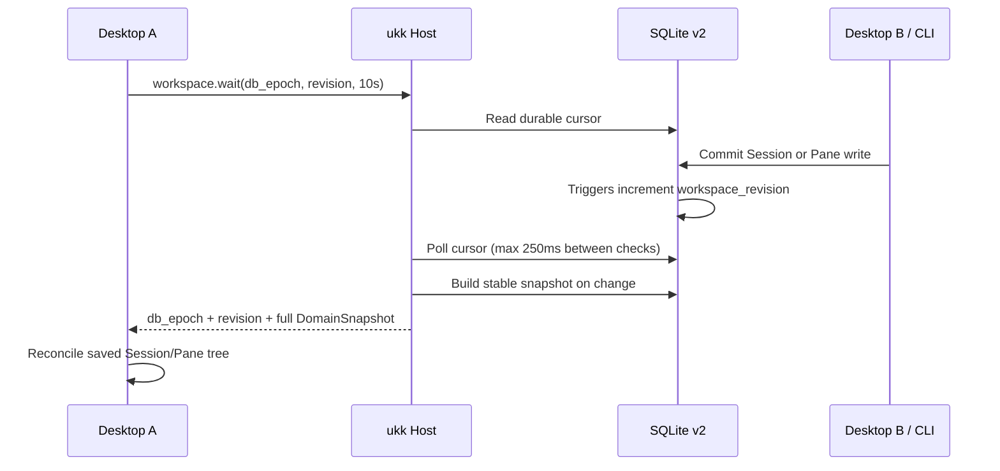

# Workspace Live Sync — Spike 05

> 2026-11-07 · Source and tests added in `feat/workspace-live-sync`. CI and real GPUI window testing are not yet verified. This is a local-only synchronization layer.

## Why

ukk already streams live Agent runtime state from herdr-core, but its **product metadata** (Spaces, Sessions, AgentRun bindings, Pane splits) lived in SQLite. A second desktop window or a CLI mutation could change the layout while the first UI stayed stale until Refresh.

## Design



- **Schema v2** adds `workspace_revision(id=1,revision,db_epoch)`. Triggers on `spaces`, `sessions`, `agent_runs`, `session_layouts` increment the durable revision on INSERT/UPDATE/DELETE.
- A unique persistent `db_epoch` distinguishes a replaced/recreated DB. The revision alone does not identify a database incarnation.
- Migration upgrades existing v1 databases in place; application tables and Session/AgentRun IDs are preserved.
- `Store::snapshot_versioned` checks the cursor before and after materializing the domain snapshot, retrying on concurrent writes rather than mislabeling a mixed snapshot.
- `workspace.state` reads the current cursor and full snapshot. `workspace.wait` long-polls a cursor for up to 10 seconds and returns a new snapshot only when it changes.
- GPUI keeps an independent background Workspace subscription alongside herdr-core Agent events. On change, it refreshes the native Space/Session list and Pane split tree while retaining a valid current selection.
- `workspace.snapshot` remains for existing read-only clients. Mutation RPC methods and their rotating same-user capability are unchanged.

## Local RPC contract

Request (read-only):

```json
{"jsonrpc":"2.0","id":1,"method":"workspace.wait",
 "params":{"after_epoch":"db-incarnation-id","after_revision":7,"timeout_ms":10000}}
```

If a write happened, response `result` contains:

```json
{"db_epoch":"db-incarnation-id","revision":8,
 "snapshot":{"spaces":[],"sessions":[],"agent_runs":[],"layouts":[]}}
```

If no change happened before timeout, `snapshot` is `null` with the same cursor. On a different `db_epoch`, `workspace.wait` immediately returns a full snapshot even if the new database has a lower revision.

`workspace.state` takes no parameters and always returns a full snapshot. Both methods use the **same private local IPC**, Unix Socket on macOS/Linux and SID-scoped Named Pipe on Windows. These methods are not an iOS/Relay remote API and cannot issue Agent commands.

## Acceptance

- [x] SQLite v2 trigger-based revision and DB epoch implementation source.
- [x] Store tests for metadata changes, idempotent retry, multiple connections, v1 migration.
- [x] Read-only Host state/wait + typed Host Client source.
- [x] GPUI background watcher and UI reconciliation source.
- [x] Host integration test with a second independent SQLite writer.
- [ ] CI: `cargo fmt`, `cargo test --workspace`, strict Clippy on macOS/Windows/Linux.
- [ ] CI: GPUI `cargo check` on macOS/Windows/Linux.
- [ ] Real dual-window GPUI test: create Session or resize Pane in one window; another updates without Refresh.
- [ ] Real CLI test on all desktop OSes, with process restart and DB replacement.
- [ ] Visual QA, offline/reconnect UX, memory/IPC load tests.

## Constraints and follow-up

- This bootstrap uses per-client, bounded SQLite cursor polling at 250ms intervals while long-polling. It works for a small number of local Desktop windows but is not the scalable multi-device event broker.
- The private Host socket still has no connection-count quota. Production should use one shared metadata watcher with fan-out and per-client limits.
- A synchronous Windows Named Pipe read deadline is not yet enforceable; this remains a separate security hardening item before release.
- Same-user local IPC does not grant remote authorization or plugin capabilities.
- **No view owns herdr-core Agent lifetime.** Closing Pane or archiving Session does not stop a running Agent.

Run locally:

```bash
cargo test --workspace
cargo run -p ukk-host -- serve
# in another shell
cargo run -p ukk-host -- request workspace.state
cargo run --manifest-path apps/desktop/Cargo.toml
```

Then change metadata with `ukk-host space-create`, `session-create`, `pane-split` or `pane-close` from another shell. In an actual GUI session, verify changes appear without pressing Refresh.

References: [Workspace Persistence](WORKSPACE_PERSISTENCE.md), [Architecture](ARCHITECTURE.md), [Engineering Standards](ENGINEERING.md).
