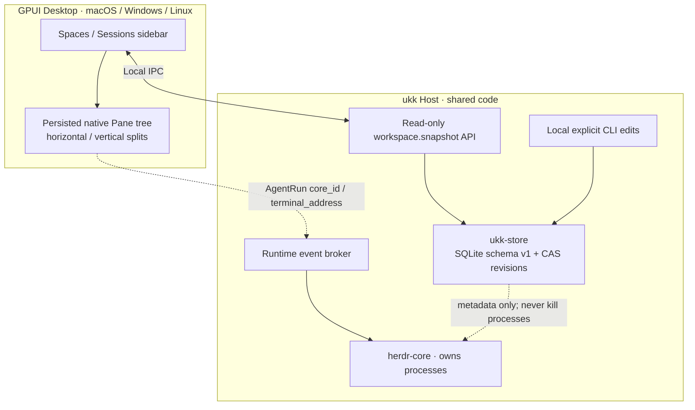

# Workspace Persistence — Spike 04

> 2026-11-07 · Source committed, compile/CI/macOS-Windows-Linux runtime acceptance **not yet verified**. This is the first durable product-level model, not a complete Coding Agent frontend.

## Product behavior

ukk's **Space**, **Session**, **AgentRun** and **Pane** are different things:

- **Space** organizes a project on a Host. It is persisted independently of runtime terminals.
- **Session** is a named work context under one Space. Archived does **not** mean terminated.
- **AgentRun** explicitly binds a Session to an *existing* herdr-core terminal, identified by `core_id + terminal_address`. A binding is metadata, not a process owner; it cannot launch/kill the agent.
- **Pane** is a native UI surface that references an AgentRun, terminal, Files, Diff or Activity. Closing a pane is presentation-only.
- **SessionLayout** is a versioned split tree; any number of panes can reference the same AgentRun.
- The live terminal snapshot still comes from the Host's independent herdr-core broker; a stored binding is not proof that the process remains online.



## Files

- `crates/domain/` — serde-friendly typed entities; recursive validated `PaneNode::Split` and `PaneNode::Leaf`; immutable split/close helpers; no GPUI dependency.
- `crates/store/` — SQLite with bundled engine, schema version 1, FK constraints, WAL, atomic Session + default layout creation, optimistic `revision` update and tests.
- `crates/host/` — read-only `workspace.snapshot` JSON-RPC for GPUI; local CLI creation, archiving, agent binding and split/close.
- `crates/host-client/` — shared typed `DomainSnapshot` fetch over Unix sockets and Windows Named Pipes.
- `apps/desktop/` — Space / Session sidebar and recursive split-pane display driven by persisted layout, not fake Agent dialogues.

## Database

Default local location:

| OS | Default path |
|---|---|
| macOS / Linux | `~/.ukk/data/workspace.sqlite3` |
| Windows | `%LOCALAPPDATA%\ukk\workspace.sqlite3` |

`UKK_DB_PATH` overrides the database path for development/testing. This configuration belongs to **Host**; Desktop never writes SQLite directly.

- The default Unix data directory is mode 0700 and SQLite file is created with mode 0600.
- WAL allows concurrent CLI writers and Host snapshot readers.
- Foreign keys enforce associations and unique `(core_id, terminal_address)` avoids duplicate terminal bindings.
- `PRAGMA user_version=1` migration prevents silently loading newer schema versions.
- Layout edits use `expected_revision`; stale updates return a Conflict instead of overwriting another view.
- A Session created by CLI starts with one Activity pane, rather than a pretend chat transcript.
- The storage layer contains project metadata, not terminal output, secrets, video frames, approvals or chat transcripts.

## Local developer walkthrough

First, start herdr-core and the ukk Host when possible. You can create metadata before herdr-core is installed; the DB is independent of runtime.

```bash
# Build and run tests from repo root
cargo test --workspace
cargo clippy --workspace --all-targets -- -D warnings

# Create a Space for your own actual project root
cargo run -p ukk-host -- space-create ukk /path/to/ukk

# The output includes an actual Space ID. Use it below:
cargo run -p ukk-host -- session-create <space-id> "Implement sync protocol"

# Inspect Session IDs, initial pane ID and layout revision
cargo run -p ukk-host -- workspace-dump

# Split an existing leaf to add a Diff view (prints new pane IDs)
cargo run -p ukk-host -- pane-split <session-id> <pane-id> horizontal diff

# Remove a leaf: this only collapses its split; agents keep running
cargo run -p ukk-host -- pane-close <session-id> <pane-id-to-close>

# Optional: create a manual binding ONLY after verifying actual core ID and terminal address
cargo run -p ukk-host -- agent-bind <session-id> <actual-core-id> <actual-address> codex

# Metadata archiving never sends a kill to herdr-core
cargo run -p ukk-host -- session-archive <session-id>

# Terminal 1: Host, which owns the broker and reads SQLite
cargo run -p ukk-host -- serve

# Terminal 2: query only; no mutation over the local socket
cargo run -p ukk-host -- request workspace.snapshot

# Terminal 3: native GPUI prototype (Windows / macOS / Linux build verification still pending)
cargo run --manifest-path apps/desktop/Cargo.toml
```

The CLI uses quoted arguments. The example angle-bracket placeholders must be replaced with real IDs before running. `pane-split` currently starts a 50/50 split; layout model stores ratios but interactive drag handles are **not** wired into GPUI yet.

## Security, consistency and current limitations

- Local socket/Named Pipe `workspace.snapshot` is **read-only**; no new write RPCs or remote privileges were exposed.
- Mutations require explicit local CLI invocation. Native UI creation/rename/archive actions will follow after local command authorization is designed.
- Metadata changes made by CLI currently appear in Desktop on manual **Refresh**. The live herdr-core Agent stream separately auto-updates; future metadata change events should remove this manual step.
- Layout validation rejects duplicate IDs, excessive nesting, more than 16 leaves, NaN/invalid ratios, unknown pane targets or AgentRun references from another Session.
- A layout tree is not yet a draggable multi-pane implementation: GPUI renders the stored split structure but ratio-resizing, drag/reorder, tab management and per-device layout preferences are still planned.
- Dynamic herdr-core terminals are intentionally not auto-assigned to a random Session. Mapping requires user intent and actual core identity; orphan terminals stay visible in the runtime list.
- Product-level Sessions survive UI and Host restarts. **Live Agent execution** still depends on herdr-core's independent persistence and its compatibility with the current runtime.
- A SQLite file cannot protect against another malicious process running as the same OS user. The full device trust, plugin sandbox and remote authorization remain separate security milestones.
- SQLite migrations, CI and platform-specific file permissions need actual runtime testing before release.

## Tests added

- Domain: split/close roundtrip, preserve Agent identity, reject last-pane removal, reject invalid ratios, duplicate IDs, JSON format stability.
- Store: DB reopen persistence, optimistic revision conflict, cross-Session binding rejection, archived Session not removing AgentRun.
- Host integration: mock hc live event stream + local socket `workspace.snapshot` from persisted SQLite.
- Windows: Windows Named Pipe test additionally reads a persisted Space and Session from Host.
- Three-OS Rust CI, GPUI build workflow already configured; success is **not** confirmed.

## Next engineering slice

1. Get cross-platform CI green and collect *real* Mac/Windows/Linux logs/screenshots.
2. Add authenticated local mutation commands for Desktop and metadata revision notifications.
3. Build true GPUI resizable splitter, pane focus, drag/reorder and tabs with saved layouts.
4. Reconcile explicit AgentRun bindings with hc identity and structured Agent provider events.
5. Then native chat, Diff, Files, Git, approvals and plugin contribution slots.

Related: [Domain Model](DOMAIN_MODEL.md), [Architecture](ARCHITECTURE.md), [Roadmap](ROADMAP.md).
