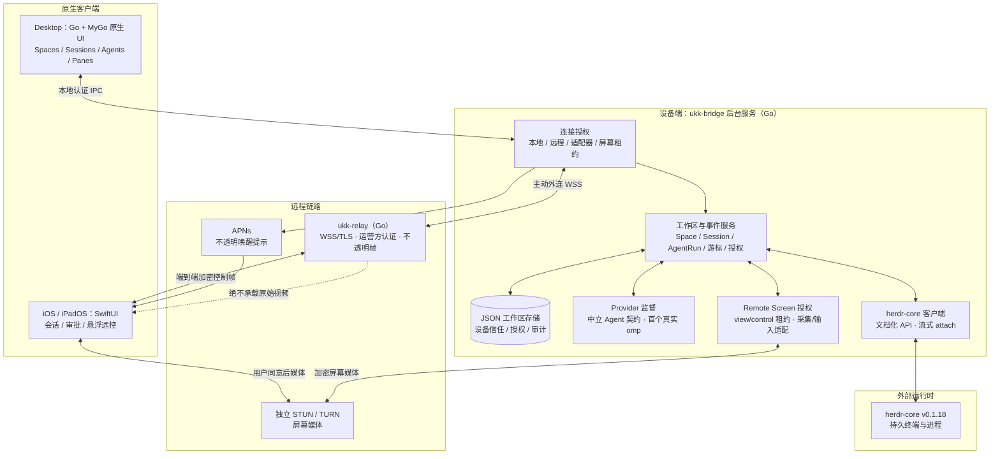
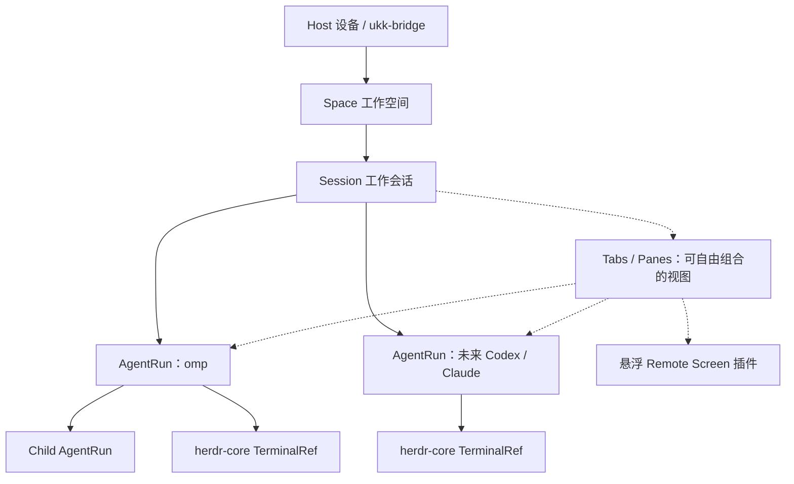

# ukk 产品与技术总览（中文版）

> 版本：MyGo 重置版规划 · 2026-11-08。架构为原生 Go/MyGo Desktop + 外部 herdr-core + SwiftUI iOS；当前实现与验证进度以 [status](status.md) 中记录的精确证据为准，不把计划写成已完成。

## 一句话定位

**ukk 是原生的、可扩展的 Multi-Agent Workspace。**

电脑用 MyGo 原生 UI 展示多个 Coding Agent 的长期会话与自由分栏；手机用 SwiftUI 远程继续同一会话，通过扫码配对连接电脑。Remote Screen 仅是会话中的按需悬浮插件，点开可放大并控制设备，收起后回到原本的 Agent 对话。

## 这次是彻底重置

- 旧的 Rust/GPUI Desktop、Host、crate、根 Cargo、旧构建脚本与工作流全部退出当前结构；旧 `main`（包括 `f033cf0`）仅作历史参考。
- 所有 Go 代码在单一模块 `apps/desktop` 中，`mygo.json` 同目录；入口规划为 `cmd/ukk`、`cmd/ukk-bridge`、`cmd/ukk-relay`。
- **不做数据迁移、不兼容旧 SQLite/协议、不保留旧发布产物。** 这是 greenfield 重置。
- 不造假：没有 dummy main、空壳包、假适配器、永远绿色的占位测试。

## 不要把产品做偏

- **不是**固定 Planner → Coder → Reviewer → Tester 流水线。Agent 数量、种类、父子关系都是动态的。
- **不是**终端/TUI 换皮，也不是网页换皮。Desktop 是 MyGo 原生 Go UI；终端只是可切换的 Pane。
- **不是**另一个远程桌面 App。Remote Screen 是小窗插件，不增加一个永久的“远程桌面模式”。
- **不是** Fork `herdr-app`。ukk 从零构建桌面 UI，但复用外部 `herdr-core` 的持久终端与进程能力，绝不复制或重写运行时。
- **不是**要求所有客户端共享 UI 代码。Desktop 用 MyGo，iOS 用 SwiftUI，通过统一协议共享会话。

## 当前交付边界

**优先完成：** Desktop 原生三端（macOS / Windows / Linux，同一套 MyGo 原生 UI）＋ iOS / iPadOS（SwiftUI）。包含完整多 Agent 工作空间、持久会话、插件安全边界、扫码配对、自托管 relay 和按需悬浮 Remote Screen。

**暂不开发：** Android、Web、TUI。它们是未来可能接入统一协议的客户端，并非当前开发任务或近期交付承诺。

## 总体架构

备注：上图为目标架构。实现与验证进度以 [status](status.md) 的精确证据为准。Remote Screen 的媒体链路独立于 relay 的控制帧，relay 不接触屏幕内容。

## 产品对象关系

Session 是 ukk 产品的工作上下文；herdr-core TerminalRef 是底层运行进程地址；Pane 是显示视图。这三者不能合并成同一个生命周期。关闭视图只 detach，不停止 Agent。注意：窗口独立不等于崩溃恢复；provider RPC 子进程的恢复能力取决于 provider 本身，不能假装支持。

## 终端与 Agent 的真实性

- herdr-core v0.1.18 是终端与进程事实来源；ukk 通过文档化 API 连接，不复制/重写运行时。
- Terminal 视图使用 MyGo 原生 UI 的终端插件（libghostty-vt，经 purego 加载运行时库）；外部连接支持 detach。
- 人类输入与自动 Agent 输入共用同一条 `Conn.Write`，因此每条写入必须带来源标签（`HUMAN_INPUT` / `AUTOMATIC_INPUT`），**绝不靠嗅探字节判断**。
- Observer 连接不写、不 resize；必须先应用 core 的 RESIZE 结果再绘制；使用有界限的 credit/背压。
- **绝不**把 ANSI 文本解析成审批或工具事件。以 omp 为首个真实 provider，通过中立契约接入；Codex/Claude 先做版本化 fixture 契约，未跑通前不宣称支持，也不写假适配器。
- 长 Markdown 必须增量、有界渲染，不能假设上游长文问题已修复。

## 扫码、配对与遥控

Mac 点击“添加设备”→ 生成短时一次性 QR → iPhone 扫码 → 通过 relay 做身份握手 → Mac 本地确认设备和验证码 → 保存信任关系 → 后续自动重连。设备绑定不意味着自动允许批准敏感操作、查看屏幕或控制鼠标。**配对、Agent 控制、屏幕查看、屏幕控制是四个独立授权。**

Relay 是真正可自托管的 Go 服务：WSS/TLS、运营方认证、端到端加密帧、有界连接与队列、无原始视频。设备身份独立于传输，每次连接都需证明持有密钥，撤销持久生效。

## 插件化与安全

插件可贡献命令、事件订阅、会话操作、原生 UI 槽位、后台任务及 Agent 适配器。必须经过 bridge 的权限代理，且第一方特权插件与第三方非可信插件分级隔离；第三方插件默认出进程运行，在系统支持时使用 OS 沙箱，授权持久化并可撤销。

**Remote Screen 是第一个代表性插件**：悬浮小窗查看，点击展开控制，view/control 独立授权，关闭即停止采集与输入。屏幕媒体走独立 STUN/TURN，relay 只做控制面。

## 完整产品功能

Spaces 多机器/多项目、动态多 Agent、子 Agent、持久会话、原生消息/Plan/工具调用/审批、Tabs/自由分栏、Diff/Files/Git/Worktree、搜索与快捷操作、插件安全边界、设备扫码与撤销、APNs、Remote Screen、自动化、诊断、备份，以及 **macOS / Windows / Linux 桌面原生三端与 iOS/iPadOS**。Android/Web/TUI 暂缓。

完整功能不会因为分阶段开发而从产品愿景中删除。

## 发布产物

最终交付为**未签名**产物并明确标注：macOS `.dmg`（`ukk.app` + bridge，允许 ad-hoc 签名）、Windows NSIS `.exe`、Linux `.deb` + tar、iOS 真机构建 `.ipa`。签名、公证、App Store/TestFlight 不在 v1 验收内；未签名 IPA 不是可安装版本，真机验证需要后续签名与设备条件，不能用“已生成 IPA”替代。

## 第一条验收链路

Mac 启动多个 Agent（包括子 Agent）→ 关掉桌面窗口但不结束 Agent → iPhone 看到实时状态并继续会话 → 审批和查看 Diff → 按需打开悬浮 Remote Screen 解决一个桌面 UI 问题 → 收起返回原会话。Relay 全程不接触屏幕媒体。

## 文档索引

- [系统架构](tech-design.md)
- [完整产品需求](requirements.md)
- [v1 完成契约](goals/v1-complete.md)
- [MyGo 实施计划](goals/mygo-implementation.md)
- [领域模型](subsystems/domain-model.md)
- [插件系统](subsystems/plugins.md)
- [安全设计](subsystems/security.md)
- [开发路线](roadmap.md)
- [实现状态](status.md)
- [平台与运行时决策](decisions/0001-platform-and-runtime.md)
- [远控插件决策](decisions/0002-remote-control-is-plugin.md)
- [上游参考](references.md)

## 待验证而非已实现

MyGo v0.8.3 在目标三端的真实窗口/权限/打包表现、herdr-core v0.1.18 的 API 细节与子 Agent 行为、omp RPC 的审批/工具事件深度、自托管 relay 的 TLS/运营认证与 TURN 穿透、iOS 真机扫码/推送/媒体、屏幕采集与输入注入权限，都必须经过工程验证。未经验证不要写成“已经接通”；以 status 记录的 exact evidence 为准。
