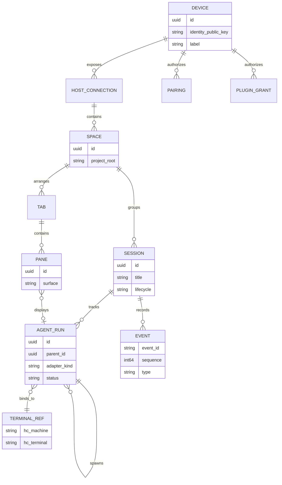

# Domain model and ownership

## Implementation baseline (Spike 04 · source, not yet runtime-verified)

The initial portable model lives in [`crates/domain/src/lib.rs`](../../crates/domain/src/lib.rs), and SQLite persistence in [`crates/store/src/lib.rs`](../../crates/store/src/lib.rs).

- Space, Session, AgentRun and SessionLayout have independently generated IDs.
- AgentRun binds explicitly to `core_id + terminal_address` and optionally a parent AgentRun within the same Session; its existence is not proof the runtime process is online.
- PaneNode is a validated `Leaf` or `Split` tree with maximum 16 leaves, at most 8 levels, ratio 0.15–0.85 and explicit AgentRun references.
- Immutable `split_leaf` and `close_leaf` return new layout trees only, without any process action.
- SQLite persists Space/Session/bindings/layouts with schema v1, foreign keys and revision compare-and-swap.
- Desktop currently renders session layout topology; drag handles, tabs, live structured panes and provider adapters remain unimplemented.
- For the full current implementation and commands, see [Workspace Persistence](../spikes/workspace-persistence.md).

## Entities



This diagram is an app-domain proposal. It is **not** the exact data model of herdr-core.

### Definitions

- **Device**: a physical computer or phone with its own asymmetric identity key.
- **Host connection**: a reachable ukk Host, local or remote. A device can reconnect; connection is not persistent identity.
- **Space**: a named developer workspace rooted at a project on one Host. Aggregated views may show multiple Spaces across Hosts.
- **Session**: ukk's durable, human-facing work context; it can involve many agent runs. Distinct from an hc terminal, hc daemon session, chat thread, or tab.
- **AgentRun**: one execution of an agent process, with optional parent/child relationship. Identifies its runtime through TerminalRef.
- **TerminalRef**: hc machine + terminal identity. Mapping must survive reconnect and avoid assuming names are globally unique.
- **Tab/Pane**: presentation layout. A Pane references an agent, diff, file or tool surface but does not own its process lifecycle.
- **Event**: a versioned, ordered snapshot/delta item in our sync protocol; never equate to herdr-core's internal sequence without mapping.
- **PluginGrant**: a scoped permission for a plugin capability on a particular device / subject.

## State machines

AgentRun: `created → starting → running ↔ blocked → finished|failed|cancelled`. `unknown/offline` is an *observation state*, not evidence that the underlying process stopped. Program-reported OSC status should be shown with its provenance, not forced into a state it did not report.

Session: `active ↔ paused → archived`; archiving never kills its terminals automatically. Explicit `stop execution` should be distinct from `close view`.

Screen share: `off → requesting_permission → negotiating → viewing → controlling → stopped`. Control requires a separate grant from view.

## Ownership & concurrency

Host owns durable Session and Space metadata; herdr-core owns actual terminal processes and their reported status; Agent adapters own provider-specific semantic runs and approvals. Reconciliation on Host restart associates TerminalRefs with AgentRuns, requests fresh hc snapshots and marks orphaned/unavailable records without inventing completion.

One agent can appear in multiple read-only panes and clients. Sending input, approval or screen control requires an explicitly authorized controller. Prefer short leases with expiry and visible takeover confirmation. Use idempotency keys for commands and optimistic revision checks for shared mutable metadata.

## Space creation and rename

Space metadata has one explicit creation/rename path on Desktop, Store and
local RPC. None of it starts, signals, attaches or approves an Agent, and none
of it can be reached with the agent-control or plugin-control capability.

```text
Desktop form (title, project root) → HostClient.local_workspace_mutation
    → workspace.space.create / workspace.space.rename
    → rotated workspace capability allowlist
    → Store::create_space_with_id / Store::rename_space
    → SQLite spaces row (no Session, AgentRun, layout or terminal write)
```

- `Store::create_space(title, project_root)` remains the convenience path for
  CLI/tests and delegates to `create_space_with_id` with a fresh UUID.
- `Store::create_space_with_id(request_id, title, project_root)` is idempotent:
  the same `request_id` with the same inputs returns the existing Space;
  the same `request_id` with different inputs is a conflict and never creates
  a second Space. `request_id` must be a UUID.
- `Store::rename_space(space_id, title)` updates only the title. An unknown
  Space is `NotFound`; an empty or oversized title is `Invalid`.
- Both titles and project roots are trimmed and bounded to 1–200 characters.
  The Desktop mirrors the bound for input, but the Store is authoritative.
- RPC `workspace.space.create` takes `{request_id, title, project_root}` and
  `workspace.space.rename` takes `{space_id, title}`. They are members of the
  same local mutation allowlist as `workspace.session.*` and `workspace.pane.*`.
  A reused `request_id` with different details returns the conflict code with
  Space-specific wording, never the pane-layout reload message.
- The Desktop sidebar exposes `+ New Space` and a per-Space rename control.
  Enter submits and Escape cancels the form; the form shows busy, validation,
  error and conflict states, and accessibility labels name each field and
  action. Creating a Space selects it and clears any Session selection because
  the new Space has no Session yet.

Test evidence lives in `crates/store/src/records.rs`,
`crates/host/src/workspace_rpc.rs`, `crates/host/src/rpc.rs`,
`crates/host-client/src/lib.rs`, `crates/host/tests/live_broker.rs` and
`apps/desktop/src/workspace/spaces.rs`. Real-window keyboard/screen-reader
acceptance of the Space form is **NOT VERIFIED**.

## Explicit AgentRun binding

An AgentRun is created only by an explicit, user-initiated binding of an
already-running herdr-core terminal to a Session. It is never inferred from a
terminal appearing, from a selected Pane, or from an "orphan" terminal count.

```text
Desktop confirmation (core_id, terminal, adapter, Session)
    → HostClient.local_workspace_mutation
    → workspace.agent.bind {request_id, session_id, core_id,
                            terminal_address, adapter, parent_run_id?}
    → live Host/herdr-core snapshot verification
    → Store::bind_agent_with_id
    → SQLite agent_runs row (no terminal/PTY call)
```

- `Store::bind_agent_with_id(request_id, ...)` is idempotent: `request_id`
  becomes the AgentRun id. Repeating it with identical inputs returns the
  existing row; repeating it with any different input is `Conflict`. The id
  must be a UUID.
- `Store::bind_agent` remains the CLI convenience path with a freshly minted
  id; it shares the same validation and cannot deduplicate a retried request.
- Both paths require an existing Session. An unknown Session is `NotFound`;
  an unknown parent AgentRun is `NotFound`; a parent from a different Session
  is `Invalid`.
- A `(core_id, terminal_address)` pair may be bound to one AgentRun only.
  Binding it again is `AlreadyBound`; a different core may reuse the same
  terminal address because the address is not globally unique.
- The binding is durable metadata across Store reopen. Its existence is not
  proof that the terminal is online.
- No path starts, attaches to, interrupts, signals or stops the terminal.

Test evidence lives in `crates/store/src/tests.rs`,
`crates/host/src/workspace_rpc.rs`, `crates/host/src/rpc.rs`,
`crates/host-client/src/lib.rs` and
`apps/desktop/src/workspace/agent_bind.rs`.

## Event envelope (proposed)

```json
{
  "protocol_version": "1.0",
  "host_id": "uuid",
  "stream_id": "workspace:uuid",
  "sequence": 104,
  "event_id": "uuid",
  "type": "agent.status.changed",
  "occurred_at": "2026-11-07T00:00:00Z",
  "subject_id": "agent-run-uuid",
  "schema_version": 1,
  "payload": {"status": "running", "source": "osc7501"}
}
```

Events are immutable; clients first fetch a versioned snapshot then subscribe with a cursor. If the cursor is expired or source indicates `missed`, replace from authoritative snapshot, do not pretend no events were lost.

## Questions tracked for implementation

- Can all preferred Agent providers supply stable semantic thread IDs and approval APIs?
- Do worktree roots belong to Space or per-Agent working directories?
- What is the retained event history budget on mobile reconnect?
- How should a session span multiple machine Hosts without ambiguous authority?

See [architecture](../tech-design.md) and [remote protocol](protocol.md).
