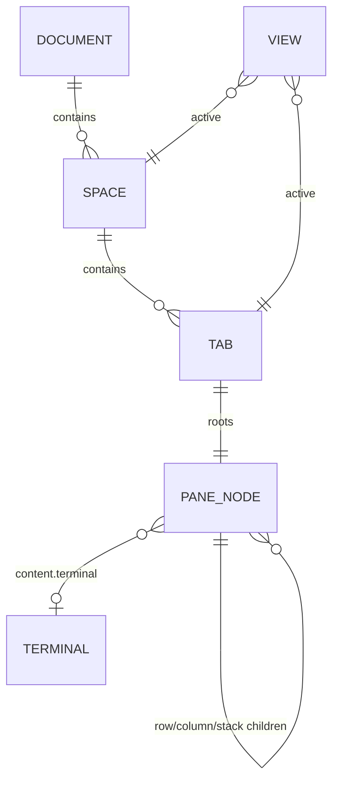

# Domain model and ownership

> Contract for ukk's workspace structure. Spaces, tabs and panes are the
> machine-owned herdr-core document `herdr-app`, read and written through
> [doc.get / doc.set](../tech-design.md) with a version CAS. The Go port of that
> document is `apps/desktop/internal/corelayout`; the typed core client is
> `apps/desktop/internal/hc`. The Desktop keeps only a local view file, and
> Agent execution is addressed per pane through the bridge.
> [tech-design](../tech-design.md) and
> [mygo-implementation](../goals/mygo-implementation.md) describe the same
> split. What is verified, and on which commit, is recorded in
> [status](../status.md); a package that exists is not proof of integration.

## Entities

| Entity | Go type | Identity | Location | Lifetime |
| --- | --- | --- | --- | --- |
| Space | `corelayout.SharedSpace` | opaque non-empty `id` (≤256) | `spaces[]` in the document | Machine-owned; durable while the core holds the document |
| Tab | `corelayout.SharedTab` | `id` unique across the document (≤256) | `spaces[].tabs[]` | Machine-owned; one layout tree each |
| PaneNode | `corelayout.Node` | `id` on each node (≤256) | `SharedTab.root` | Machine-owned block / row / column / stack |
| View | local view record (Desktop `view` file) | one file per installation | Desktop config directory | Ephemeral presentation; discardable |
| Terminal | herdr-core `terminal_address` | core identity + address | Referenced by `Node.content.terminal` | Owned by herdr-core; outlives every view |

A Space is a named project folder on one machine. A Tab groups one pane tree.
A `PaneNode` is a `block` (one pane, with `content` naming exactly one of
`terminal`, `mod`, `tab` or `agent`), or a `row`, `column` or `stack` of
children. The view file stores which space and tab the user is looking at,
pane focus and zoom, and floating-tile position; it is never product data.



This is the world model shared by every client of a machine, not ukk's private
schema. Device identity, pairing grants and plugin grants live in the bridge's
trust/grant records (see [security](security.md) and [plugins](plugins.md)).
There is no Desktop-owned Session or AgentRun row: those entities are not part
of this model.

## Document

`hc.DocGet(ctx, "herdr-app", on)` returns the raw JSON value and the version.
`hc.DocSet(ctx, "herdr-app", on, version, value)` replaces it only when the
version still matches and returns the new version. A missing document comes
back as a nil value, not an error. Values above `hc.MaxDocValueBytes` are
rejected before sending, and a stale version fails with the core's `conflict`
kind: read again and reapply, never force-write.

```json
{
  "spaces": [
    {
      "id": "s1",
      "name": "ukk",
      "folder": "/Users/me/src/ukk",
      "tabs": [
        {
          "id": "t1",
          "name": "shell",
          "root": {
            "id": "root",
            "type": "row",
            "children": [
              {"id": "p1", "type": "block", "content": {"terminal": "7"}},
              {"id": "p2", "type": "block", "content": {"mod": "agents"}}
            ]
          }
        }
      ]
    }
  ]
}
```

- `spaces` is always emitted as an array.
- Decoding keeps unknown fields on nodes, floats, content and style objects, so
  a document written by a newer core round-trips those fields unchanged.
- The document, space and tab objects are closed by the world contract: unknown
  fields there are kept on decode but rejected by `Validate`. Validate before
  every write, and keep the decoded `Extra` map when re-encoding.

## Validation

`corelayout.Document.Validate` rejects a document this version cannot render:

| Rule | Limit / failure |
| --- | --- |
| Space and tab ids | non-empty; tab ids unique across the document; `ErrInvalid` |
| Spaces / tabs per space / tabs | 1024 / 1024 / 16384 |
| Nodes per document | 100000 |
| Node nesting | 64 |
| Children per node | 256 |
| Node types | `block`, `row`, `column`, `stack`; anything else is `ErrInvalid` |
| Block content | exactly one of `terminal`, `mod`, `tab`, `agent`; `pane` styling requires `tab` |
| Props | ≤ 1 MiB |
| Field lengths | id/mod/tab/agent/title 256, name 256, folder 4096 |
| Sizes | non-negative `min`, `max` and `radius`; `min` ≤ `max` |

Names and folders may be empty: the upstream model derives a space name from
the folder and documents the folder as possibly empty. Unknown fields are
allowed on nodes, floats, content and style objects but not on the document,
a space or a tab.

## Local view

The view file holds only state that can be thrown away: active space id, active
tab id per space, focused pane id, zoom state and floating-tile position. Rules:

- It is read at startup and after a document reload; ids that no longer exist
  are dropped rather than repaired by writing to the document.
- It is never synchronized to the bridge, other clients or the phone.
- Deleting it changes what the user sees first, never what is running.

## Lifecycle and binding rules

1. **View close detaches.** Closing a Pane, Tab, Space view, floating tile or
   window performs no `kill` and no core `pane.close`/`tab.close`/`space.close`.
   Removing a pane or tab is a document edit; the terminal survives and stays
   addressable. See [ADR-0003](../decisions/0003-close-detaches-not-kills.md).
2. **Layout is metadata.** A document mutation changes structure and look. It
   never starts, stops, signals or resizes a process.
3. **Binding is explicit and bridge-owned.** An Agent is controlled per pane
   through the bridge after the caller has verified the live core terminal
   identity. There is no Desktop AgentRun row to create, archive or unbind.
4. **No orphan adoption.** A terminal appearing in a core snapshot is not
   attached, started or claimed automatically. A pane shows it only because
   the document references its address.
5. **One writer per document.** Concurrent writers use the version CAS. Losing
   the race means reload and reapply; a silent merge would drop another
   client's edit.
6. **Unknown is honest.** A pane referencing a terminal that is not currently
   reported stays visible as unresolved; the UI must not invent a running,
   stopped or restarted state.
7. **No result implies execution.** A successful `doc.set` proves the document
   was stored, not that any Agent ran or that a terminal is healthy.

## Ownership and concurrency

| Information | Owner | Client rule |
| --- | --- | --- |
| Terminals, processes, reported program status | herdr-core | Reference by terminal address; never infer from text |
| Spaces, tabs, panes, layout | herdr-core `herdr-app` document | Read/write through `doc.get`/`doc.set` with the version CAS; validate before writing |
| Local view: active space/tab, focus, zoom, floating tile | Each Desktop installation | Local file only; never synchronized or used as product state |
| Agent execution, turns, approvals | Provider adapter in the bridge | Per-pane typed control; closing a pane only detaches |
| Device trust, grants, pairing state | `ukk-bridge` | Durable trust JSON plus live scope/TTL checks |

- The Desktop holds no authoritative copy of the document. A cached snapshot is
  a read for painting; every mutation re-reads the version first.
- `corelayout` does no I/O and calls no core method. `hc` owns the request
  timeouts, framing and conflict error. Keeping those separate is what makes
  "layout is metadata" and "close never stops" enforceable.
- A restarted Desktop reloads the document and its view file, then re-observes
  terminal state; it cannot promote an unresolved pane to a running claim.

## Error vocabulary

| Error | Meaning |
| --- | --- |
| `corelayout.ErrInvalid` | Validation failure: bounds, unknown node type, missing content, closed object with unknown fields |
| core `conflict` (via `hc.DocSet`) | The version passed to `doc.set` is no longer current; reload and reapply |
| `hc` transport error | Connection, handshake or frame failure; no document write is assumed to have happened |

## Implementation status

The world model port lives in `apps/desktop/internal/corelayout` (types,
validation, unknown-field preservation); the document calls live in
`apps/desktop/internal/hc` (`DocGet`, `DocSet`). Wiring the Desktop shell to
read and write `herdr-app`, the local view file and per-pane Agent control are
target work; module presence is not completion. Evidence is tracked in
[status](../status.md) and the M1 gate in
[mygo-implementation](../goals/mygo-implementation.md).

Retired with this direction and not current: SQLite persistence, a Desktop
Session/AgentRun store, bridge workspace mirroring of Desktop metadata, event
logs, cursors, automatic orphan reconciliation and crash recovery of provider
children.

See [architecture](../tech-design.md), [security](security.md),
[plugins](plugins.md) and [requirements](../requirements.md).
