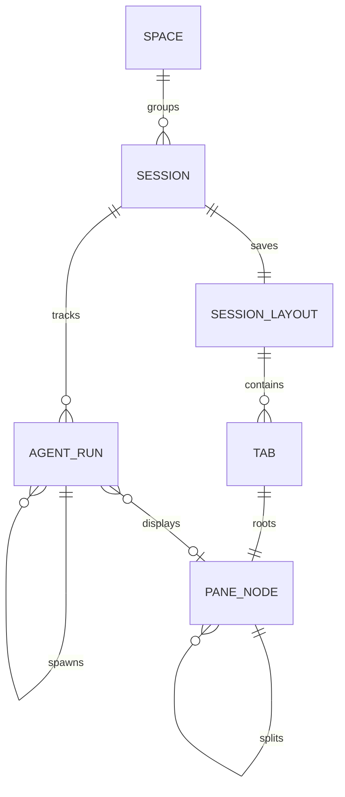

# Domain model and ownership

> Contract for ukk's durable product metadata in the Go implementation. The
> implemented store is `apps/desktop/internal/workspace`: one JSON document per
> user, owned by the Desktop process, with atomic replacement and revision CAS.
> The bridge keeps a read-only mirror of that document for remote clients.
> [tech-design](../tech-design.md) and
> [mygo-implementation](../goals/mygo-implementation.md) describe the same split.
> What is verified, and on which commit, is recorded in
> [status](../status.md).

## Entities

| Entity | Go type | Identity | JSON document key | Lifetime |
| --- | --- | --- | --- | --- |
| Space | `workspace.Space` | UUIDv4 | `spaces[]` | Durable; owns a project root (no delete path implemented) |
| Session | `workspace.Session` | UUIDv4 | `sessions[]` | `active ↔ paused → archived`; not tied to a window |
| AgentRun | `workspace.AgentRun` | UUIDv4 | `agents[]` | Metadata binding; its existence is **not** proof the process is live |
| SessionLayout | `workspace.SessionLayout` | Session id | `layouts[session_id]` | Presentation state per Session |
| Tab | `workspace.Tab` | UUIDv4 | inside `SessionLayout.tabs[]` | View composition |
| PaneNode | `workspace.PaneNode` | UUIDv4 | inside `Tab.root` | Binary split tree leaf/split |

A Space is a named project root. A Session is the human work context that
groups AgentRuns. A Tab/Pane is presentation: it references a surface and
optionally an AgentRun, and it never owns a process, terminal or provider
child. The herdr-core terminal (`core_id` + `terminal_address`) is referenced by
an AgentRun, not redefined here; herdr-core remains the process authority.



This is the ukk application model, not herdr-core's internal schema. Device
identity, pairing grants and plugin grants live in the bridge's trust/grant
records, not in this document (see [security](security.md) and
[plugins](plugins.md)).

## Persistence

### Location and permissions

`Open` takes a directory from its caller; the per-user data directory follows
the bridge's resolution rules: `UKK_DATA_DIR` when set, otherwise
`~/Library/Application Support/ukk` on macOS, `%AppData%\ukk` on Windows and
`$XDG_CONFIG_HOME/ukk` (falling back to `~/.config/ukk`) elsewhere. The store
creates its directory `0700` and writes `workspace.json` `0600`. A process that
can read the same user's files can read this metadata; file permissions are not
a boundary against same-user code.

### Document

```json
{
  "revision": 1,
  "mutation": 42,
  "spaces": [],
  "sessions": [],
  "agents": [],
  "layouts": {}
}
```

- `revision` is the **schema** revision and must equal 1. An unknown revision is
  `ErrInvalid`; a document that cannot be decoded is an error, never silently
  discarded or reset.
- `mutation` is the committed-mutation counter. `Snapshot().Revision` exposes it
  so clients can detect that state moved, and it is not a substitute for the
  per-layout compare-and-swap revision.
- Arrays are emitted in insert order. `Snapshot()` sorts Spaces, Sessions and
  Agents by `created_ms` and returns deep copies, including every layout tree.

### Atomic replace

Every mutation is serialized by the store mutex and persisted before it is
acknowledged:

1. encode the whole document with two-space indentation plus a trailing newline;
2. create `.workspace-*.tmp` in the same directory, chmod `0600`;
3. write, `fsync`, close;
4. `rename` over `workspace.json` (atomic replace on the same filesystem);
5. best-effort `fsync` of the directory.

A failure at any step restores the in-memory record and returns the error; no
subscriber is notified. Because the document is rewritten in full, cost grows
with the number of records. Bounded event logs, cursors, idempotency records and
durable audit are **not** in this document yet; they are target work recorded in
[mygo-implementation](../goals/mygo-implementation.md), not current behavior.

### Open-time validation

`Open` validates the loaded document before serving it:

- Space and Session ids are non-empty and unique; every Session names an
  existing Space.
- Every AgentRun names an existing Session, has a non-empty `core_id` and
  `terminal_address`, and no two AgentRuns share the same
  `(core_id, terminal_address)` pair.
- Every layout names an existing Session and passes layout validation.
- A missing `workspace.json` is a new, empty workspace; a missing store
  directory is created `0700`.

### Bridge mirror

The bridge does not open the store. It keeps `workspace.mirror.json` in its data
directory as a read-only copy for remote clients:

- `workspace.set` accepts a JSON object up to 1 MiB, validates that it is a
  JSON object, persists it atomically with `0600`, and updates the in-memory
  copy only after the write succeeds.
- `workspace.get` returns the last accepted mirror, or
  `{"spaces":[],"sessions":[],"agents":[],"layouts":{}}` when none was ever
  published.
- The bridge never edits product metadata. A malformed mirror on disk is an
  error at open, not an empty workspace, and a mirror over the limit is refused.
- Remote clients therefore see what the Desktop last published. The mirror is
  not an authority for bindings, lifecycle or layout revisions; those decisions
  stay with the owning store.

## Identities and records

### Space

| Field | Rule |
| --- | --- |
| `id` | UUIDv4 from `crypto/rand`; rejected if empty or duplicated on load |
| `title` | trimmed, 1–200 runes (`ErrInvalid` outside the bound) |
| `project_root` | trimmed, 1–4096 runes; the stored string is not normalized |
| `created_ms` | Unix milliseconds, set once at creation |

`CreateSpaceWithID(id, title, projectRoot)` is the idempotent path: the same id
with the same inputs returns the existing Space, and the same id with different
inputs is a conflict. `CreateSpace` is the convenience path with a fresh UUID.
`RenameSpace` changes only the title.

### Session

| Field | Rule |
| --- | --- |
| `id` | UUIDv4; unique |
| `space_id` | must name an existing Space |
| `title` | trimmed, 1–200 runes |
| `lifecycle` | `active`, `paused` or `archived`; any other value is `ErrInvalid` |
| `created_ms`, `updated_ms` | creation time and last lifecycle commit |

`CreateSession` adds one Session and its default layout in one commit. The
default layout is a single tab titled `Session` containing one `conversation`
leaf; `active_tab` starts empty.

`SetSessionLifecycle` changes only lifecycle metadata and `updated_ms`. It never
attaches, signals, pauses or stops a terminal or Agent. Archiving a Session is
therefore reversible UI state, not process control.

### AgentRun

| Field | Rule |
| --- | --- |
| `id` | UUIDv4, generated by `BindAgent` |
| `session_id` | must name an existing Session |
| `parent_id` | optional; must name an AgentRun **in the same Session** |
| `core_id` | non-empty herdr-core identity |
| `terminal_address` | non-empty terminal address within that core |
| `adapter` | provider adapter name; empty input is stored as `unknown` |
| `status` | observation state, initial value `unknown` |
| `created_ms` | set once at bind time |

`status` values are `created`, `running`, `blocked`, `finished`, `failed` and
`unknown`. The store records what a caller observed with `SetAgentStatus`,
rejects no string value, and does not poll, infer or transition on its own;
producers are responsible for using this vocabulary. `unknown` means "not
currently observed", never "stopped".

`UnbindAgent` removes only the metadata row and clears `parent_id` on direct
children; it is not a stop, kill or terminal operation. Detaching a view is
never an `UnbindAgent` call.

### SessionLayout, Tab and PaneNode

```json
{
  "session_id": "…",
  "revision": 7,
  "tabs": [
    {
      "id": "…",
      "title": "Session",
      "root": {
        "id": "…",
        "kind": "split",
        "split": "row",
        "ratio": 0.5,
        "first": {"id": "…", "kind": "leaf", "surface": "conversation"},
        "second": {"id": "…", "kind": "leaf", "surface": "terminal", "terminal_address": "t7"}
      }
    }
  ],
  "active_tab": "…",
  "updated_ms": 1762550000000
}
```

A `PaneNode` is either a leaf (`kind: "leaf"`, one surface, optional
`agent_run_id` or `terminal_address`) or a split (`kind: "split"`, `split` is
`row` or `column`, two children and one ratio for the first child). A
`terminal_address` leaf shows a herdr-core terminal that no AgentRun owns, such
as a shell the Desktop started in a Space root; it is a view reference, not
process ownership, and closing the pane only detaches. Limits, enforced by
`PaneNode.Validate` at load and on every save:

| Limit | Value | Failure |
| --- | --- | --- |
| Leaves per tree | 16 | `ErrInvalid` |
| Nesting depth | 8 (root = 1) | `ErrInvalid` |
| Split ratio | 0.15–0.85 inclusive | `ErrInvalid` |
| Leaves per split | exactly two children | `ErrInvalid` |
| Leaf surfaces | `conversation`, `terminal`, `files`, `diff`, `screen`, `activity` | `ErrInvalid` |
| Tab count | at least one, unique ids, non-empty titles | `ErrInvalid` |
| `active_tab` | empty or an existing tab id | `ErrInvalid` |

`SplitLeaf` and `CloseLeaf` validate the input and return the updated root (or
`nil` when the last leaf is closed); the walk updates the tree it is given, so
callers must treat a stored layout as store-owned and work on a copy. Neither
performs a process, terminal or Agent action. Closing a leaf promotes its
sibling. Unknown leaf ids return `ErrNotFound`. Closing the last leaf yields no
tree, and a layout must still contain at least one tab with a valid root, so
that result cannot be saved as a Session layout.

### Revision compare-and-swap

`SaveLayout(sessionID, layout, expected)` replaces a layout only when
`expected` equals the stored layout `revision`. On success the stored revision
is incremented, `updated_ms` is refreshed and the response is the persisted
copy. A stale revision returns `ErrConflict`; callers reload and reapply rather
than overwriting a concurrent edit. The layout's `session_id` is always taken
from the argument, never from caller-supplied layout content.

## Lifecycle and binding rules

1. **View close detaches.** Closing a Pane, Tab, Session view or window has no
   store mutation that reaches a terminal or Agent. Only explicit user intent
   with agent control may stop execution.
2. **Binding is explicit.** An AgentRun is created only by an explicit bind of
   an already-running herdr-core terminal. Callers must verify the live core
   identity **before** calling `BindAgent`; the store enforces metadata
   integrity only.
3. **No orphan adoption.** A terminal that appears in a core snapshot is not
   bound automatically, and an AgentRun is never created from "orphan terminal
   count", pane selection or a heuristics pass. Unbound terminals remain
   unbound until the user binds them; a stale binding stays visible as stale.
4. **One binding per terminal.** `(core_id, terminal_address)` may map to one
   AgentRun. Rebinding returns `ErrAlreadyBound`; the same address under a
   different core is a different terminal.
5. **Parenting is within a Session.** A child AgentRun may name a parent in the
   same Session. A cross-Session parent is `ErrInvalid`.
6. **Archive is not stop.** `archived` Sessions keep their AgentRuns and
   terminals untouched; reopening only flips lifecycle metadata.
7. **Unknown is honest.** `unknown` and `failed` are observation states. The
   store never converts them into a completed, stopped or restarted claim.
8. **No result implies execution.** A successful store commit proves durable
   metadata, not that an Agent ran.

## Ownership and concurrency

| Information | Owner | Client rule |
| --- | --- | --- |
| Terminals, processes, reported program status | herdr-core | Reference by `core_id` + `terminal_address`; never infer from text |
| Spaces, Sessions, AgentRuns, layouts | `internal/workspace`, owned by the Desktop process | Mutate through store commands; render snapshots. The bridge serves a read-only mirror to remote clients |
| Provider turns, tool calls, approvals | Provider adapter in the bridge | Typed provider semantics only |
| Window, pane focus, floating tile position, selected tab | Each client | Ephemeral; not durable here |

- One `Store` serializes all mutations. Reads return deep copies, so a caller
  cannot mutate committed state without a store method.
- `Subscribe` returns a size-1 notification channel signalled after each
  committed mutation. A slow subscriber loses intermediate notifications; the
  next snapshot is authoritative. `Close` releases subscribers and does not
  touch any Agent.
- Revision CAS is required for layout writes from multiple clients. Losing the
  race is `ErrConflict`, never a silent merge.
- Store methods do not call herdr-core, a provider, the relay or the UI; keeping
  I/O and process decisions out of the store is what makes "binding is
  metadata" and "close never stops" enforceable.
- Startup associates nothing automatically. A restarted Desktop reloads the
  document and must re-observe core terminals before showing live state; it
  cannot promote unknown records to running. A restarted bridge reloads only
  its mirror and never becomes the metadata owner.

## Error vocabulary

| Error | Meaning |
| --- | --- |
| `ErrNotFound` | The id does not name a stored record, or an unknown leaf id |
| `ErrInvalid` | Validation failure: bounds, unknown enum, dangling reference, schema revision |
| `ErrConflict` | Layout revision does not match the stored revision, or a reused Space id arrives with different inputs |
| `ErrAlreadyBound` | `(core_id, terminal_address)` already belongs to another AgentRun |

## Implementation status

Implemented in `apps/desktop/internal/workspace`: entity validation, JSON
document persistence with atomic replace and `0600`, layout limits, validated
split/close, revision CAS, mutation notification and load-time integrity checks.
The bridge publishes a workspace mirror (`workspace.get` / `workspace.set`) and
the Desktop surfaces exist as UI packages; end-to-end wiring, remote mutation
authorization and real herdr-core binding evidence are tracked in
[status](../status.md) and the M1 gate in
[mygo-implementation](../goals/mygo-implementation.md).

Not current and not claimed: SQLite persistence, event-log cursors, idempotency
records, durable audit, automatic orphan reconciliation, and crash recovery of
provider children.

See [architecture](../tech-design.md), [security](security.md),
[plugins](plugins.md) and [requirements](../requirements.md).
