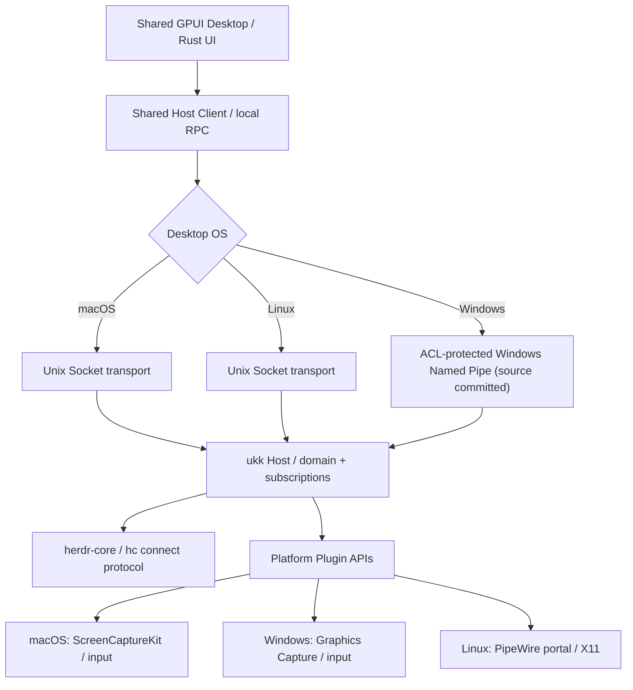

# Cross-platform support matrix / 跨平台支持约定

> 2026-11-07 · Product target is **macOS + Windows + Linux desktop at parity**, not a Mac-only application. This is a specification of intent and validation gates; it does **not** claim that every platform already builds or runs.

## Product decisions

**One Rust + GPUI Desktop codebase** targets macOS, Windows and Linux equally. Platform-specific code is isolated behind interfaces, not forked UIs. Native SwiftUI is used for iOS/iPadOS in the active delivery track. Android/Jetpack Compose and Web/TUI are deferred client candidates, with no current implementation tasks; the architecture keeps their eventual protocol access possible.

herdr-core itself supports macOS/Linux and Windows. `hc connect` exposes the same JSON-RPC text protocol across platforms; Unix uses local sockets under the hood and Windows uses named pipes. https://github.com/herdrdev/herdr-core/blob/master/schema/README.md

GPUI's `gpui_platform::application()` selects platform-specific backends:

| Desktop OS | GPUI presentation backend | Host private IPC | Host background service | Remote Screen capture | Current state in ukk |
|---|---|---|---|---|---|
| macOS | Metal; text through font-kit | Unix Domain Socket | launchd user agent (explicit `install`) | ScreenCaptureKit + VideoToolbox; Accessibility input | GPUI + local socket sources committed; native build/runtime test pending |
| Windows | Win32 + DirectWrite | SID-scoped ACL-protected Named Pipe (source committed) | current-user logon Scheduled Task (explicit `install`) | Windows Graphics Capture + Media Foundation or D3D encoder; input API review | GPUI and Host Named Pipe source committed; CI / real Windows verification pending |
| Linux | Wayland / X11; platform graphics backend | Unix Domain Socket | systemd --user service (planned) | PipeWire/portal for Wayland, X11 capture fallback; input via permission-brokered APIs | GPUI + local socket sources committed; native build/runtime test pending |

GPU rendering, text, fullscreen, tray, update, screen capture, input injection and window decorations must be tested per OS. A macOS pass does not constitute a Windows/Linux pass.

## Implementation boundaries



- **UI owns no Agent lifetime.** A window closed on any desktop OS must not stop ukk Host or herdr-core terminals.
- **OS-neutral protocol.** Same commands, events, authorization, identity and models regardless of IPC transport.
- **Windows IPC is local-only and scoped to the current user's SID.** The implementation builds an explicit protected DACL (current user + SYSTEM), rejects remote pipe clients, requires the first instance to be new, restricts the client to identification-level impersonation, and keeps bounded JSON-RPC frames. Verify on Windows CI and independently test different-user access denial before shipping.
- **No headless screen capture assumption.** A herdr-core host can run without a graphical desktop, in which case Remote Screen is unavailable but Agents continue to work.
- **Remote Screen remains an on-demand plugin**, not a navigation mode. OS capture and control permissions will differ.
- **Platform-specific components are adapters**, not reimplementations of business logic or page layouts.

## Build / test entrypoints

```bash
# Core Rust — all three platforms; independent of GPUI's heavy graphics dependencies
cargo test --workspace
cargo clippy --workspace --all-targets -- -D warnings

# Desktop — macOS, Windows and Linux each compile from same source tree
cargo check --manifest-path apps/desktop/Cargo.toml

# Local Host + Desktop (Windows uses a per-user Named Pipe, Unix uses sockets)
cargo run -p ukk-host -- serve
cargo run --manifest-path apps/desktop/Cargo.toml
```

**Windows status:** Windows Named Pipe Host/server and client **source is committed** and Windows CI passed `cargo test --workspace` + Clippy at code commit `9b28bce` (run `42392340865`); real herdr-core acceptance also passed (run `42392340910`). Pipe I/O is overlapped with a bounded deadline and `CancelIoEx`; the server and client verify each other's process token SID. Real-device validation, cross-user denial and real service installation remain NOT VERIFIED. See [Host lifecycle](../runbooks/host-lifecycle.md#evidence).

**macOS/Linux status:** the Unix socket enforces a 0700 directory, 0600 socket, same-user peer credentials and flock-guarded stale-socket recovery. The hardening tests pass in macOS and Linux CI (run `42392340865`), and real herdr-core acceptance passes on all three OS images (run `42392340910`). Cross-user denial and real service installation remain NOT VERIFIED.

## Required CI coverage

- [x] Rust core test/Clippy workflow matrix includes Ubuntu, macOS and Windows.
- [x] GPUI source build workflow matrix includes Ubuntu, macOS and Windows (with native Linux build dependencies).
- [ ] Verify CI passes on each OS and fix platform-specific compiler/toolchain issues.
- [x] Windows Named Pipe Host server/client and explicit current-user DACL (source committed; not yet verified).\n- [ ] Windows CI/test green, different-user ACL denial test, pipe hijack test, timeout/cancellation and peer verification as appropriate.
- [ ] macOS/Linux/Windows real `install`/`uninstall`/`restart` evidence and cross-user denial (source + local macOS tests committed; see [Host lifecycle](../runbooks/host-lifecycle.md)).
- [ ] End-to-end real hc snapshot/events from Windows Host and Linux Host, including reconnect and child Agent tree.
- [ ] Window close/reopen persistence, permissions, keyboard shortcuts and accessibility tested on all platforms.
- [ ] OS-specific Remote Screen privilege prompts, view/control separation and media compatibility.

## Prioritization

**All three desktops are first-class targets.** Build verification starts on all three immediately. Feature implementation can be staged to reduce uncertainty: OS-independent Host/data protocol, cross-platform local IPC, then validated UI/runtime integration on each OS. The exact shipping schedule is tied to the platform acceptance checks, not to a Mac-only MVP assumption.

Related documents: [Architecture](../tech-design.md), [Product](../requirements.md), [Runtime Spike](../spikes/runtime-spike.md), [Desktop Spike](../spikes/desktop-spike.md), [Remote Screen](remote-screen.md).

Windows transport implementation and caveats: [Windows Named Pipe runbook](../runbooks/windows-ipc.md).
