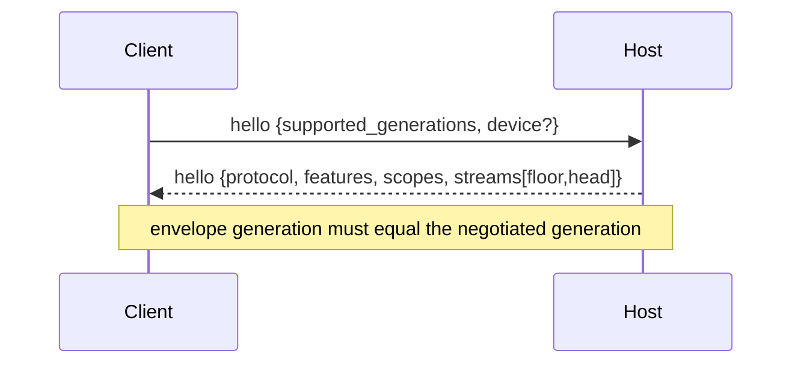
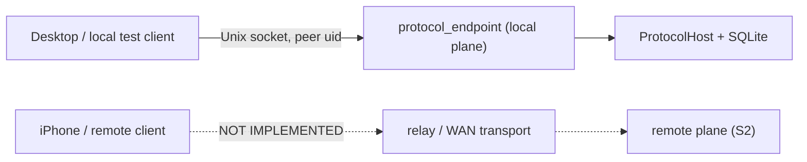

# ukk client ↔ Agent Host protocol

> Status: implemented contract for generation 1 (`crates/protocol`) · 2026-11-08.
> The Unix local streaming endpoint, SQLite hydration and transport tests are
> implemented (see [Local Host endpoint](#local-host-endpoint-implemented-unix)).
> A WAN/relay listener, TLS/E2EE and pairing cryptography remain separate
> follow-ups (S2). This document describes what the repository actually
> enforces, not an aspiration.

The protocol is independent of herdr-core's OpenRPC API and of alma-relay's
transport frame. herdr-core positions (`hc_seq`) and Host process epochs
(`host_epoch`) are **never** durable protocol fields.

## Planes and separation of concerns

| Layer | Contract | Owner |
| --- | --- | --- |
| `herdr-core ↔ hc-client` | OpenRPC, framed terminal attach, OSC 7501 status | pinned upstream |
| Desktop ↔ Host, local | user-scoped OS IPC (Unix socket / Named Pipe), OS-authenticated peer uid | H1 transport |
| Phone/remote client ↔ Host | this document: device identity, scopes, durable sync | `crates/protocol` |
| Host ↔ relay | outbound encrypted transport; relay is an untrusted router | S2 |
| Remote Screen | media path outside event history | M1 |

The two client planes share envelope types but **not** trust. A remote device
claim is rejected on the local socket, a local peer is rejected on a remote
binding, and an idempotency key first used on one plane is rejected on the
other. There is no implicit forwarding from local IPC to WAN.

## Transport framing

One UTF-8 JSON message per frame. Frames are bounded (see
[Limits](#limits-and-backpressure)). Unknown top-level fields are rejected.
The reserved names `hc_seq` and `host_epoch` are rejected explicitly with a
typed error, because accepting them would let a client believe an ephemeral
position is a durable cursor.

## Handshake



The transport establishes the plane before the hello:

* Local IPC: the transport verifies the OS peer uid and supplies it to
  `TransportBinding::local_ipc(uid)`. The hello must **not** contain a device.
* Remote: the hello must contain a `device` claim. The Host verifies it against
  the trust registry (device id, public-key fingerprint, key generation).

`accept_hello` returns the typed errors `SessionError::Binding`,
`SessionError::Negotiation` or `SessionError::Denial`; nothing is executed on a
failed handshake.

```json
{
  "type": "hello",
  "request_id": "6f1c…",
  "supported_generations": [1],
  "device": {
    "device_id": "9d2a…",
    "key_fingerprint": "sha256:…",
    "generation": 3
  }
}
```

```json
{
  "type": "hello",
  "protocol": 1,
  "request_id": "6f1c…",
  "features": ["agent.approval", "events.durable_sync", "screen.preview"],
  "scopes": ["agent.send", "session.observe"],
  "streams": [{"stream": "workspace", "floor": 40, "head": 912}]
}
```

Generation negotiation picks the highest generation offered by the client that
the Host serves (`ProtocolRange`, currently `1..=1`). Empty offers, generation
`0` and disjoint ranges fail closed. A negotiated connection rejects any
envelope carrying a different generation.

Features are capability hints only. An unsupported feature is visibly
unavailable; it is never emulated by scraping terminal output.

## Commands

```json
{
  "type": "command",
  "protocol": 1,
  "request_id": "cdd1…",
  "idempotency_key": "0e4b…",
  "issued_at_ms": 1762550000000,
  "command": {
    "command": "agent_send",
    "session_id": "…",
    "agent_run_id": "…",
    "text": "Run the tests",
    "expected_revision": 7
  }
}
```

Envelopes do not carry a device id or plane. Those are fixed by the
authenticated handshake and cannot be re-declared per message.

### Command set

| Command | Payload | Required scope (remote) | Class |
| --- | --- | --- | --- |
| `session_create` | `space_id`, `title`, `expected_revision?` | `session.manage` | idempotent mutation |
| `agent_send` | `session_id`, `agent_run_id`, `text`, `expected_revision?` | `agent.send` | idempotent mutation |
| `approval_respond` | `session_id`, `approval_id`, `decision`, `revision` (must be > 0) | `approval.respond` | human decision |
| `pointer_input` | `session_id`, `lease_id?`, `events[1..=32]` | `screen.control` + live lease | ephemeral input |
| `device_revoke` | `device_id` | `device.manage` | idempotent mutation |

Local OS owners do not need device grants, but every command still passes
semantic validation and replay classification. Approvals and pointer input can
never be queued for automatic reconnect replay.

### Result classification

`Accepted` means durably dispatched, not finished. `Completed` means semantic
completion where the adapter reports it. `Rejected` carries a typed denial.
Acceptance is never displayed as task completion.

```json
{"type":"result","request_id":"cdd1…","replayed":false,
 "result":{"status":"accepted","dispatch_id":"…"}}
```

## Durable event sync

Events are ordered only per stream. There is no cross-stream or cross-Host
total order, and a dropped heartbeat never means "done".

```json
{
  "type": "event",
  "protocol": 1,
  "event_id": "b71e…",
  "stream": "workspace",
  "cursor": 913,
  "emitted_at_ms": 1762550000123,
  "event": {
    "event": "agent_run_status_changed",
    "session_id": "…",
    "agent_run_id": "…",
    "status": "waiting_for_approval",
    "revision": 8
  }
}
```

### Cursor invariants

* `DurableCursor` is assigned only by the Host event log. It is a per-stream
  monotonic `u64` and survives Host and herdr-core restarts.
* `hc_seq`, `host_epoch` and any process-local revision are not cursors. Durable
  messages and checkpoints reject those field names.
* A client persists `CursorCheckpoint {stream, cursor}` after applying events.
  Checkpoints refuse to move backwards.
* Restoring a log requires the durable head and retention floor; the next event
  continues at `head + 1`, never at 1. Non-contiguous or inconsistent durable
  records are rejected.
* A cursor beyond the head is a typed protocol error, never a silent reset.

### Resume and gap recovery

```json
{"type":"subscribe","protocol":1,"stream":"workspace","cursor":912,"max_batch":256}
```

The Host answers with ordered `event` frames. Resume outcomes:

| Cursor vs log | Outcome |
| --- | --- |
| `> head` | `CursorBeyondHead` error |
| `< floor` (history pruned) | snapshot required at current head |
| `== floor` or between floor and head | replay events `> cursor`, up to `max_batch` |

A snapshot is bound to a cursor. The client applies the snapshot body, persists
`at_cursor`, then resumes from it. `EventInbox::apply_snapshot` (or
`EventInbox::resume_from`) positions the deduplication window at the snapshot
cursor and clears the recent-id window; without it the first post-snapshot
event would look like an out-of-order gap. A snapshot behind the applied cursor
is refused. A snapshot body is an opaque JSON object owned by the Host domain
layer.

```json
{"type":"snapshot","protocol":1,"stream":"workspace","at_cursor":912,
 "revision":41,"body":{"sessions":[]}}
```

Delivery is at-least-once. Clients deduplicate by deciding whether a cursor is
already applied and by remembering a bounded window of recent `event_id`
values. The same event id at a different cursor is an `InconsistentReplay`
error, not a duplicate.

ACKs are advisory: `{"type":"ack","protocol":1,"stream":"workspace","cursor":913}`.
Losing an ACK causes redelivery and client-side deduplication, never a second
semantic effect.

## Idempotency

Every command carries an `idempotency_key`. The Host records:

`(key) → (command fingerprint, plane, authenticated principal, result?)`

* Same key, same command, same principal and plane → the original
  classification is returned with `replayed: true`; the command is not executed
  again. An in-flight attempt returns `Duplicate {result: null}`.
* Same key with a different command → `fingerprint_mismatch`.
* Same key from another principal (device/local owner) → `cross_principal`; a
  key can never leak another peer's result.
* Same key on the other plane → `cross_plane`.
* The store is bounded and refuses new keys at capacity. It never evicts a
  record silently, because eviction re-enables duplicate execution.
* **In-flight records never expire.** A command whose result is not yet
  classified remains a duplicate (`result: null`) no matter how old it is.
  Dropping it would let a retry execute a second time. An abandoned in-flight
  record is resolved by Host reconciliation, not by silent expiry.
* **Completed records expire into tombstones.** The retention window starts at
  completion. After it, the result is dropped but the key remains: a retry is
  refused with the typed `expired` error, never treated as a first attempt.
  Tombstones still consume capacity, so capacity exhaustion remains a visible
  typed refusal rather than a correctness regression.
* The reconnect queue applies the same window. It rejects commands older than
  the idempotency retention (or far in the future) and discards entries that
  aged out before drain. A queued command is therefore never replayed after the
  Host would refuse its key.

The fingerprint is the canonical serialized command, excluding request id,
timestamp and the key itself.

## Authorization

Scopes are explicit, additive and server-side:

| Scope | Grants |
| --- | --- |
| `session.observe` | subscribe to durable events and read Sessions |
| `session.manage` | create/archive Sessions |
| `agent.send` | dispatch text to an Agent |
| `approval.respond` | answer a structured approval |
| `screen.view` | see that a screen is available |
| `screen.control` | inject input behind a controller lease |
| `plugin.invoke` | invoke an installed plugin command |
| `device.manage` | pair, rotate or revoke devices |

Authorization is re-evaluated against the live trust registry on **every**
command, every subscription request **and every outbound event batch**.
Transports must call `ProtocolService::authorize_delivery(session, now)` before
sending each batch; a denial closes the open subscription. Cached permissions
from the handshake are never authoritative, so revocation, key rotation and
grant expiry take effect on the next command or delivery batch. Authorization
runs before idempotency lookup, so an unauthorized retry cannot discover a
previous result.

### Reconnect replay queue

Only idempotent mutations may be queued. `approval_respond` and `pointer_input`
are refused at enqueue time, so reconnection cannot approve an action or inject
input the user never repeated. Queue entries are stamped with `issued_at_ms`;
enqueue and drain reject entries outside the idempotency retention window. A
stale entry is discarded rather than replayed, because the Host would refuse its
expired key and executing it would reintroduce a duplicate side effect.

### Device identity and rotation

A device is `(device_id, public-key fingerprint, generation)` plus grants bound
to that generation and an absolute expiry. Typed denials distinguish:

* `unknown_device`, `device_revoked`, `forged_identity` (wrong fingerprint or a
  future generation), `stale_identity` (older key generation or a session
  minted before rotation), `missing_scope`, `grant_expired`, `plane_mismatch`.

Key rotation increments the generation and drops all grants; the device must be
re-granted. Revocation clears grants, invalidates sessions and withdraws
controller leases.

### Remote input

`pointer_input` requires `screen.control` **and** an active controller lease
matching the device and Session. Leases are issued only by an explicit local
action, expire in absolute time (max 10 minutes) even if the phone vanishes,
and are withdrawn on device revocation. Missing, expired and mismatched leases
all produce distinct typed denials.

## Durable persistence (SQLite adapter)

`crates/store` schema v3 persists the S1 state that must survive a Host restart.
The protocol crate remains the source of cursor, trust and idempotency
semantics; the store only assigns cursors transactionally and reloads typed
records. It adds no transport and no permission surface.

| Table | Holds | Key invariant |
| --- | --- | --- |
| `event_streams` | per-stream generation, `head`, retention `floor` | one row per stream; generation must equal the current protocol |
| `event_log` | `(stream, cursor)`, event id, generation, payload JSON | cursor and event id are unique per stream; append is one `IMMEDIATE` transaction |
| `devices` | device id, public-key fingerprint, generation, revoked | revocation/rotation CAS on generation |
| `device_grants` | scope, generation, absolute expiry | grants are cleared on rotation/revocation |
| `idempotency_records` | key, fingerprint, plane, principal, state, result, timestamps | in-flight never expires; completed becomes a tombstone; capacity refuses |

* **Append.** `Store::append_event` reads the stream under `BEGIN IMMEDIATE`,
  assigns `head + 1`, validates the typed event with `Limits`, inserts the row
  and advances `head` in the same commit. A duplicate event id, an oversized
  payload, a different stored generation or cursor exhaustion is refused before
  the head moves. Retention prunes oldest rows and advances `floor`; the floor
  never moves backwards.
* **Read.** `Store::read_events` returns the protocol's own `Resume`:
  `CursorBeyondHead`, `SnapshotRequired { at_cursor: head }` below the floor, or
  contiguous `Events`. Corrupt gaps, generation mismatches and stale payloads
  are rejected instead of silently resetting.
* **Snapshot boundary.** `Store::snapshot_at_head` binds a domain-owned body to
  the current durable head and validates the protocol snapshot size.
* **Trust.** `Store::load_trust_registry` hydrates `TrustRegistry` from
  `devices`/`device_grants`; no authorization decision is reimplemented.
  Rotation bumps the generation and deletes grants; revocation sets the terminal
  status and deletes grants. Both are compare-and-swap on the expected
  generation, so a stale writer cannot affect a newer key.
* **Idempotency.** `begin_idempotent_command` runs purge → lookup → capacity →
  insert in one `IMMEDIATE` transaction. Concurrent retries get exactly one
  `Execute`. The same key with another plane, principal or fingerprint is a
  typed conflict. Completed records expire into tombstones after retention;
  in-flight records never expire; tombstones still consume capacity.

No private key, pairing secret or session key is stored. Device rows contain
only public identity metadata (fingerprint) and grant policy.

**NOT VERIFIED:** Host RPC/transport wiring, relay/WAN delivery, OS keychain
storage, real phone/relay reconnect, and multi-process contention beyond the
SQLite busy timeout are not exercised by this adapter. The contract is tested
through SQLite reopen, concurrent begin, CAS conflict and migration tests in
`crates/store`.

## Local Host endpoint (implemented, Unix)

`crates/host/src/protocol_endpoint.rs` serves this protocol over a same-user
Unix Domain Socket; `crates/host/src/protocol_service.rs` hydrates
`ukk_protocol::ProtocolService` from SQLite and owns admission/delivery. The
endpoint starts with `ukk-host serve` and is independent of the existing
newline-delimited JSON-RPC socket, whose semantics are unchanged.

| Property | Implemented behavior |
| --- | --- |
| Path | `~/.ukk/run/agent-host.protocol` (sibling of `agent-host.sock`). `UKK_PROTOCOL_SOCKET` overrides it; with `UKK_SOCKET` set the sibling stays in that private directory |
| Authorization | socket mode `0600` in the `0700` run directory; `SO_PEERCRED`/`getpeereid` verifies the peer uid before any frame; the verified uid is the `TransportBinding::local_ipc` principal |
| Framing | 4-byte big-endian length + UTF-8 JSON body. Not newline JSON. The declared length is checked against `Limits::max_envelope_bytes` (64 KiB) before the body is read or allocated |
| Handshake | first frame must be `hello`; commands/subscriptions before it are refused. A device claim on this local binding is `plane_mismatch` |
| Streams | one durable stream, `workspace`; the `hello` reply carries its persisted `floor`/`head`. Live and replay frames are ordered by the event log cursor. Session commands and the herdr-core status bridge append to this stream, and open subscriptions receive the new cursor live |
| Snapshot | a cursor below the retention floor yields a `snapshot` at the durable head whose body is the Host's durable workspace snapshot; the client resumes at `at_cursor` |
| Commands | The **local plane is read-only** in this slice: every `command` frame is refused before admission, because the merged wire has no local capability field and the JSON-RPC mutations require the rotated per-Host `LocalAuth` token. The command/idempotency path remains implemented and tested on the remote plane (`session_create` + `device_revoke`); it becomes reachable in production only when S2 authenticates a device. `agent_send`, `approval_respond` and `pointer_input` are also refused; they belong to the separate runtime-control and controller-lease surfaces and are never reported as `accepted` |
| Idempotency | `Store::begin_idempotent_command`/`finish` are the durable authority; the in-memory `IdempotencyStore` in `ProtocolService` is bypassed to avoid two sources of truth. A retry across a Host restart returns the stored result with `replayed: true`. Input that cannot execute (unknown Space, non-UUID request id, unknown device) is rejected before admission, and an execution failure aborts its in-flight record so a retry is not permanently burned |
| Delivery | `authorize_delivery` runs before every outbound batch, including an idle live stream. Revocation, key rotation or grant expiry sends a typed `error` and closes the subscription/connection |
| Bounds | 16 concurrent connections, `max_queue_depth` outbound frames per connection (a non-draining client is closed), 60 s idle deadline for pre-handshake, non-subscribing and partial-frame connections, 10 s write deadline, 256-event replay batches |

The 40 ms live poll means a newly appended event reaches an open subscription
without a reconnect; replay itself is served from SQLite in bounded batches.
Acknowledgements are advisory and tracked per connection with a monotonic
check; no per-client checkpoint is persisted by this slice.

Why the local plane does not carry mutations: the existing JSON-RPC workspace
mutations require a short-lived per-Host capability, and the merged protocol
wire has no field for it. Executing `session_create` on same-user peer identity
alone would create a local RPC path stronger than the capability-gated one.
The durable command/idempotency adapter stays in the binary and is exercised
through the test-only remote binding; production local clients use the
JSON-RPC endpoint for mutations until a protocol-level local capability is
designed.

The herdr-core runtime broker stays on the JSON-RPC plane for its snapshot
API. A bridge (`crates/host/src/protocol_bridge.rs`) additionally publishes a
structured terminal status change as `agent_run_status_changed` on the durable
`workspace` stream **only when the terminal is already bound to a persisted
`AgentRun`**. Unbound terminals never gain an Agent identity, and the broker's
`hc_seq`/`host_epoch`/revision are never used as cursors: the Store assigns the
durable cursor. Mapping is deliberately narrow — `working`→`running`,
`idle`→`idle`, everything else (including `blocked`)→`unknown`, because an
approval must never be inferred from terminal status.

### Local vs WAN separation



There is **no TCP listener** and no forwarding from the local socket to a
remote plane. `EndpointPlane::RemoteForTests` exists only under `cfg(test)` to
exercise device grants, unauthorized commands and mid-stream revocation over
the same socket; production constructs `EndpointPlane::Local` only.

**NOT VERIFIED in this slice:** local command execution (intentionally disabled
until a protocol-level local capability exists; the adapter is exercised on the
test-only remote plane, which is not reachable from production builds); a
Windows Named Pipe implementation of this streaming endpoint (the shared logic
compiles and is unit-tested on all three OSes, but no Windows protocol listener
exists); a real relay/TLS/WAN listener; pairing proof-of-possession; OS key
storage; iOS client integration; and cross-account peer denial beyond the
existing single-user runbook.

## Limits and backpressure

Default bounds (`Limits`); all are configurable and validated at startup:

| Bound | Default | Enforced |
| --- | --- | --- |
| encoded envelope | 64 KiB | before parse and before send |
| command/event payload | 32 KiB | encode and decode |
| snapshot | 4 MiB | snapshot frame |
| reconnect queue depth | 256 | enqueue |
| retained events | 4096 | append (prunes oldest, advances floor) |
| idempotency records | 4096 | admit (refuses, never evicts) |
| idempotency retention | 10 min | completed records → tombstones, queue freshness; in-flight never expires |
| replay batch | 256 | subscribe |

Endpoint names not listed here are not part of generation 1. Terminal bytes and
screen media use separate channels and never enter event history.

## Security notes

* The relay is an untrusted router. Device grants are verified at the Host, not
  by the relay.
* Local IPC is a separate trust domain with OS peer authentication; it is never
  exposed on a network listener.
* Structured approvals are never inferred from ANSI output, and a reconnect
  never replays an approval or pointer input.
* Pairing cryptography, E2EE and replay protection at the transport layer are S2
  work; this crate defines and tests the authorization and synchronization
  contract those transports must call.

See [security](security.md), [pairing](pairing.md),
[live events](../spikes/live-events.md), [domain model](domain-model.md).

## Contract tests

`crates/protocol/tests`:

* `wire.rs` — round-trip of every client/server message, tagged wire shape,
  reserved ephemeral field rejection, unknown field rejection (including inside
  tagged command/event/pointer payloads), version negotiation mismatch,
  generation mismatch, oversized command/event/snapshot, mandatory approval
  revision.
* `sync.rs` — two independent reconnecting clients, dropped ACK with dedup and
  backward-checkpoint refusal, out-of-order delivery, event-id reuse, retention
  gap → snapshot → inbox positioning → next event, cursor monotonicity across
  two restarts, rejection of non-contiguous/squeezed/generation-mismatched
  durable logs, cursor beyond head.
* `security.rs` — mid-session revocation, revocation/expiry/rotation stopping an
  **open delivery stream**, stale/forged/unknown identity, key rotation
  invalidating sessions, duplicate/idempotent commands, principal- and
  plane-scoped keys, approval/pointer replay refusal, pointer scope and lease
  checks, local/WAN plane separation, expired grants, lease withdrawal.
* `retention.rs` — in-flight records never expire; completed records become
  tombstones that refuse retries; capacity is refused rather than evicting;
  stale/future queued commands are rejected/discarded; the service refuses a
  post-retention retry instead of re-executing.

`crates/host` (real Unix socket, in-crate `protocol_endpoint/tests.rs`):

* `hello_negotiates_generation_and_rejects_incompatible_versions` — handshake
  bounds and disjoint-generation refusal.
* `subscribe_replays_batches_snapshots_pruned_history_and_streams_live` — ordered
  replay, cursor-beyond-head error, retention snapshot, live cursor continuation.
* `command_idempotency_never_executes_twice` — remote-plane durable retry
  classification and fingerprint conflict; the local plane refuses commands and
  burns no idempotency record.
* `handshake_is_required_and_remote_commands_need_their_scope` — pre-handshake
  refusal, local device-claim rejection, remote `missing_scope`.
* `revocation_and_grant_expiry_terminate_an_open_stream` — live revocation,
  external-store revocation (proving per-batch registry reload) and absolute
  grant expiry close delivery with typed denials.
* `oversized_and_malformed_frames_are_rejected` — length-prefix bound, malformed
  JSON/UTF-8/empty frames, connection remains usable after recoverable errors.
* `reconnect_resumes_from_the_persisted_cursor` — disconnect, bounded replay,
  resume at head, next live cursor.
* `events_and_idempotency_survive_a_host_restart` — SQLite reopen preserves
  event ids/cursors and the completed idempotency record.
* `protocol_service` unit tests — trust hydration from `devices`/`device_grants`,
  durable idempotency, generation mismatch before execution, local-command
  refusal, execute-failure abort, per-authorization trust reload, and
  broker-status publication only for the exact `(core_id, terminal)` AgentRun;
  these compile and run on all three OSes.
* `crates/host/tests/protocol_stream.rs` — the shipped `ukk-host serve` process
  derives the sibling endpoint path, hydrates the seeded database and answers
  `hello`/`session_create`/`subscribe` over a raw client.
* `crates/host/tests/protocol_bridge.rs` — a mock herdr-core status stream
  (`status.state=working`) becomes a durable `agent_run_status_changed` event
  on the socket; `blocked` is unit-tested to map to `unknown`, never an
  inferred approval.

`crates/store` (schema v3):

* `s1_tests.rs` — event log reopen with continued cursors, cursor regression,
  retention floor/snapshot boundary, duplicate event id, generation mismatch,
  device grants across reopen/expiry, rotation/revocation CAS invalidation,
  concurrent idempotency begin, tombstone expiry, capacity refusal, and v2→v3
  migration with workspace data preserved.
