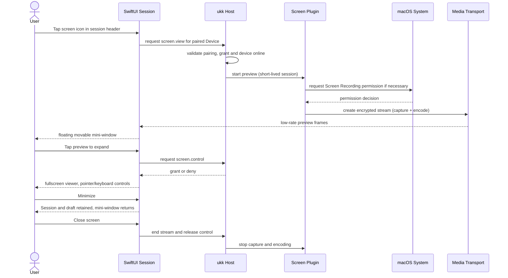
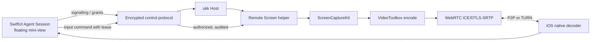

# Remote Screen plugin — small floating capability, not a separate mode

## Intent

The iOS companion remains in a normal multi-agent session. A small, optional floating live-screen preview can be opened, dragged, minimized and tapped to expand. Expand enters a dedicated **temporary** full-screen viewer for direct computer interaction. Closing returns to the exact previous session position and draft.

**Never add a persistent "Remote Desktop" main tab or replace the core Agent interface.**

> **Implementation status (2026-11-08):** two bounded pieces exist. First, a
> macOS ScreenCaptureKit **capture spike** under `plugins/remote-screen/` —
> metadata listing plus one-frame, display-only `capture-once`. Second,
> `crates/media` implements the **versioned signalling, view/control grant and
> controller-lease contract** with mock peers. There is still **no OS capture
> adapter for Windows/Linux, no input control, audio capture, real media
> transport, WebRTC/DTLS-SRTP/TURN path, Host/GPUI or iOS wiring**. Everything
> below describes the target product, not implemented behavior. See
> [Capture spike](#capture-spike-m1-macos-only) and
> [M1 media/signalling contract](#m1-mediasignalling-contract-implemented-mock-tested)
> for the exact boundaries.

## Interaction sequence



## Proposed UI

- **Collapsed:** 16:9 floating tile in Session detail, video view, live/offline status, a one-tap expand and close action, draggable within safe area. Never obstruct send button permanently.
- **Expanded:** use available screen space; pan/zoom, trackpad-style pointer, tap-to-click, keyboard, scroll, screen selection; visible end control.
- **Switching session:** preview may remain pinned to a Device with clearly displayed context; default should minimize/stop rather than silently changing the target.
- **Reduced data:** throttle preview frames/resolution; stream audio only if separately authorized; stop media when tile is dismissed or after inactivity.
- **Disconnected:** keep session chat responsive, show 'Device offline', retry deliberately instead of replaying stale pointer events.

## Capture spike (M1, macOS only)

### What is implemented

| Path | Purpose |
|---|---|
| `plugins/remote-screen/plugin.toml` | Schema-v1 manifest declaring only `screen.view` and one session-scoped `screen.capture.once` command. No UI view, no event subscription, no `screen.control` or `screen.audio`. |
| `plugins/remote-screen/macos/` | Self-contained SwiftPM executable `ukk-remote-screen-helper` linking ScreenCaptureKit. |
| `.github/workflows/remote-screen-macos.yml` | Builds and tests the helper on `macos-latest` and asserts that the real-capture test skips honestly. |

The helper exposes three commands. None of them injects input, captures audio,
opens a media transport or keeps frames after the requested write:

| Command | Behavior |
|---|---|
| `list-displays` | Prints display id, size and origin as JSON. Metadata only; no pixels. |
| `list-windows` | Prints window id, title, owning application, layer and frame as JSON. Metadata only; no pixels. |
| `capture-once --display <id> --out <file.png>` | Uses `SCScreenshotManager.captureImage` to take exactly one frame from one display and writes one PNG. Audio is explicitly disabled (`capturesAudio = false`); there is no stream, no frame callback and no retained frame. |

Exit states are stable so a future host adapter does not parse English:

| Exit | Meaning |
|---|---|
| `0` | Success. |
| `2` | Usage error, invalid display id, or unsafe output path. |
| `3` | Unsupported macOS version. `capture-once` needs macOS 14+ (`SCScreenshotManager`); the package builds on macOS 13 so it can fail explicitly instead of at load time. |
| `4` | Screen Recording permission denied (`userDeclined` or missing entitlement). |
| `5` | ScreenCaptureKit capture failure, including no matching display. |
| `6` | JSON or PNG output could not be written. |

The output path guard is part of the contract: paths are capped at 1024 UTF-8
bytes and must end in `.png`; the parent must exist and be a directory; existing
directories, symbolic links, FIFOs and other special files are refused. The PNG
is created owner-only (`0600`), encoded to a temporary sibling and atomically
renamed, so a failed encode leaves no partial or temporary frame.

### What this proves — and what it does not

Proven by code and tests (build/test evidence in CI; real capture excluded):

- the manifest is accepted by the schema-v1 validator with `screen.view` only;
- argument parsing, invalid ids, oversized/NUL/wrong-extension paths,
  missing or non-directory parents, directory/symlink/FIFO targets and atomic
  write behaviour are unit-tested;
- ScreenCaptureKit permission and error codes map to explicit exit states;
- the capture path is real ScreenCaptureKit (`SCScreenshotManager`), not a stub;
- no audio path and no frame storage beyond the requested owner-only PNG exist
  in the helper.

**Not implemented and not claimed:**

- **View versus control:** this spike declares and implements viewing only.
  `screen.control` (mouse/keyboard injection) is neither declared nor coded.
  Accessibility permission, controller leases and input audit do not exist.
- **No audio:** `screen.audio` is not declared; `capturesAudio` is always false.
- **No media product:** no WebRTC/DTLS-SRTP, VideoToolbox encode, TURN, relay,
  frame pacing, decoder, low-latency path or bandwidth adaptation.
- **No integration:** no Host RPC, GPUI surface, iOS floating overlay, plugin
  installer, grant UI, pairing check, lease issuance or audit-sink wiring.
- **No Windows or Linux adapter.** Graphics Capture and PipeWire/portal work has
  not started.
- **No production TCC identity:** an unsigned SwiftPM executable inherits the
  permission of whatever terminal or parent process launches it. A signed,
  entitlement-bearing helper bundled by the installer is required before TCC
  behaviour can be claimed.
- **Not a complete Remote Screen feature.** Do not describe this spike as
  streaming, remote control or a shipped M1.

### Permission and consent gates required before integration

1. **P1 broker grant:** `screen.view` must be granted per plugin/scope with a
   mandatory lease (≤1 hour) before the command runs; grants are absent by
   default. `screen.control` remains a separate grant and is not implemented.
2. **S2 pairing/trust:** viewing is authorized separately from Agent access and
   from device pairing. Pairing a device must not imply screen access.
3. **I1/H1 local consent and lifecycle:** an explicit local start action, a
   visible capture indicator, an immediate stop/revoke control, and a Host-owned
   helper lifecycle that cannot leave an orphaned capture process.
4. **macOS TCC:** signed helper identity, Screen Recording permission UX,
   denial and revocation detection, and an honest unsupported state when no
   display session exists.
5. **Audit:** one record per invocation with plugin/session/scope, never frame
   pixels, image contents or output-path arguments.
6. **Separate grants for every extra surface:** audio, microphone, clipboard,
   file transfer and recording each need their own grant and consent.
7. **Media gate:** an audited E2EE transport and its NAT/TURN behaviour must be
   validated before any frame leaves the machine.

### Verification status

| Claim | Status |
|---|---|
| `swift build` / `swift test` on `macos-latest` | CI evidence in the workflow run for this change. |
| CLI parsing, path safety and permission-state mapping without capture | Unit-tested; CI green. |
| Real `capture-once` on a live display | **NOT VERIFIED.** Requires Screen Recording permission and a signed identity; CI skips the test with an explicit message. |
| Real TCC denial and revocation | **NOT VERIFIED.** Only synthetic `SCStreamError` mapping is tested. |
| macOS 13 unsupported-OS branch | Code present; older-runtime execution **NOT VERIFIED**. |
| Windows/Linux capture, iOS overlay, media transport | Not started. |

Reproduce locally:

```bash
swift build --package-path plugins/remote-screen/macos
swift test  --package-path plugins/remote-screen/macos

BIN="$(swift build --package-path plugins/remote-screen/macos --show-bin-path)/ukk-remote-screen-helper"
"$BIN" list-displays
"$BIN" list-windows
"$BIN" capture-once --display <id> --out /tmp/frame.png

# Validate the manifest contract.
cargo test -p ukk-plugin-api shipped_remote_screen_capture_spike_manifest_is_valid
```

To exercise the real capture test on a manually granted machine:
`UKK_RUN_SCREEN_CAPTURE_TESTS=1 swift test --package-path plugins/remote-screen/macos --filter CaptureNotVerifiedTests`.

## M1 media/signalling contract (implemented, mock-tested)

`crates/media` (`ukk-media`) is the typed boundary between the Host control
plane and a future media transport. It contains **no capture backend, WebRTC
stack, socket, event log or clock**. Two in-memory peers exercise it in
`crates/media/tests/contract.rs`.

### Versioned signalling (v1)

One JSON object per message; `v` must be `1`; unknown fields, unknown versions,
oversized input and the array form fail closed. The envelope has exactly these
message types:

| Type | Direction | Payload |
|---|---|---|
| `offer` | Host → viewer | `media_session_id`, absolute `expires_at_ms`, capability descriptor, SDP |
| `answer` | viewer → Host | same id/expiry, negotiated capability subset, SDP |
| `ice_candidate` | both | one bounded candidate line |
| `ice_complete` | both | end-of-candidates marker |
| `pause` | Host → viewer | `screen_locked`, `app_backgrounded`, `user_paused` or `reconnecting` |
| `resume` | Host → viewer | resume media; never restores an old input lease |
| `stop` | both | terminal stop with a typed reason |
| `failed` | both | terminal failure with a typed reason |

Bounds are enforced before parsing and again on the state-machine boundary:

| Field | Bound |
|---|---|
| encoded message | 64 KiB |
| SDP | 16 KiB, must start with `v=`, no NUL |
| ICE candidate | 1 KiB, single-line printable ASCII |
| ICE URL | 2 KiB; only `stun:`, `turn:`, `turns:`; no userinfo/fragment; `transport=udp\|tcp` only |
| TURN username/credential | 512 bytes each; printable ASCII; supplied as a pair; required for `turn:`/`turns:` and forbidden for STUN-only |
| codecs | 1–16 descriptors (`name`, clock rate, channels) |
| transports | 1–2 descriptors; DTLS-SRTP is mandatory for v1 |
| ICE servers | 0–8 per capability descriptor, 1–8 URLs each |
| media session lifetime | at most 1 hour from the offer; absolute expiry, never relative |

An answer must be a codec/transport subset of the offer and must carry **no**
ICE server configuration: only the capture side supplies TURN/STUN settings.
`Sdp`, `IceCandidate`, `Credential` and `IceServer` redact in `Debug`/`Display`;
the raw TURN secret is available only through `Credential::expose_for_transport`
for the ICE adapter. Validated TURN URLs cannot contain userinfo. There is no
frame/sample/pixel variant or field, so media bytes cannot enter durable event
history or a relay payload through this contract.

### Separate grants and controller lease

| Authority | Rule |
|---|---|
| `ViewGrant` | per bound device, Session and media session; absolute expiry ≤ 1 hour and capped by the media session expiry; authorizes receiving media only |
| `ControlGrant` | minted only from a live view grant with the same device/Session/media session; expiry ≤ 10 minutes and capped by the view grant |
| `ControllerLease` | one per media session; absolute expiry ≤ 10 minutes and capped by its control grant; single-controller binding |
| Input admission | requires `connected` media state **and** live view + control + lease for the same bound device/Session/media session **and** an unlocked screen |

`HostSession` is bound to one authenticated `ViewerBinding` `(device_id,
session_id)` at construction. It must hold a live view grant before `start`, and
every inbound answer/ICE is checked against that binding plus a live view grant;
a different paired device, a device without `screen.view`, or a revoked grant
is rejected with `WrongPeer`/`ViewDenied`. The sender identity is supplied by
the transport from the authenticated handshake, never by the signalling
envelope.

`HostSession::authorize_input` is the only admission point on the capture side.
A view-only device is refused with `MissingControlGrant`; an unbound device is
refused with `WrongPeer`, and a viewer has no equivalent method at all.
`release_controller`, `revoke_view`, `revoke_control`, `revoke_device`, `lock`
and `stop` are explicit operations. Revoking a view cascades to its control
grants and lease; device revocation removes every grant and lease it held; stop
records the media session id in the Host's shared `StoppedSessions` tombstone
set, so a grant cannot be revived and a new `HostSession` cannot reuse the id.

### Pause, lock, reconnect and stop

The state machine is:

```text
Host:   Idle --offer--> OfferSent --answer--> Connected
Viewer: Idle --offer--> Connected
Both:   Connected/Paused --pause--> Paused(reason) --resume--> Connected
        any non-terminal --stop/failed--> Stopped/Failed (terminal)
```

* Pause, screen lock, app backgrounding and reconnect **withdraw the controller
  lease**. Resume never restores it; the controller must claim a new lease.
  Therefore no pointer/keyboard batch from before the gap can be replayed.
* `lock` pauses media and blocks `resume` until an explicit `unlock`; unlock
  alone does not resume media. `lock`, `unlock` and `resume` on a
  `stopped`/`failed` session return `Terminal` instead of overwriting terminal
  state.
* `suspend_for_reconnect` emits `pause(reconnecting)`; `resume_after_reconnect`
  reconnects media only after the transport has a fresh generation.
* Stop/failure is terminal for that media session id; a new session needs a new
  id. Expiry observed by any transition is converted into `failed(expired)` and
  revokes grants. Terminal ids are kept in the Host's shared `StoppedSessions`
  set.

The `sdp` field is opaque to this crate: it is bounded and redacted, but the
typed capability descriptor is the negotiation authority checked on both
answer and offer. A WebRTC adapter must configure profiles/transport/DTLS from
the validated typed capabilities (or re-validate the answer SDP itself); it
must not treat SDP text as having passed the typed subset check.

### Adapter boundary

A future capture adapter creates a `HostSession` with a real `Sdp`,
`MediaCapabilities`, and the authenticated `ViewerBinding`, issues a view grant
for that binding, then calls `start`. It sends
`SignallingMessage::encode()` bytes over the authenticated control channel,
calls `handle(sender, message, now)` with the transport-authenticated sender,
and calls `authorize_input` immediately before injecting one input batch. The
WebRTC/ICE adapter consumes `Sdp`, `IceCandidate`, `IceUrl`/`Credential` and
enforces DTLS-SRTP; **this crate never touches a frame, a socket or TURN**.
The viewer mirror uses `MediaSession::viewer` and returns the answer produced by
`MediaSession::handle`.

No capture backend, Host RPC, GPUI/Desktop, iOS or `plugins/remote-screen` file
is changed by this contract; the existing macOS capture spike remains a
separate, metadata/single-frame boundary.

### Test evidence

`cargo test -p ukk-media` (27 tests) covers:

* offer → answer → ICE candidate/complete ordering, and wrong order/session/role;
* answer/ICE sender binding: only the live-granted `ViewerBinding` is accepted;
* answer expiry mismatch, stale offer and codec/transport widening;
* malformed, unknown-field, array-form, unsupported-version and oversized
  messages, including rejection of a `frame`/`media_frame` field or type;
* bounded SDP/candidate fields and `stun:`/`turn:`/`turns:` URL validation;
* TURN username/credential redaction in `Debug`/`Display`;
* separate view/control grants, control-without-view denial, unbound/view-only
  input refusal, lease expiry, control expiry and view expiry;
* media-session-capped view TTL and `authorize_view` expiry/closed checks;
* single-controller binding, explicit release, wrong-device renew,
  view/control/device revocation removing a live lease;
* pause, screen lock/unlock/resume, reconnect/resume, and proof that an old
  lease is refused after each withdrawal;
* terminal stop/expiry, `lock`/`unlock`/`resume` refusing to overwrite terminal
  state, and process-level stopped-id tombstones preventing resurrection.

Dependency record: only the in-repo `ukk-protocol` path crate plus `serde` and
`serde_json`, which the workspace already uses (MIT OR Apache-2.0). No new
external crate, network call, cryptography or platform API is added.

**NOT VERIFIED:** real WebRTC/DTLS-SRTP negotiation, ICE gathering or
connectivity checks, any contact with a STUN/TURN server, OS capture, encoder,
iOS viewer, Host RPC/relay wiring, production TURN credential issuance, or a
physical iPhone. The 3-OS workflow (`.github/workflows/ci.yml`) covers
`crates/**`; its result is authoritative only once the PR runs.

## macOS host implementation targets

- Screen capture: ScreenCaptureKit, user-selected screen or window with OS permission. **Current spike:** display-only, single-frame `capture-once` plus metadata listing; see [Capture spike](#capture-spike-m1-macos-only).
- Hardware encoding: VideoToolbox H.264 baseline support (evaluate HEVC after interoperability testing).
- Input: OS-supported event injection with Accessibility permission; require control grant independent of view grant.
- Transport: authenticated WebRTC DTLS-SRTP or another audited E2EE media mechanism; prefer direct P2P where possible, TURN fallback.
- Lifecycle: on-demand helper, never permanently record the screen; show a desktop capture indicator and immediate stop control.

**ScreenCaptureKit is not remote control**: permission for viewing does not authorize mouse/keyboard control. Add macOS permissions UX, refusal handling, TCC revocation detection and headless restrictions.

## iOS renderer targets

SwiftUI holds the shell and controls; AVFoundation/VideoToolbox or vetted WebRTC-native library decodes stream. Use a stable SwiftUI `UIViewRepresentable` where custom view is needed. Respect safe areas, orientation changes, touch gestures, keyboard, accessibility and Backgrounding limitations.

## Streaming architecture



The alma-relay candidate is for Host connection and signalling. It is **not** the media TURN server. The optional TURN service is a separate deployment, even if referenced by alma-relay config. Verify that its existing TURN credential delivery is suitable for ukk or implement ours.

## Safety requirements

- First pairing grants only requested Agent access, **not** screen control by default.
- Screen `view` and `control` are different grants with separate switches.
- Device local user sees when capture/control are active and can instantly revoke.
- Clipboard, file transfer, mic and audio each require independent grants.
- No recording by default. Screenshot saving/download is a separate permission.
- Session-specific consent, expiring control leases and per-session audit trail.
- Input commands should never be blindly replayed after reconnect.
- Screen access is not proof that the terminal agent runs in that screen session.

## Failure / compatibility matrix

| Scenario | Expected behavior |
|---|---|
| macOS screen permission denied | Explain local permission steps; Agent API unaffected |
| Accessibility denied | View-only; disable all control input |
| Phone locked/backgrounded | Pause video and input; rely on normal Agent/push flow |
| Host sleeping/offline | Show offline; never spoof cached video as live |
| TURN unavailable behind strict NAT | Show actionable network error and stay in Session |
| Other client controls same screen | Read-only or explicit takeover; visible lease owner |
| Headless Linux Host | Remote Screen unsupported without display session |

## Not a requirement for v0

High frame rate gaming, GPU passthrough, streaming multiple displays at once, hidden unattended surveillance, always-on capture. Full product can add audio and secure clipboard after security validation.

See [plugin architecture](plugins.md) and [pairing](pairing.md).
