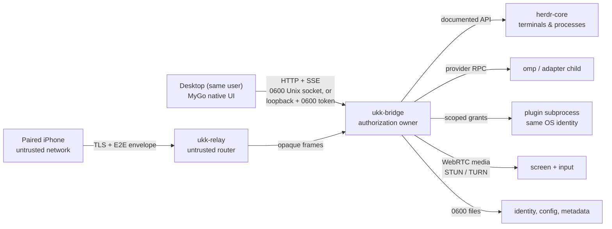

# Security architecture and threat model

> Security contract for the Go Desktop, `ukk-bridge`, `ukk-relay`, the remote
> protocol and the plugin boundary. Mechanisms marked "implemented" below exist
> in the Go source; everything else is the required contract, not evidence.
> Verification evidence, not this page, decides whether a control is claimed.
> See [status](../status.md) for the current evidence boundary. **No item here
> claims an OS sandbox, a signed build, a notarized artifact or a reviewed WAN
> deployment.**

## Assets

Source code and local files; Agent tool-execution authority; approval
decisions; terminal/process control; screen pixels and injected input; device
identities and private keys; pairing invitations; conversation and session
metadata; push tokens; relay routing metadata.

## Trust boundaries



| Boundary | Authentication | Authority |
| --- | --- | --- |
| Desktop → bridge (local) | OS-private endpoint plus bearer token on every route except health | Local same-user principal: the authorizer allows every method; no device grant is required |
| Phone → relay | Relay operator TLS; relay sees connection metadata only | Routing only; relay cannot authorize, decrypt or read commands |
| Phone → bridge (E2E) | Pairing: single-use invite, triple DH, Ed25519 signatures, AEAD proofs. Later sessions prove possession again with fresh ephemeral keys and signatures, never a stored claim | Only the device's live granted scopes |
| Bridge → herdr-core | herdr-core's documented API and local socket | Account-level shell access; ukk adds no per-client permission to herdr-core |
| Bridge → plugin | Manifest, declared capabilities, live grants, audit | Only granted capabilities and declared commands |
| Bridge → screen media | Separate view/control grants, controller lease, OS permissions | Capture and input only while granted and running |

Pairing is not agent control, screen view or screen control. A grant is scoped
to one device, capability and subject. The bridge, not the Desktop and not the
relay, is the authorization owner for remote devices, adapters and screen
leases: Desktop-side enabling is presentation, and for a remote command the
bridge re-checks the live grant and lease rather than trusting a handshake
snapshot. The local Desktop is authorized by the private endpoint and bearer
token as the same OS user.

## Local control plane

**Implemented in `internal/bridge`: configuration and token handling
(`config.go`), endpoint selection and permissions (`local.go`), and the HTTP/SSE
server (`server.go`).**

The Desktop and bridge are separate processes on one machine. The transport is
local HTTP with server-sent events for pushed state.

| Control | Enforced behavior |
| --- | --- |
| Endpoint | Unix domain socket `bridge.sock` in the `0700` data directory on macOS/Linux; loopback `127.0.0.1:<ephemeral>` on Windows because Go's standard library has no portable named-pipe listener |
| Permissions | Unix socket chmod `0600` after bind; data directory created `0700`; token file and endpoint file written `0600` through a same-directory temp file plus rename |
| Discovery | `bridge.endpoint.json` records network, address, token path, PID, protocol version and start time; the client rejects an endpoint older than 24 hours and rejects a TCP endpoint on non-Windows hosts |
| Authorization | Every route except `GET /v1/health` requires `Authorization: Bearer <token>`; comparison is constant time; the token is created on first use and must be at least 43 characters |
| Windows token | The loopback listener has no OS peer identity, so the `0600` token file is the authorization secret. It is readable by same-user code: this is not an authentication boundary against a hostile same-user process |
| Stale socket recovery | Only a path that is still a socket and accepts no connection within 300 ms is removed; a live bridge or a non-socket path is refused |
| Request bounds | 1 MiB request body, strict parameter decoding with unknown fields rejected, 64 KiB header cap, 30 s read timeout, 120 s idle timeout, 45 s command deadline |
| Event stream | SSE subscriber buffer of 32 events; a slow client drops intermediate events and the next snapshot is authoritative; keepalive every 15 s; closing the stream does not stop any Agent |
| Health | Unauthenticated and returns only `{ok, version}` — no metadata |

No Unix-TCP fallback exists. The local API never carries screen media; on Unix
it is reachable only through the `0600` socket, and on Windows only through the
loopback listener plus token.

## Remote identity, pairing and session protocol

**Implemented in `internal/remote`: identity storage, invites, handshake,
envelope, replay window and grant registry. Relay routing is implemented in
`internal/relay` and `cmd/ukk-relay`. Durable device/grant storage and the
bridge-side connection wiring are not implemented.**

The protocol is specified in `apps/desktop/internal/remote` so a Swift client
can reproduce it with CryptoKit. Byte strings are unpadded base64url; keys are
32 raw bytes; expiry is 8-byte big-endian Unix milliseconds.

### Device identity

- Each host and each device has an Ed25519 signing key plus an X25519 static
  key. The identity file is versioned JSON, regular and non-symlink, `0600` on
  Unix, written atomically; a group/other-readable file is refused rather than
  repaired, and a mismatched public/private pair is rejected.
- The published fingerprint is unpadded base64url SHA-256 of the Ed25519 public
  key. Private key material is zeroized after use and is never logged.
- A device identity is independent of transport. The iOS companion is expected
  to store it in Keychain; an implementation that persists it elsewhere is
  unverified, not accepted.

### Invite

```json
{"v":1,"host_id":"…","host_ed":"…","host_x":"…","invite_id":"…",
 "secret":"…","expire_ms":1762550000000,"relay":"wss://relay.example/ws"}
```

- The invite is one JSON object with unknown fields and trailing data rejected,
  at most 2048 bytes; `v` must be 1.
- `secret` is 32 random bytes and formats as `[redacted]`. It is the one-time
  bootstrap credential, never a long-term key.
- Default lifetime is 2 minutes and the maximum is 5 minutes; expiry is
  checked at parse and again when the invite is claimed.
- The relay URL must be an absolute `wss://` URL with a host and no userinfo.
- Invites are single use: the store marks one in progress **before** any
  handshake work, a failed handshake burns it permanently, and a successful
  pairing erases the stored secret. Reuse, expiry and in-progress claims return
  distinct typed codes (`invite_used`, `invite_expired`,
  `invite_in_progress`).

### Handshake (C1 → S1 → C2)

```text
C1 {"t":"c1","invite_id","ed","x","eph","nc","sig"}
S1 {"t":"s1","host_ed","host_x","eph","ns","sig","proof"}
C2 {"t":"c2","proof"}
```

- `eph` values are fresh X25519 ephemeral keys. A handshake never reuses a
  previous ephemeral key or a previous transcript.
- `C1.sig` is Ed25519 over the client-visible transcript prefix
  `SHA256("ukk-handshake-v1" || host_id || invite_id || host_ed || host_x ||
  client_ed || client_x || eph_client || expire)`. The prefix omits
  `eph_host`, which does not exist yet.
- The full transcript is
  `SHA256("ukk-handshake-v1" || host_id || invite_id || host_ed || host_x ||
  client_ed || client_x || eph_host || eph_client || expire)`. `S1.sig` covers
  it.
- Input key material is the triple DH plus the invite secret, in this exact
  order: `DH(eh, ec) || DH(hx, ec) || DH(eh, cx) || secret`, where `eh` is the
  host ephemeral, `ec` the client ephemeral, `hx` the host static X25519 key
  and `cx` the client static X25519 key. A zero or non-contributory X25519
  result is rejected.
- `salt = SHA256("ukk-salt-v1" || transcript)`;
  `HKDF-SHA256(ikm, salt, "ukk-confirm|ukk-c2s|ukk-s2c", 96)` yields the
  confirm key and two directional keys. `HKDF-SHA256(ikm, salt, "ukk-code", 4)`
  yields the six-digit code (`u32be mod 1e6`), shown on both sides for human
  comparison.
- Proofs are ChaCha20-Poly1305 with `k_confirm`, an empty plaintext,
  `aad = transcript` and `nonce = SHA256(transcript || label)[0:12]`, labels
  `ukk-s1-proof` and `ukk-c2-proof`. The client verifies the S1 proof before
  showing the code, so both sides have derived the same keys before a human
  compares digits. Pairing completes only after the host verifies the C2 proof;
  any failure burns the invite.

**Possession is proven per session, not cached.** The Go implementation
requires a fresh ephemeral handshake with the device's static keys and
Ed25519 signatures for each new remote session; pairing does not mint a
reusable bearer token, and a previously paired `device_id` or a stored
handshake result is not accepted as proof. A captured `device_id`/claim
therefore cannot substitute for a new signature.

### Envelope and replay

```text
version(1) || stream(4, big-endian) || counter(8, big-endian) ||
ChaCha20-Poly1305(k_direction, nonce = counter || stream, aad = header)
```

- The header is the first 13 bytes and is authenticated as associated data;
  `c2s` and `s2c` keys are distinct, so a frame cannot be reflected.
- Counters start at 1 and the receiver keeps a replay window of 1024 counters per
  stream: duplicate counters, counters older than the window and gaps beyond it
  are rejected (`envelope_replay`). Wrong version, wrong stream, failed
  authentication and oversized plaintext (over 1 MiB) are distinct typed
  failures.
- The envelope carries no plane, device id or permission bit. Those come from
  the authenticated handshake, so a captured frame cannot be replayed into a
  different trust domain.
- Authorization is checked on every command, not once per connection: a revoked
  device, expired grant or withdrawn lease fails at the next decision
  (`device_revoked`, `stale_identity`, `grant_expired`, `missing_scope`).

## Grants and leases

Scopes are additive; holding one never implies another:

`workspace.read`, `session.observe`, `agent.send`, `agent.approve`,
`filesystem.read`, `git.write`, `screen.view`, `screen.control`,
`screen.audio`, `plugin.control`, `device.manage`.

| Property | Rule |
| --- | --- |
| Issue | Explicit consent on the host; a grant can only name a declared capability. Every grant has a future absolute expiry; a grant without one is invalid |
| Scope | Keyed by `(device, scope, subject)` with subject `host`, `space:<id>` or `session:<id>`; a `host` grant covers every subject, and there is no implicit downward inheritance in v1 |
| Sensitive TTL | `agent.approve`, `screen.view`, `screen.control`, `screen.audio` and `plugin.control` expire within one hour; screen control also needs a lease |
| Generation | A device is authorized against the generation observed by its authenticated session. Revocation and key rotation bump the generation and clear every grant, so an old session fails with `stale_identity` |
| Revocation | Immediate and idempotent; it clears grants and withdraws controller leases. The relay may also be told to drop a device, but the authoritative check is the bridge's live device registry, which must be persisted before WAN use |
| Denial | Typed wire codes, never a generic string; denied requests change no state |
| Refresh | For remote devices, handshake-time scope lists are advisory UI state; the live registry is re-read for every command and event delivery |

`device.manage` is not grantable through pairing. A phone may observe a Session
without being able to send to an Agent, approve, view or control the screen.

## Relay

**Implemented in `internal/relay` and `cmd/ukk-relay`; no deployed WAN relay is
verified.**

`ukk-relay` is a control-plane router that a third party can operate. The
relay operator is not trusted with content. It serves `GET /healthz` (plain
`ok`), `GET /host` (host register) and `GET /device` (paired device); both
peers upgrade to WebSocket and must send `hello` first.

| Control | Rule |
| --- | --- |
| Transport | WSS; TLS is terminated by the relay itself (`-tls-cert`/`-tls-key`, TLS 1.2 minimum) or by a reverse proxy in front of a loopback listener. The relay must not be exposed over plaintext on a public host |
| Operator authentication | `GET /host` requires `Authorization: Bearer <operator token>`, compared in constant time before the socket is accepted. The token is at least 32 bytes with at least eight distinct byte values; a weak token fails startup |
| Registration | Host sends `{"t":"hello","host_id":…}`; a second host connection for the same id is refused with `host_already_connected` — there is no silent takeover. Device sends `{"t":"hello","host_id":…,"device_id":…}`; the host must be online and limits are checked |
| Frames | `{"t":"open","conn":…}` device→relay→host; `{"t":"data","conn":…,"payload":"<base64>"}` in either direction; `{"t":"close","conn":…}`; `presence` frames from the relay; `revoke`/`repair` from the host; `error` with a stable code. Unknown or duplicate `hello` is fatal |
| Opacity | `payload` is an E2E envelope. The relay never decodes, inspects or logs it, and cannot authorize a scope or authenticate a device |
| Video | The relay never carries raw video. Screen media uses independent STUN/TURN and the relay is signalling only |
| Bounds | 16 MiB WebSocket message, 1 MiB opaque payload, 1024 queued frames per peer, 8 connections per device, 32 devices per host, 90 s idle timeout, 10 s write deadline, server pings. Overflow is a typed close, not unbounded buffering |
| Rejection | Offline host, revoked device, duplicate conn, unknown conn, malformed or duplicate hello, oversize payload, queue overflow and limit breaches return a typed error; fatal errors close the peer |
| Revocation | Host sends `{"t":"revoke","device":…}`; the relay closes that device's connections and refuses future registrations until `{"t":"repair","device":…}`. The deny set is per process and lost on restart. Grant clearing and the per-command check live in the bridge registry; that registry is currently in-memory and must be persisted before WAN deployment |

A relay that is compromised can deny service, correlate traffic and drop
frames; it cannot decrypt control traffic, inject a valid command, read screen
media or change grants. A relay restart forgets its deny set, which is why the
bridge must reject a revoked device on its own authority.

## Screen capture and input

**Contract for M4; capture adapters, media negotiation and leases are not
implemented yet.**

- Remote Screen is an opt-in, first-party Session surface. Viewing and control
  are separate grants; control requires a short controller lease with visible
  takeover.
- Capture starts only on an explicit `screen.start` that requests view and holds
  the view grant, and shows a persistent local indicator plus a one-tap stop.
- Stop, lease expiry, revocation, device lock or backgrounding, and app
  termination tear down capture and input. Screen availability never affects
  Agent operation.
- Capture uses the platform permission model: macOS ScreenCaptureKit and
  user-consented Accessibility input, Windows Graphics Capture where verified,
  Linux PipeWire/portal where available. Unsupported combinations are named in
  the UI, not emulated.
- Input events are accepted only with the control grant and the lease; the
  bridge validates them before the platform adapter sees them.
- Media travels over STUN/TURN with a reviewed secure transport (DTLS-SRTP in
  the WebRTC path); it never traverses the relay or the bridge's local API.

## Plugin boundary

**Contract for M5; no plugin supervisor is wired into the bridge yet.**

Third-party plugin code does not run inside the bridge's privileged process by
default. A plugin is a subprocess with the bridge user's OS identity, a cleared
environment, bounded framed stdio, request deadlines and kill-on-disable. This
is process separation, not an OS sandbox; it does not confine a same-user
process that deliberately escapes the protocol. Capabilities, grants, audit and
manifest validation are defined in [plugins](plugins.md).

## Terminal provenance and observer safety

**Contract; real herdr-core attach, provenance tagging and observer rejection
are not yet verified.**

- Human input and automatic Agent input share one `Conn.Write`; each write is
  tagged `HUMAN_INPUT` or `AUTOMATIC_INPUT` by the adapter. Provenance is never
  inferred by inspecting bytes.
- An observer attachment never writes and never resizes. A controller lease is
  explicit, single-writer and expiring; takeover is visible.
- RESIZE is applied before painting; backpressure is bounded in both
  directions, and degraded state is surfaced instead of blocking the UI thread.
- Terminal bytes are untrusted display text. Control strings are stripped and
  invalid UTF-8 replaced lossily for rendering; tool calls, plans and approvals
  come only from the provider adapter. No ANSI-derived structured events exist.
- Closing a Pane/Tab/Session/window detaches; it performs no stop/kill call.
  Audit and cancellation of a provider child are separate, explicit actions.

## Audit, logging and redaction

Required for any privileged decision: local and remote authorization denials,
pairing attempt outcomes, grant issue/revocation, device revocation, controller
lease changes, plugin lifecycle and command dispatch, screen start/stop and
capture-permission outcomes, and explicit stop/kill of an Agent or terminal.

| Rule | Detail |
| --- | --- |
| Fields | Timestamp, actor/device or plugin id, method/action, subject ids, scope, outcome and stable error code |
| Never recorded | Bearer/operator tokens, invite secrets, private keys, prompt or conversation text, terminal contents, command arguments, event payloads, file content, screen data |
| Redaction | Untrusted strings are control-character and bidi-escaped and length-capped before storage; parse failures report category and position, not the offending payload |
| Delivery | Audit must not block the command path; bounded buffering with a counted drop is acceptable, silent loss is not |
| Logs | Same rules as audit. Diagnostics may show paths, modes and uids, which are not secrets. |

Durable audit storage and a query surface are target work (M5); do not describe
the current source as providing durable audit.

## Threat scenarios

| Threat | Mitigation |
| --- | --- |
| Another person sees the pairing QR | 2–5 minute single-use invite, host-side human confirmation, transcript-bound signatures, failure burns the invite |
| Malicious relay or MITM | TLS to the relay, authenticated E2E handshake, pinned host keys in the QR, transcript binding, AEAD, per-direction keys |
| Captured device claim replayed on WAN | Fresh ephemeral handshake and Ed25519 signatures per session; no cached claim is accepted |
| Stolen or revoked phone | Per-device revocation, short-lived grants, lease withdrawal, Keychain-backed identity, re-check on every command |
| Replayed command or approval | Envelope counter window, idempotency keys bound to principal and method, approvals and pointer input never blindly replayed |
| Forged or stale identity | Signature over the full transcript, key-generation check, `stale_identity` and `forged_identity` codes |
| Malicious plugin | Out-of-process helper, declared capabilities only, explicit grants, deadlines, kill-on-disable, audit; no privileged in-process third-party code |
| Prompt injection asking for broader host powers | Capability-scoped tools, explicit approval where the provider emits it, no implicit escalation into grants or plugin control |
| Unauthorized screen viewing | Separate screen-view grant, persistent capture indicator, explicit stop, no always-on capture |
| Unauthorized input injection | Separate screen-control grant, short lease, visible takeover, per-event validation |
| Relay resource exhaustion | Frame/queue/rate limits, bounded subscribers, connection close on overflow |
| Notification metadata leakage | Opaque APNs wake hints; no code, file names, prompt text or secrets in the payload |
| Local same-user process | Out of scope as a boundary: it can read the token, metadata and keys. Documented as residual risk, not defended |

## Permission matrix

| Role | Observe | Send to Agent | Approve | View screen | Control input |
| --- | --- | --- | --- | --- | --- |
| Local Desktop owner | Yes | Yes, via bridge commands | Yes, provider approval only | OS permission + view grant | OS permission + control grant + lease |
| Paired phone, observe only | Yes | No | No | No | No |
| Paired phone, operator | Yes | Optional `agent.send` grant | Optional `agent.approve` grant | Optional `screen.view` grant | Separate `screen.control` grant + lease |
| Plugin, default | No | No | No | No | No |

## Residual risks and non-claims

- **Same-user is not a boundary.** Any process running as the logged-in user can
  read the bridge token, endpoint file, workspace metadata and (through the OS)
  the user's files. Loopback-plus-token on Windows is authorization, not
  authentication against hostile same-user code.
- **Builds are unsigned.** macOS packaging uses ad-hoc signing (`-`). There is
  no Developer ID signature, no notarization and no Gatekeeper acceptance claim.
  Users must expect a Gatekeeper block; that block is not a packaging defect.
- **The unsigned IPA is not installable.** It requires later signing and a
  provisioning/device path; it is an artifact, not a release.
- **Physical-device evidence is a separate gate.** Camera pairing, APNs,
  Keychain persistence and real media over TURN are unverified until a real
  device run is recorded; simulator results do not count.
- **Device trust and grants are not yet durable.** The remote registry is
  in-memory: a bridge restart forgets paired devices and grants. Durable
  storage with fail-closed loading is required before remote access is
  claimable, and an in-memory registry must never be presented as persistent
  trust.
- **WAN deployment is not proven here.** Possession, replay, revocation and
  operator-auth denial must be demonstrated against a deployed relay on a real
  network. A local mock is not evidence.
- **No independent cryptographic review.** The handshake, envelope and relay
  boundary are specified and testable, but no third-party audit is claimed.
- **herdr-core has no per-client permission model.** Anyone who reaches its
  socket has the account's shell access; ukk does not sandbox it.
- **A subprocess is not an OS sandbox.** Plugin containment relies on the
  protocol, grants and supervision described in [plugins](plugins.md).
- **Not claimed:** OS-level sandboxing, secure enclave/HSM storage, protection
  from malware already running as the user, signing, notarization, store
  distribution, or telemetry-based abuse detection.

See [domain model](domain-model.md), [plugins](plugins.md),
[remote control decision](../decisions/0002-remote-control-is-plugin.md),
[requirements](../requirements.md) and [status](../status.md).
