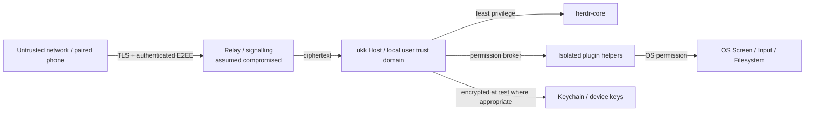

# Security architecture & threat model

> Planning document; these mechanisms must be implemented, reviewed and tested before remote control is generally enabled. Do not describe the present repository as secure or production-ready.

## Assets to protect

Source code, filesystem and secrets; agent tool execution authority; process/terminal control; approval decisions; screen pixels and user input; device identities; session history; pairing invitations; keys; push tokens; relay metadata.

## Trust boundaries

The relay is not an authority over desktop actions. Phone pairing grants per-device identity, not root privileges. A compromised or revoked mobile device must not retain full control.

## Local Host IPC and service lifecycle

The local Desktop ↔ Host endpoint is a separate trust boundary from the future
remote protocol. It is local-only, same-user and read-only for Agent runtime
state; workspace metadata mutations require a rotated per-Host capability.
There is **no TCP listener and no TCP fallback**.

### Controls implemented in `crates/host` and `crates/host-client`

| Control | Implementation |
|---|---|
| User-scoped lifecycle | macOS launchd user agent, Linux systemd `--user`, Windows logon Scheduled Task (`Interactive`, `RunLevel Limited`). No root daemon. Explicit `install`/`uninstall`/`restart`/`status`/`cleanup`; `serve` never auto-installs. |
| Agent lifetime independence | Service stop/restart/uninstall only owns the Host endpoint. The systemd unit uses `KillMode=process`; the Windows task ends only the Host. No Host path sends `terminal.stop`/`kill`. |
| Unix directory | Validate real directory and Host ownership **before** chmod, then chmod the default dir to 0700 and re-verify; all paths must have group/other bits clear. Symlinks rejected. |
| Unix socket | Created 0600; type, uid and mode re-verified after bind. |
| Unix peer identity | `SO_PEERCRED` (Linux/Android) or `getpeereid` (macOS/BSD); peer uid must equal Host euid. Unsupported platforms fail closed. |
| Stale socket recovery | Exclusive lifecycle `flock`; only `ECONNREFUSED` is treated as stale. Before unlink the path must still be a socket owned by the Host uid with mode 0600. Ambiguous connect errors, live sockets, symlinks, foreign files and non-private stale sockets are never removed. `cleanup` validates the directory ownership/mode before creating the lock. |
| Windows pipe ACL | Explicit protected SDDL DACL: current user + SYSTEM only. No default-ACL fallback. |
| Windows remote rejection | `PIPE_REJECT_REMOTE_CLIENTS`; pipe name is namespacing, not authentication. |
| Windows single owner | `FILE_FLAG_FIRST_PIPE_INSTANCE` is created **before** `LocalAuth::install()` and broker start. A refused second Host cannot rotate or temporarily remove the live Host's mutation capability token. |
| Windows peer identity | Server verifies the client process token SID; client verifies the server process token SID. Both compare against the current user. Client opens with IDENTIFICATION-only QoS. |
| Deadlines/cancellation | Unix read/write timeouts; Windows overlapped I/O with bounded waits and `CancelIoEx`. A silent or non-reading peer cannot pin a worker. The framed `hc connect` handshake and frame writes also have bounded deadlines and kill/reap the client child on expiry. |
| Resource bounds | 32 concurrent clients, 256 requests per connection, 64 KiB request, 4 MiB reply, 60s idle read, 10s write. Excess clients get a bounded error and are closed. |
| Capability separation | Local mutation token authorizes workspace metadata only. Agent mutation, terminal input and screen control require the separate, default-off `agent-control` capability described below; the workspace token never authorizes them. Plugin enable/disable/invoke require a third, separate default-off `plugin.control` token. |

### Security consequences and residual risks

- **Same-user is the trust boundary.** A malicious process running as the same
  OS user has the same token identity and can read the capability file. This
  interface is not a sandbox between same-user applications. Windows
  executable-signature/app identity and stronger isolation are future work.
- The Windows DACL includes SYSTEM for conventional pipe administration. The
  SID verification rejects SYSTEM *clients*, but the Host must never itself run
  as LocalSystem. A SYSTEM/elevated Host would be a new audited boundary.
- The Windows mutation token file relies on the user profile ACL; Unix uses
  0600 inside the 0700 run directory. Neither is protected against same-user
  code.
- **Different-user denial is NOT VERIFIED in CI.** The DACL/mode and peer-uid
  paths are implemented and tested within one user; cross-account tests require
  a second OS account and a documented runbook
  ([HOST_LIFECYCLE.md](../runbooks/host-lifecycle.md#different-user-denial-not-verified--runbook)).
- Windows runtime tests (including overlapped deadline cancellation and
  second-Host refusal) are committed but must be confirmed by Windows CI and a
  real machine before Windows evidence is claimed.
- `install`/`uninstall`/`restart` were not executed against real service
  managers in this change. Template contents and rendering are unit-tested.
- Credentials, tokens and Agent content must never be logged. Diagnostics may
  show endpoint paths, modes and uids, which are not secrets.

## Protocol trust boundaries (implemented, S1)

`crates/protocol` now implements and tests the remote authorization and
synchronization contract. Host socket/relay wiring and pairing cryptography are
separate follow-ups; this section describes the controls that exist in source
and are covered by contract tests today.

| Plane | Authentication | Authority |
| --- | --- | --- |
| Local IPC | OS-verified peer user id; transport must supply it | local OS owner; no device grant required, but still typed validation and replay classification |
| Remote (WAN) | registered `(device_id, public-key fingerprint, key generation)` plus explicit scoped grants | only the granted scopes; every command re-checks live grants and leases |

An envelope carries no plane, device id or permission bit. Those are fixed by
the authenticated handshake, so a captured envelope cannot be replayed into a
different trust domain. A device claim on a local binding is rejected, a local
hello on a remote binding is rejected, and an idempotency key first used on one
plane is rejected on the other (`cross_plane`). Idempotency records are also
bound to the authenticated principal, so one device cannot claim another
device's retry record or learn its result.

### Enforced invariants

* **Live authorization.** Cached handshake scopes are not authoritative.
  Revocation, key rotation and grant expiry are re-read on every command, every
  subscription request and every outbound event batch
  (`ProtocolService::authorize_delivery`). A denied batch closes the open
  stream. Revocation also withdraws that device's controller leases.
* **Typed denials.** `unknown_device`, `device_revoked`, `forged_identity`,
  `stale_identity`, `missing_scope`, `grant_expired`, `plane_mismatch`,
  `replay_forbidden`, and the three controller-lease reasons are distinct wire
  values.
* **Durable cursors only.** Per-stream cursors are issued by the event log and
  persist across Host and herdr-core restarts. `hc_seq` and `host_epoch` are
  reserved names and are rejected on durable messages and checkpoints.
* **Snapshot on gap.** A cursor behind retained history forces a cursor-bound
  snapshot instead of silent event loss; a cursor ahead of the head is a typed
  error, never a reset. `EventInbox::apply_snapshot`/`resume_from` positions
  deduplication at the snapshot cursor, so resync does not disable duplicate
  detection. Event-id reuse at a different cursor is detected within the
  bounded recent-id window. Restored logs must continue the retention floor and
  belong to the current generation.
* **No blind replay.** `approval_respond` (human decision) and `pointer_input`
  (ephemeral input) are classified `NeverReplay`. The reconnect queue refuses
  them, so reconnection cannot approve an action or inject input the user never
  repeated.
* **Bounded resources.** Envelope, payload, snapshot, queue, retention,
  idempotency-store and replay-batch limits are validated at startup and
  enforced before work. The idempotency store refuses new keys at capacity
  rather than evicting records, because eviction re-enables duplicate
  execution. In-flight records never expire; completed records become
  tombstones after retention and refuse a late retry with `expired` instead of
  executing. The reconnect queue applies the same retention window and discards
  stale entries.
* **Ordered checks.** Transport binding → generation negotiation → device
  identity → semantic validation → live authorization/lease → idempotency
  lookup. An unauthorized retry cannot discover whether a key exists or what
  its result was.

## Pairing and device trust (implemented, S2 core)

`crates/remote` implements the pairing core and the outbound signalling
boundary; a real WSS relay adapter, OS key storage and iOS UI are separate
follow-ups. See [PAIRING.md](pairing.md) for the exact wire fields, prologue
encoding, signalling envelope and dependency record.

| Control | Implementation |
| --- | --- |
| Bootstrap credential | 32-byte one-time PSK in a bounded QR payload (`v: 1`), default 2 min / max 5 min expiry, single use, unknown fields rejected, strict `https`/`wss` relay validation |
| Secret handling | `InviteSecret` is zeroized on drop and never formatted; QR parsing/errors discard payload text |
| Key agreement | `snow` 0.10.0 Noise `IKpsk0` (X25519, ChaChaPoly, SHA-256); QR secret as `psk0`; Host static key pinned from the QR; device static key encrypted in message 1; non-contributory/low-order X25519 keys rejected on both sides |
| Transcript binding | Canonical prologue binds version, Host id, invite id, absolute expiry, relay URL and Host public key; Noise hashes it with every handshake message |
| Human confirmation | Six-digit code derived from the final handshake hash plus a random one-time challenge (60 s cap / invite expiry); `confirm()` compares it in constant time and returns a `ConfirmedAttempt` that `approve()` requires |
| Replay/expiry | Invitation is marked in progress before the first Noise read; a failed handshake burns it; expired and reused invitations fail closed |
| Grants | Explicit subset of requested scopes, additive only, absolute expiry (default 30 days / max 90 days), `device.manage` not grantable through pairing; authority is committed only after an encrypted completion ACK (`PendingPairing` → `complete`) |
| Revocation/rotation | Delegated to the S1 live trust registry; revocation clears grants, rotation bumps the generation and clears grants, and existing sessions fail on their next check |
| Key storage | `DeviceKeyStore` trait; only an in-memory test store ships. OS Keychain/Keyring is **NOT VERIFIED** and must not fall back to plaintext SQLite |
| WAN proof of possession | **NOT IMPLEMENTED / MAJOR GATE.** S2 authenticates the device only during pairing. S1 `accept_hello` trusts a client-supplied `DeviceClaim` on `TransportBinding::remote()`; until host/relay wiring requires a fresh Noise session keyed by the device static key (or a signature over hello), a captured claim can be replayed. Do not expose a WAN listener. |

### Relay signalling boundary (ukk-internal, mock-tested)

`transport::RelayConnection` is the only outbound seam, and
`relay::RelayDriver` is the protocol state machine. The envelope is
**ukk-internal** and is not claimed to be alma-relay-compatible; see the gap
record in [PAIRING.md](pairing.md).

| Control | Implementation |
| --- | --- |
| Outbound only | The Host sends `register`; there is no inbound listener, port forwarding or TCP fallback, and the relay never dials the Host |
| Reconnect generation | Monotonic `generation()`; the driver refuses a reused/stale generation and resets all state on a higher one. State never crosses a connection generation |
| Bounds | Encoded envelope ≤ 8192 bytes, opaque pairing payload ≤ 4096 bytes (encoded length prechecked before base64 decode), session id `[A-Za-z0-9_-]{16,128}`. Only the single JSON-object frame form is accepted. Per-peer queues must be bounded; the mock relay caps 64 undrained frames and disconnects the peer on overflow |
| Fail closed | Duplicate registration, unknown route, offline peer, oversized frame, stale generation, wrong Host, out-of-order message, session close and revocation all produce a typed error and close the driver |
| Resume | Not part of v1: no resume field exists, and a frame carrying one is rejected as malformed before the relay/driver acts |
| Relay authority | The relay only routes ciphertext and typed control; it cannot grant scopes, authenticate a device or alter pairing state |
| Test evidence | Synchronous in-memory mock relay (`tests/relay.rs`); no socket, TLS, relay process or external call |

The pairing crate performs no network I/O and adds no cryptographic primitive:
the driver carries opaque Noise frames and only enforces routing, ordering,
version and size bounds.

**NOT VERIFIED in S2:** WAN device-claim proof-of-possession, a real WSS/TLS
relay adapter, relay operator authentication, TURN/media credentials,
real alma-relay exchange, OS protected key storage, physical iPhone, relay
outage/reconnect against a real process and independent cryptographic review.

## Threat scenarios and mitigations

| Threat | Required mitigation |
|---|---|
| QR observed by another person | One-time short expiry, host confirmation with code, signed transcript and replay protection |
| Malicious relay / MITM | Authenticated end-to-end key agreement, device public key pinning, transcript binding, AEAD, TLS |
| Stolen phone | Per-device revocation, Keychain storage, optional biometric gate for approvals/control, short-lived sessions |
| Malicious third-party plugin | Signed distribution, separate helper, brokered scoped permissions, process limits, audit, crash isolation |
| Agent prompt injection asks for broad host powers | Approval, scope-bound tools, no implicit plugin/system capability escalation |
| Unauthorized screen viewing | Distinct screen.view consent, visible local indicator, explicit stop, no always-on capture |
| Input injection | Distinct screen.control scope, time-limited controller lease, audit, re-auth on escalation |
| Replay of `agent.send` or approvals | Idempotency keys bound to command fingerprint, principal and plane; approvals carry a mandatory revision; approvals and pointer input are `NeverReplay` and refused by the reconnect queue |
| Revoked or stolen device keeps acting | Live grant lookup on every command; revocation clears grants, withdraws leases and invalidates existing sessions (`device_revoked`) |
| Forged or stale device identity | Fingerprint plus key-generation verification; rotation bumps the generation, clears grants and invalidates sessions (`forged_identity` / `stale_identity`) |
| Duplicate execution after a dropped ACK | Durable per-stream cursor, bounded client dedup by cursor and event id, and stored idempotency classification; ACK loss causes redelivery, not re-execution |
| Cross-plane privilege escalation | Local IPC and WAN are separate bindings; device claims are rejected locally; idempotency records reject cross-plane and cross-principal reuse |
| Cursor reset or silent event loss | Durable cursor independent of `hc_seq`/`host_epoch`; gap requires a snapshot; cursor beyond head is a typed error |
| Relay resource exhaustion | Size/rate limits, quotas, circuit breakers, event backpressure |
| Notification metadata leakage | APNs opaque hints, no code/file/secrets in push payloads |
| Local privilege escalation | User-scoped background service, OS sandbox/entitlements as appropriate, no root service by default |
| Dependency supply-chain | Pinned hashes/versions, audit licenses and vulnerabilities, reproducible CI, release signing |
| Remote Host compromised | Explicit host trust warning; phone cannot guarantee source-code or agent-output integrity |

## Permission matrix (illustrative)

| Role / Capability | Observe sessions | Send to Agent | Approve dangerous action | View screen | Control input |
|---|---|---|---|---|---|
| Local Desktop owner | Yes | Yes | Explicit local policy | OS permission | OS permission |
| Paired phone, observer | Yes | No | No | No | No |
| Paired phone, operator | Yes | Optional scope | Separate approval grant | Optional explicit scope | Separate temporary lease |
| Plugin (default) | No | No | No | No | No |

The server-side scope set is `session.observe`, `session.manage`, `agent.send`,
`approval.respond`, `screen.view`, `screen.control`, `plugin.invoke` and
`device.manage`. Scopes are additive; holding one never implies another.
Unknown scope strings fail to deserialize rather than widening a grant.
Handshake scopes are advisory UI state only; authorization re-reads the live
registry.

## Agent runtime control capability

Terminal input, interrupt, stop and runtime archive are **not** workspace
metadata edits. They are gated by a separate capability that is disabled until
an operator creates its own token file:

- Default path: next to the local Host socket with extension
  `.agent-control` (for example `~/.ukk/run/agent-host.agent-control`), or
  `UKK_AGENT_CONTROL_TOKEN_FILE`. Windows uses
  `%LOCALAPPDATA%\ukk\run\agent-host.agent-control`; an override may point
  elsewhere but the Host still requires a regular file.
- The file must be a regular file (no symlinks), ASCII, at least 60
  characters, and mode `0600` on Unix. Any other state leaves control
  disabled with a typed reason.
- `ukk-host agent-control-enable` creates it explicitly and refuses to
  overwrite an existing token; `agent-control-disable` removes it.
- The rotated workspace metadata token in `local_auth.rs` is never accepted
  for control. RPC calls carry the control value in a distinct `control`
  field; an `auth` value is ignored for `runtime.*`.

New `runtime.*` RPC methods require `request_id`, `intent: "user"` and the
capability for every mutation. `request_id` is the idempotency key; a
concurrent duplicate gets a typed "in flight" error instead of executing
twice, and a reused id with different content is rejected. The Host keeps at
most 256 completed ids and fails closed when that bound is reached instead of
silently evicting an id that might still be retried. `intent: "user"` is a UI
convention asserted by the caller, not cryptographic proof; the capability is
the actual control boundary. The Host verifies the binding's `core_id`
against the connected herdr-core identity before acting. Successful and
denied control attempts are written to a JSONL audit file
(`UKK_AGENT_CONTROL_AUDIT`, default beside the token) containing the request
id, action, core id, terminal address, intent and outcome — never the token or
terminal contents.

Local-only threat model: the capability is same-user, same-host defense in
depth, not remote authentication and not a boundary against a process that can
already read the user's profile. herdr-core itself has no per-client
permission model; anyone who reaches its socket has the account's shell
access. Remote pairing and device authorization remain separate gates.

Closing a Pane/Tab/Session/window, detaching a framed view or calling
`runtime.detach` is local and performs **zero** runtime calls. There is no
code path from view close to `terminal.kill` or `terminal.rm`.

### Desktop read-only terminal observation

The Desktop's Terminal pane and terminal detail card open
`terminal.attach {observe:true}` directly through `ukk-hc-client` from a
background worker. The line RPC cannot carry a backpressured byte stream, and
the Host remains the owner of control and Agent lifetime. This direct read
boundary has the following consequences:

- It is enabled only by an explicit pane/detail action, never on application
  load or Session selection.
- The observer request fixes `observe:true`, sends no input, does not resize
  after the initial `cols`/`rows`, and has no call path to interrupt, stop,
  kill, archive or input. The client refuses those calls for observers before
  writing a frame. Explicit one-line input is a separate Host-gated path; see
  below.
- Dropping the attachment/connection only closes this view's stream and reaps
  the local `hc connect` helper. Terminal and Agent lifetime remain owned by
  herdr-core. See [GPUI_TERMINAL.md](desktop-terminal.md).
- The Desktop is another same-user client of the herdr-core socket. It does
  not sandbox herdr-core and does not add authentication or per-client
  permissions; a process that can already reach the socket has account shell
  access.
- Terminal output is untrusted display text. CSI/OSC and other control strings
  are stripped, invalid UTF-8 is replaced lossily, and raw bytes are never
  parsed into Agent messages, tool calls or approvals.
- The terminal byte ring is capped at 256 KiB / 4096 lines per attachment and
  relies on framed CREDIT backpressure. Diagnostics never include terminal
  contents.

### Desktop one-line terminal input

The Session Terminal pane may offer one explicit line of input. This does not
turn the observe stream into a writer and does not add terminal emulation:

- The composer exists only for an `AgentRun { core_id, terminal_address }`
  binding with a live observe stream. The unbound terminal detail card stays
  read-only.
- A send is only triggered by an explicit Send click or Enter in that field.
  Nothing is sent on load, selection, Tab switch, attach, reattach or per
  keystroke. There is no keystroke streaming, resize, interrupt, stop, kill or
  detach path in the composer.
- `HostClient::runtime_send` reads the separate, default-off agent-control
  token **at call time**. The workspace metadata token and the plugin-control
  token are never accepted or substituted. Every call carries a fresh
  `request_id`, `intent: "user"` and the exact `core_id` +
  `terminal_address` binding.
- The line is one bounded printable line (8 KiB maximum); newlines, tabs,
  other control characters and bidi overrides are rejected client-side before
  the token is read or a socket is opened. The Host still validates the
  address and text.
- The Host preflights the capability, checks the binding against the connected
  core identity, applies in-process idempotency by `request_id`, and writes an
  audit entry (request id, action, core id, terminal address, intent, outcome).
  Neither the token nor the submitted text is audited.
- Failures are truthful: the draft is kept and the error is shown; the Desktop
  never retries automatically. The field is cleared only after a verified Host
  success. A Host-reported `replayed` outcome is labelled instead of hidden.
- The capability state shown in the pane comes from read-only
  `runtime.status`. When it is disabled or the Host is offline, the input field
  is absent and the reason is displayed; there is no optimistic fallback.

Residual risk: this is still a same-user local boundary. A process that can
read the user's profile can read the agent-control token, and `intent: "user"`
is a caller assertion rather than cryptographic proof. The Host capability is
the control boundary, not the Desktop label. Full terminal emulation, resize
and keystroke streaming are unsupported; real GUI line-send acceptance on
macOS/Windows/Linux is **NOT VERIFIED** in this slice.

## omp RPC session surface

`crates/omp-client` runs `omp --mode rpc --no-session` as a Host-owned child;
the Desktop only calls the local Host. Security properties:

- **Mutations:** `omp.start`, `omp.prompt`, `omp.abort` and `omp.stop` use the
  same separate, default-off agent-control capability described above
  (`control` field, `request_id`, `intent: "user"`). Workspace and
  plugin-control tokens are never accepted. Every attempt (including denial)
  is audited with `core_id: "omp"`; tokens and prompt text are not audited.
- **Idempotency and pacing:** `request_id` is an idempotency key (bounded 128
  completed ids). The prompt transition is atomic, and a second prompt while a
  turn runs is rejected with `-32041` instead of silently steering. `omp.stop`
  is the only explicit process-kill path.
- **Read surface:** `omp.snapshot` / `omp.wait` require no capability because
  the local endpoint is already same-user private (0600 socket in a 0700
  directory; Windows protected Pipe DACL). They expose conversation text,
  tool arguments/results, cwd, session state and a redacted stderr tail. Any
  process that can reach the Host socket can read a conversation; this is
  consistent with the local-observation model, but no remote/client caller may
  receive it without future remote authorization.
- **Bounds:** 400 entries, 8 KiB per entry, 512 KiB total; serialized
  snapshots stay well below the 4 MiB Host reply cap. Oversized/malformed
  frames are reported, not guessed.
- **No synthesized approvals:** `extension_ui_request` methods that expect a
  value are answered `cancelled`; fire-and-forget UI updates are ignored.
  `host_tool_call` / `host_uri_request` are refused. omp's own tool policy and
  approvals remain outside this surface; ukk adds no approval bypass.
- **Process lifetime:** UI close/session switch/window close sends nothing.
  On Unix SIGTERM/SIGINT stops children before exit; when the Host dies
  abruptly the OS closes the child's stdin pipe and omp exits. Windows
  service-stop handling relies on that EOF behaviour and is NOT VERIFIED.
- **Residual risk:** an agent runs with the user's OS privileges and may place
  secrets in tool output. Provider credentials are never passed by ukk, and
  error/stderr text is redacted, but conversation text is shown verbatim to
  the local user. There is no Host-restart reattach and no transcript
  persistence in this slice.

## Plugin broker and `plugin.control`

The Host owns one plugin supervisor (`crates/host/src/plugin_service.rs`). It
loads plugins only from an explicit registry file and never scans arbitrary
directories:

- default `~/.ukk/plugins/registry.json`, override `UKK_PLUGIN_REGISTRY`;
- each entry carries a plugin id, absolute manifest path, absolute helper path
  and the startup `enabled` flag;
- the registry, manifest and helper must be regular non-symlink files; on Unix
  group/other write bits are refused, the files must be owned by the Host euid,
  and their real parent directories must be owned by that user with no
  group/other write bits (a path under `/tmp` is refused, and the helper must
  be executable);
- the manifest must validate, its id must equal the registry id, its
  `entrypoint` must equal the helper file stem, and duplicate ids/paths/command
  ids refuse the whole registry (fail closed);
- a missing registry means no plugins, never a discovery fallback.

Installation starts no process. Registry-flagged plugins are enabled on a
background thread only after the local endpoint is bound, so a hung helper
cannot delay Host RPC. `plugin.enable`/`disable` re-read and revalidate the
registry before an atomic rewrite, preserving concurrent operator edits and
refusing an unsafe concurrent edit.

The Host installs a bounded in-memory audit sink (512 records) and records
registry rejections, RPC-level `plugin.control` denials, invalid requests and
supervisor decisions (including crashes/timeouts). It is **not durable** and
has no audit RPC; this is not a substitute for durable audit persistence.

A helper is a subprocess with the Host user's full OS identity. This is process
separation, cleared environment, bounded framing, deadlines and kill-on-disable
— **not an OS sandbox**. Third-party helpers have not been exercised through
this wiring; only the first-party sample is verified.

`plugin.control` is a third local capability, separate from both the workspace
metadata token and `agent-control`:

- Default path `~/.ukk/run/agent-host.plugin-control` (next to the Host socket
  with extension `.plugin-control`), or `UKK_PLUGIN_CONTROL_TOKEN_FILE`;
  Windows uses `%LOCALAPPDATA%\ukk\run\agent-host.plugin-control`.
- Regular non-symlink ASCII file, at least 60 characters, mode 0600 on Unix.
  Malformed or insecure files leave control disabled with a typed reason. On
  Unix the file must be owned by the Host euid and its real parent directory
  must also be euid-owned with no group/other write bits, so `/tmp` overrides
  are refused.
- `ukk-host plugin-control-enable` provisions it explicitly and refuses to
  overwrite; `plugin-control-disable` removes it; `plugin-control-status`
  reports state without the secret.
- The Host reloads it on every mutating request, so removal revokes plugin
  control immediately without a Host restart.
- `plugin.enable`, `plugin.disable` and `plugin.invoke` read only the distinct
  `control` field. The workspace `auth` field and agent-control values are
  never accepted. `plugin.snapshot` is read-only and capability-free.
- Enabling/disabling rewrites only the registry's `enabled` flag atomically
  (0600 temp + rename). It never restarts the Host, and it never sends an
  Agent/terminal stop signal; the plugin service has no runtime handle.

Local-only threat model: the capability is same-user, same-host defense in
depth. It is not remote authentication and does not protect against a process
that can already read the user's profile. A malicious same-user process can
read the token and the registry, so this is not a sandbox between local
applications.

## Security test evidence (plugin wiring)

| Invariant | Test |
|---|---|
| Registry rejects unknown fields, wrong version, relative paths, symlinks, writable files, duplicate ids and id/helper mismatches | `crates/host/src/plugin_service.rs` unit tests |
| Default-off control; provisioned token needed; workspace/agent-shaped tokens rejected in both `auth` and `control` | `plugin_control_is_default_off_and_never_accepts_other_tokens` |
| Sample helper installs, enables, invokes, disables and re-enables without a Host restart; disable reaps the helper (OS liveness) | `sample_plugin_enable_invoke_disable_without_host_restart` (`crates/host/tests/plugin_wiring.rs`) |
| Snapshot is contribution-only and never contains helper output or the token; helper pid is reported | `snapshot_never_contains_helper_output`, `snapshot_shape_is_contribution_only_and_never_contains_helper_output` |
| Malformed registry fails closed with `-32066`; insecure token path with `-32063`, both audited | `malformed_registry_fails_closed_with_registry_error`, `insecure_token_path_is_reported_and_audited` |
| Registry rewrite preserves a concurrent operator entry | `registry_rewrite_preserves_concurrent_entries` |
| Dropping the service reaps the helper and a bounded audit sink evicts oldest records | `dropping_the_service_reaps_the_helper`, `plugin_audit` tests |
| Plugin work does not alter the Host runtime/terminal observation | `plugin_rpc_does_not_change_runtime_observation` |
| CLI provisions/revokes the separate token with 0600 permissions | `plugin_control_cli_provisions_and_revokes_the_separate_token` |

**NOT VERIFIED:** third-party helper behaviour, Desktop real-window acceptance
on each OS, OS sandboxing/entitlements, capture/input, and durable
grant/audit persistence.

## Credential management

Use macOS Keychain / iOS Keychain. Host identity and pairing material must never be committed to git or logged. Rotate session keys independently of device trust. Persist only public identities/metadata in SQLite; protect sensitive local data with OS file permissions and storage design review.

## Remote Screen policy

- Viewing and control authorization separate.
- Active sharing indication and kill switch locally.
- Never enable input when no local permission or no per-device grant.
- Input lease expires even if the phone silently disconnects.
- Clipboard, file exchange, audio and recordings have independent grants.
- No frame storage unless explicit user action and retention policy.

## Security test evidence (S1)

| Invariant | Contract test |
| --- | --- |
| Two clients reconnect independently; dropped ACK redelivers and dedups | `tests/sync.rs` |
| Out-of-order delivery, event-id reuse, retention gap → snapshot → inbox continues | `tests/sync.rs` |
| Cursor monotonicity across restarts; non-contiguous/squeezed/generation-mismatched durable log rejected | `tests/sync.rs` |
| Revocation mid-session; revocation/expiry/rotation stop an open stream; leases withdrawn | `tests/security.rs` |
| Stale, forged and unknown identity claims; rotation invalidates sessions | `tests/security.rs` |
| Duplicate/idempotent commands; fingerprint conflict; principal and plane scoping | `tests/security.rs` |
| In-flight retention, completion tombstones, capacity refusal, stale queue replay | `tests/retention.rs` |
| Approval and pointer replay refusal; mandatory approval revision | `tests/security.rs`, `tests/wire.rs` |
| Pointer scope and live/expired/mismatched lease denials | `tests/security.rs` |
| Local IPC vs WAN distinct bindings | `tests/security.rs` |
| Oversized payload/event/snapshot rejection | `tests/wire.rs` |
| Version negotiation mismatch and envelope generation mismatch | `tests/wire.rs` |
| Reserved `hc_seq`/`host_epoch` rejection; unknown fields | `tests/wire.rs` |
| Durable event log, trust grants and idempotency records survive reopen; rotation/revocation CAS invalidation; concurrent begin | `crates/store/src/s1_tests.rs` |
| Local Unix protocol endpoint: same-user acceptance, handshake-before-command, bounded length-prefixed frames, oversized/malformed rejection, partial-frame tracking and bounded outbound queue | `crates/host/src/protocol_endpoint/tests.rs` |
| Endpoint enforcement: typed pre-handshake refusal, local device-claim rejection, local `command` refusal without a local capability, remote `missing_scope`, mid-stream revocation, external-store revocation and grant expiry closing delivery | `crates/host/src/protocol_endpoint/tests.rs` |
| Adapter enforcement: SQLite trust hydration and reload per handshake/command/delivery, durable idempotency across retries/restart, execute-failure abort, pre-admission Space validation, generation mismatch before execution | `crates/host/src/protocol_service.rs` unit tests |
| Shipped `serve` exposes the sibling protocol socket and serves the seeded database end to end | `crates/host/tests/protocol_stream.rs` |
| herdr-core structured status becomes a durable event only for bound AgentRuns; `blocked` never becomes an inferred approval | `crates/host/tests/protocol_bridge.rs`, `crates/host/src/protocol_bridge.rs` unit tests |

## NOT VERIFIED in S1

These are explicitly out of scope for this lane and must not be claimed as
working:

* **Pairing and cryptography.** No QR challenge, key agreement, E2EE, AEAD or
  transport replay protection is implemented here. Device fingerprints are
  registry inputs that S2 pairing must produce and authenticate.
* **Host transport integration (local only).** `ukk-host serve` starts a
  same-user Unix Domain Socket at `~/.ukk/run/agent-host.protocol` using
  length-prefixed protocol frames (see PROTOCOL.md). The local plane is
  **read-only**: `command` frames are refused because the merged wire has no
  local capability field and the JSON-RPC mutations require the rotated
  per-Host capability. Command execution and durable idempotency remain
  implemented and tested on the test-only remote plane; they become reachable
  in production only after S2 authenticates a device. There is no TCP/WAN
  listener, no Windows Named Pipe protocol stream (**NOT VERIFIED**), and no
  relay connection from this adapter. Tests use a real socket plus a raw
  client, not a mock transport.
* **Durable persistence.** `crates/store` schema v3 persists event logs, device
  trust/grants and idempotency records with reopen, CAS and migration tests.
  The local endpoint hydrates all three from SQLite and survives a Host restart
  in tests. Relay/WAN delivery, OS key storage and real-device persistence
  remain separate. An execution failure aborts its in-flight record before
  returning the error; only a crash between admission and completion can leave
  an `in_flight` record, which is intentionally not expired and needs explicit
  reconciliation rather than blind retries.
* **Controller lease issuance UI.** Leases are API-typed and expiry-tested, but
  no local consent surface exists yet (M1).
* **Rate limiting and fuzzing.** Size/queue bounds exist; per-connection rate
  limits, parser fuzzing and property tests remain release-gate work.
* **Platform IPC.** Unix socket / Named Pipe peer verification and lifecycle
  belong to H1 and are independent of this protocol contract.

## Required release gates

1. Third-party review of pairing/cryptographic construction; prefer established audited protocols/libraries.
2. Fuzz and property testing around input parsers, framing, and cursor replay.
3. Manual permission tests on macOS and iOS including screen denial/revocation.
4. Test malicious relay, lost phone, revoked device, expired QR, device identity substitution.
5. Review licenses and transitive native dependencies for GPUI/herdr-core/media integration.
6. Independent security testing before generally available remote access.

## Reporting

Until a dedicated security address and policy are set, do **not** post vulnerabilities with secrets or exploit details into public issues. Repository owner should add a private disclosure channel before any public release.

See [pairing](pairing.md), [remote screen](remote-screen.md), and [plugin architecture](plugins.md).
