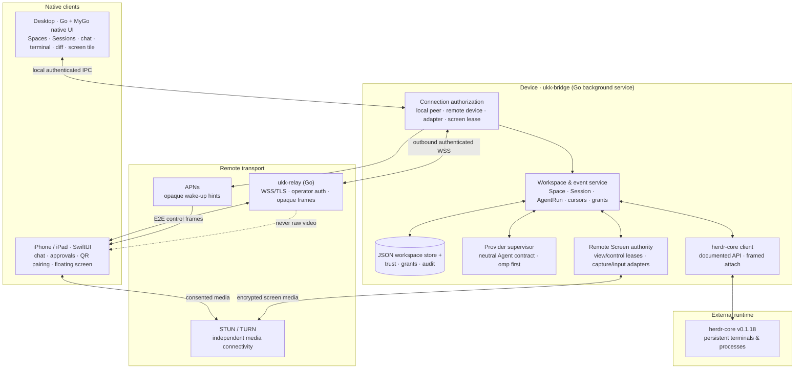

# System architecture

> Status: accepted target design · 2026-11-08 · Implementation reset underway.
> This document describes the fixed structure and contracts. Implementation status is recorded with exact evidence in [status](status.md); planned module paths are not proof that code exists. See [mygo-implementation](goals/mygo-implementation.md) for the ordered plan.

## Product boundary

ukk is a native multi-agent coding workspace with a remote mobile companion.

- **Desktop** is a native Go application built with MyGo (`apps/desktop`, package `ui`). It is not a webview page, not a GPUI/Rust app and not a fork of herdr-app.
- **`ukk-bridge`** is the background service that authorizes remote, agent-adapter and screen connections, owns Agent children and supervises provider adapters. It runs independently of any window. The Desktop owns durable workspace metadata and publishes a read-only mirror to the bridge for remote clients.
- **herdr-core** (pinned v0.1.18) is the external authority for persistent terminals, processes and reported program status. ukk integrates through its documented API; it never copies or rewrites the runtime.
- **`ukk-relay`** is a self-hostable control-plane relay: WSS/TLS with operator authentication, opaque end-to-end encrypted frames, and no raw video.
- **iOS/iPadOS** is a native SwiftUI companion sharing the protocol, never the desktop UI code.

The reset is greenfield: no data, schema, protocol or release-artifact migration from the earlier Rust/GPUI implementation. Its `main` history (including `f033cf0`) is historical reference only.

## System diagram



**Trust boundaries:** the Desktop is a local authorized client, not the owner of Agent lifetime. The relay is an untrusted router that must not read control plaintext or any screen media. Pairing is not agent control, screen viewing or screen control. A plugin grant is scoped to a device, capability and subject.

## Source of truth

| Information | Authoritative component | Notes |
|---|---|---|
| PTY, process tree, terminal identity, reported program status | herdr-core | Survives closing ukk windows. Status uses structured reporting (OSC 7501); never inferred from ANSI. |
| Terminal surface, resize intent, input provenance | Desktop UI → bridge → herdr-core | The UI is an observer/controller client; it does not own the process. MyGo's terminal plugin exposes one `Conn.Write`, so the Desktop currently sends both human keys and terminal-generated replies as DATA (herdr-core's legacy path); bytes are never sniffed. `hc-client` exposes `AutomaticWrite` for a future source-tagged hook. |
| Workspaces, app sessions, agent-run metadata, layouts | Desktop `internal/workspace` | One atomic JSON document with revision CAS; the bridge serves a read-only mirror to remote clients. |
| Device trust, grants, pairing state | `ukk-bridge` | Durable trust JSON plus live scope/TTL checks; the Desktop can grant or revoke explicitly. |
| Provider turns, tool calls, approvals, capabilities | Provider adapter inside the bridge | Only explicit provider semantics; unsupported features degrade to terminal output, never fabricated. |
| Relay routes and connection liveness | `ukk-relay` | Content is opaque ciphertext; the relay is not a source of product state. |
| Screen media and input events | Endpoint media path | Independent of the relay and of Agent event history; leased and revocable. |
| Selected tab, pane focus, floating-window position | Each client | Local ephemeral presentation state, not globally synchronized. |

## Internal modules

Module root is `apps/desktop` (one Go module with all Go metadata). Target layout:

```text
apps/
  desktop/
    go.mod, go.sum, mygo.json
    cmd/
      ukk/              MyGo desktop entrypoint and window lifecycle
      ukk-bridge/       background service entrypoint
      ukk-relay/        self-hostable relay entrypoint
    internal/
      ui/
        app/            shell, navigation, menus, settings, keybindings
        workspace/      Spaces, Sessions, tabs/panes, sidebar, activity
        conversation/   provider-neutral turns, tools, approvals, Markdown
        terminal/       libghostty-vt surface; observer/controller views
        repository/     files, Git status, diff and activity surfaces
        remotescreen/   floating Session tile and permission UI
      bridge/           local API, authorization, lifecycle, audit, persistence wiring
      relay/            WSS/TLS server, operator auth, opaque routing
      agents/           provider-neutral contract and omp adapter
      hc/               herdr-core client, framed attach, resize, provenance, credit
      workspace/        domain identities, layouts, atomic JSON persistence
      remote/           pairing, device identity, E2E, relay client, revocation
      remotescreen/     capture/input adapters, media negotiation, leases
    testdata/           provider/hc fixtures and contract vectors
  ios/                  SwiftUI companion (fixture code retained; real integration not yet claimed)
```

The old Rust crates, GPUI app, root Cargo workspace, plugins directory, root Go metadata and obsolete build workflows are removed during the cutover. Active workflows are `ci.yml`, `ios.yml` and `release.yml`.

### Desktop build configuration

`apps/desktop/mygo.json` is the single MyGo configuration:

| Key | Value |
| --- | --- |
| `name` / `slug` | `ukk` / `ukk` |
| identifier | `dev.ukk.desktop` |
| version | `0.1.0` |
| main | `cmd/ukk` |
| icon | `../../assets/icon/ukk-macos-1024.png` |
| out | `../../dist/desktop` |
| license | MIT |
| macOS minimum | 13.0 |
| macOS signing identity | `-` (ad-hoc; unsigned artifact) |
| Linux webview | disabled (native UI only) |

The Go tool is pinned to MyGo v0.8.3 (release SHA `5add3817c74bb7505d0b473bc5fb28abe2201b99`) and the toolchain to Go 1.27.3.

## Runtime and terminal rules

1. **External runtime.** Talk to herdr-core through its documented JSON-RPC/OpenRPC surfaces and framed terminal streams, pinned to v0.1.18 for the first acceptance. Compatibility tests use a recorded schema and a real daemon; do not invent operations the upstream version does not expose.
2. **Process ownership.** Closing a Desktop window, Pane, Tab or Session detaches and must not call stop/kill. Only explicit user intent with the agent-control capability may stop execution.
3. **Terminal surface.** Render with MyGo's native UI terminal plugin (libghostty-vt through purego runtime libraries). The terminal plugin is a view over the herdr-core terminal, not a second process authority. An external connection supports detach without ending the process.
4. **Input provenance.** Human input and automatic Agent input are combined by the MyGo terminal plugin on one `Conn.Write`. The current adapter uses herdr-core's legacy DATA path for both and never inspects bytes; `AutomaticWrite` (kind 6) is implemented in `hc-client` but not yet reachable through the plugin hook. Observers remain read-only.
5. **Observer safety.** An observer connection never writes and never resizes. A controller lease is explicit, single-writer and expiring.
6. **Sizing and backpressure.** Apply the core's RESIZE result before painting the terminal surface; do not paint a stale grid. Use bounded credit/flow control in both directions, drop or coalesce only under an explicit policy, and surface degraded state instead of blocking the UI thread.
7. **No ANSI semantics.** Terminal text is presentation. Tool calls, plans and approvals come only from the active provider adapter.
8. **Crash honesty.** Window independence is not crash recovery. The bridge can restart and reattach to herdr-core terminals, but an adapter-owned provider RPC child may be lost with the bridge; resume is only claimed where the provider RPC explicitly supports it.

## Provider-neutral Agent contract

One bridge/Desktop contract covers sessions, turns, messages, tool calls, progress, artifacts, approvals, capabilities and bounded errors.

- **omp is the first real provider**, speaking its RPC through `internal/agents` with host-owned child lifecycle, bounded timelines and typed events.
- **Codex and Claude Code are adapter targets**, specified by versioned fixture contracts. They may be fixture-tested; no live support is claimed until an actual provider run passes.
- **No fake adapters.** A provider that lacks structured semantics is not mapped into invented approvals or tool events; the UI falls back to explicit raw terminal output and an `unsupported` capability state.
- **Timeline bounds.** Entries, per-entry bytes and total bytes are capped. Markdown rendering is incremental and bounded; long documents must not assume an upstream long-Markdown issue is resolved.
- **Idempotency.** Start/prompt/steer/abort/stop/approval decisions are idempotent where the provider allows; unknown or lost outcomes are reported as unknown, never as success.

## Remote, relay and media

- `ukk-relay` is an actual self-hostable service: WSS with TLS, operator authentication, per-connection limits, opaque E2E frames, and no plaintext metadata beyond what routing requires.
- Device identity is independent of transport. Pairing proves key possession with a short-lived challenge; every remote connection proves possession again. Revocation is durable and takes effect on the next authorization decision.
- Separate grants: pairing, agent control, screen view and screen control. A paired phone is not automatically a controller.
- The relay is control-plane only. Screen media uses independent STUN/TURN connectivity with DTLS-SRTP or an equivalent reviewed secure transport; the relay must never carry raw video.
- Offline/reconnect uses durable cursors and replay with bounded retention. Approvals and pointer input are never blindly replayed.

## Remote Screen

A first-party, opt-in plugin inside a Session. It is surfaced as a small floating tile above the conversation; expanding it temporarily opens the viewer, minimizing returns to the same conversation.

- Viewing and control require separate grants; control requires a short lease and visible takeover.
- Capture uses macOS ScreenCaptureKit (permission via a permission-flow UI), Windows Graphics Capture where verified, and Linux PipeWire/portal where available. Unsupported combinations are named in the UI and docs.
- Input injection uses platform permissions and an explicit controller lease.
- Capture has a persistent indicator and a one-tap stop; stop, lock, backgrounding, revocation or lease expiry tears down media and input immediately.
- Screen availability never affects Agent operation or event delivery.

## iOS companion

Native SwiftUI, sharing the wire protocol only.

- Real QR/camera pairing, Keychain-backed device identity, live chat, approvals only where the provider supports them, APNs with opaque wake hints.
- The current `apps/ios` fixture shell may be preserved as UI scaffolding, but it is not evidence of Host/relay integration. Fixture labels stay until a real authenticated connection exists.
- The Session overlay slot is reserved for Remote Screen and must not become permanent navigation.

## Plugin safety

- Third-party plugins are untrusted by default: versioned manifest, declared commands/events/UI slots, durable per-device grants, audit, crash containment and OS sandboxing where available.
- Plugin code never runs in the bridge's privileged process by default. First-party JavaScript plugins may run in the capability-limited moejs runtime (no globals, imports, filesystem or network); third-party code stays in a helper process.
- Remote Screen is first-party privileged capability, but still uses grants and leases like any other sensitive surface.
- The immediate product scope is the safety boundary needed by ukk's own features; a general-purpose plugin marketplace/SDK is not a current deliverable.

## Deployment patterns

- **Local Mac:** MyGo Desktop ↔ local bridge (user service) ↔ local herdr-core. Optional outbound relay registration when remote access is enabled.
- **Headless Linux:** bridge ↔ herdr-core; phone or Desktop can connect through the same protocol. No screen sharing without a graphical session.
- **Multiple machines:** each bridge owns its own identity, trust grants and relay registration; a phone paired to one bridge does not gain access to every SSH-connected machine.

## Platform integration

macOS: MyGo native UI on Metal, launchd user service for the bridge, ffmpeg/avfoundation capture, user-consented Accessibility input, VideoToolbox encoding inside ffmpeg. Windows: MyGo native UI on Direct3D 11, user process/Task Scheduler service, ffmpeg/gdigrab capture and SendInput injection. Linux: MyGo native UI on OpenGL/GTK 3, systemd user service, ffmpeg/x11grab capture and xdotool injection (typed unavailable when absent). MyGo needs no cgo; runtime libraries are loaded through purego where applicable. iOS: SwiftUI, AVFoundation/VisionKit QR, Keychain, APNs, VideoToolbox.

Every platform permission and capture adapter is verified separately; a CI compile is not permission evidence.

## Distribution

Unsigned by design: macOS `.dmg` (`ukk.app` + bridge, ad-hoc signing allowed), Windows NSIS `.exe`, Linux `.deb` plus tarball, and an unsigned iOS device-build `.ipa`. Signing, notarization, Gatekeeper/App Store distribution and an installable iOS package are out of scope. The unsigned IPA is an artifact, not an installable release.

## Non-goals

Not a fork of herdr-app; not an Agent framework replacing omp/Codex/Claude; not a mandatory remote desktop product; not a hosted central repository of users' source code; not a runtime reimplementation. A terminal stream remains an optional pane, not the sole product UI.

## References

- [Product requirements](requirements.md)
- [Implementation plan](goals/mygo-implementation.md)
- [Platform and runtime decision](decisions/0001-platform-and-runtime.md)
- [Remote control decision](decisions/0002-remote-control-is-plugin.md)
- [Domain model](subsystems/domain-model.md)
- [Security](subsystems/security.md)
- [Plugins](subsystems/plugins.md)
- https://github.com/herdrdev/herdr-core
- https://github.com/egoist/mygo
- https://github.com/egoist/mygo/blob/main/docs/architecture.md
